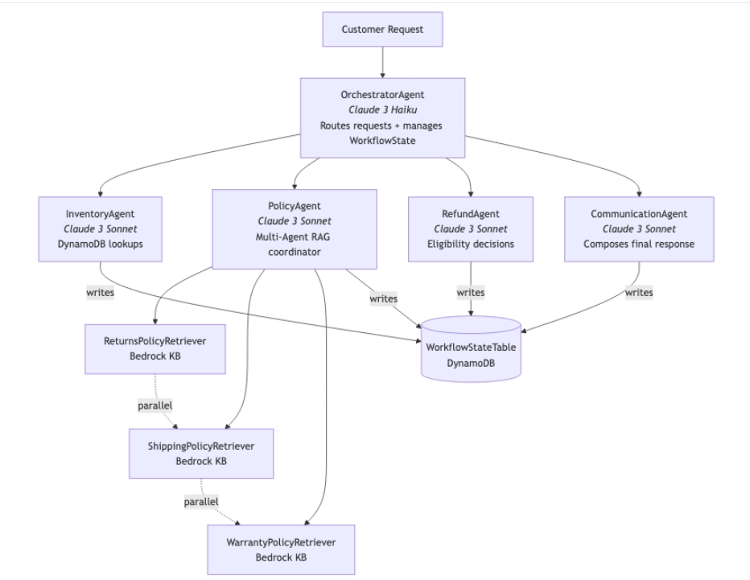
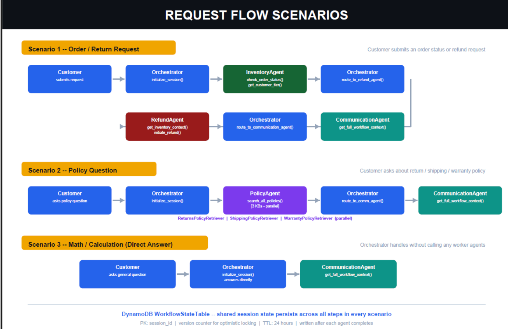

# Multi-Agent E-commerce RAG

An AWS-based reference project for a multi-agent customer-support system. The design uses an orchestrator, specialist agents, shared DynamoDB workflow state, and parallel policy retrieval.

> **Project status:** The architecture and CloudFormation infrastructure are being developed. The Python package is currently a scaffold; the agents, tools, and end-to-end runtime described below are not implemented yet.

## Agent Architecture

The diagram shows the intended agent graph and how work and shared state flow through the system.



The orchestrator routes customer requests to specialist agents:

| Component | Intended responsibility |
|---|---|
| Orchestrator | Classify and route requests; coordinate shared workflow state |
| Inventory agent | Retrieve customer and order information |
| Policy agent | Coordinate parallel retrieval from Returns, Shipping, and Warranty knowledge bases |
| Refund agent | Evaluate return/refund eligibility |
| Communication agent | Compose the final customer-facing response |
| Workflow State table | Persist session state shared across agents |

The graph is a design reference, not a claim that the agents or runtime are already operational.

## Example Request Flows

These scenarios illustrate how different requests may route through the planned agents.



## Infrastructure

The current CloudFormation template defines:

- DynamoDB tables for customers, orders, and workflow state.
- An encrypted, versioned S3 bucket for policy documents.
- An S3 Vectors bucket and a Returns policy vector index.

The template does not yet define the full runtime, IAM, guardrails, or observability stack. See the [CloudFormation template](./infrastructure/starter_stack.yaml) for its exact current resources.

## Getting Started

This repository uses [uv](https://docs.astral.sh/uv/) for Python dependencies and environments.

```powershell
uv sync
```

Copy the example environment file and fill in the Knowledge Base IDs after creating the Knowledge Bases:

```powershell
Copy-Item .env.example .env
```

`.env` is ignored by Git; keep real IDs and credentials there, not in `.env.example`.

The root-level `config.py` exposes these values through `get_settings()`. Blank
Knowledge Base IDs are returned as `None`.

Run the current package scaffold:

```powershell
uv run multi-agent-ecommerce-rag
```

At present, the command prints a scaffold greeting; it does not run the agent graph.

Validate the CloudFormation template:

```powershell
uv run cfn-lint infrastructure/starter_stack.yaml
```

Run the unit tests:

```powershell
uv run python -m unittest discover -s tests
```

To deploy or update the AWS stack, configure AWS CLI credentials and select the intended account and region first:

```powershell
aws cloudformation deploy `
  --template-file infrastructure/starter_stack.yaml `
  --stack-name udacity-agentcore `
  --region us-east-1 `
  --capabilities CAPABILITY_NAMED_IAM
```

Dependency declarations live in `pyproject.toml`; `uv.lock` records the resolved environment. After changing dependencies, run `uv lock` and `uv sync`.

## Project Layout

| Path | Purpose |
|---|---|
| `infrastructure/` | CloudFormation infrastructure |
| `agentcore/` | AgentCore runtime and deployment configuration (planned) |
| `diagrams/` | Architecture and request-flow diagrams |
| `src/multi_agent_ecommerce_rag/` | Python package scaffold |
| `tests/` | Unit tests |
| `progress-docs/` | Deployment milestones and evidence |
| `theory+prep/` | Architecture notes and project preparation |
| `agents&tools_reference.md` | Agent graph and role reference |
| `pyproject.toml`, `uv.lock` | Project metadata and uv dependency lock |

## Progress Documentation

- [Milestone 1: Customer DynamoDB table](./progress-docs/milestone-01-dynamodb-customer-table.md)
- [Milestone 2: Orders DynamoDB table](./progress-docs/milestone-02-dynamodb-orders-table.md)
- [Milestone 3: Workflow State DynamoDB table](./progress-docs/milestone-03-dynamodb-workflow-state-table.md)

## Related References

- [Agent architecture and roles](./agents%26tools_reference.md)
- [Architecture design notes](./theory%2Bprep/architectural_thinking.md)
