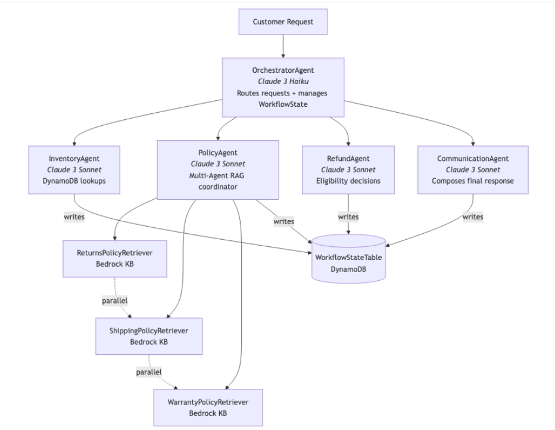
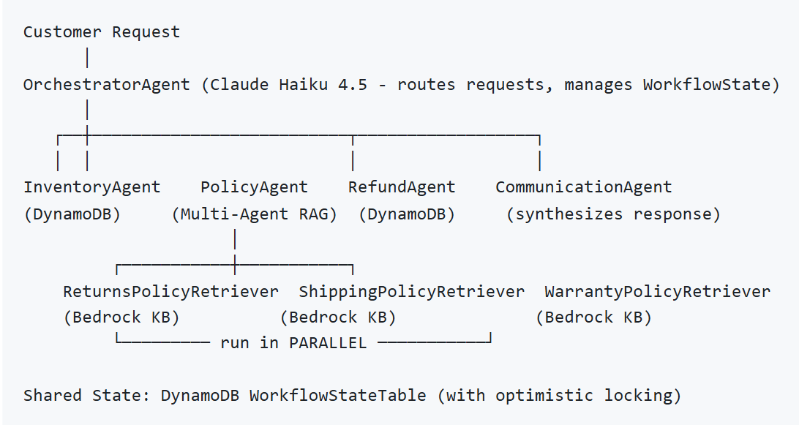
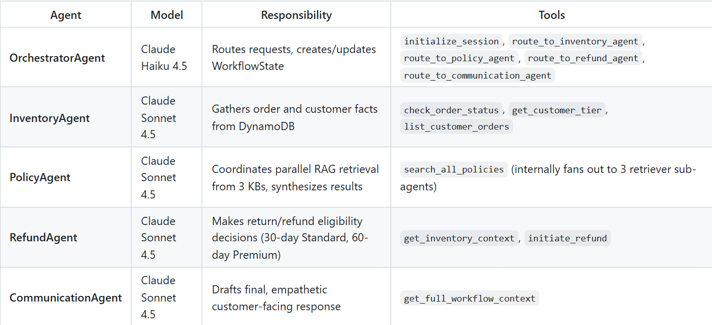
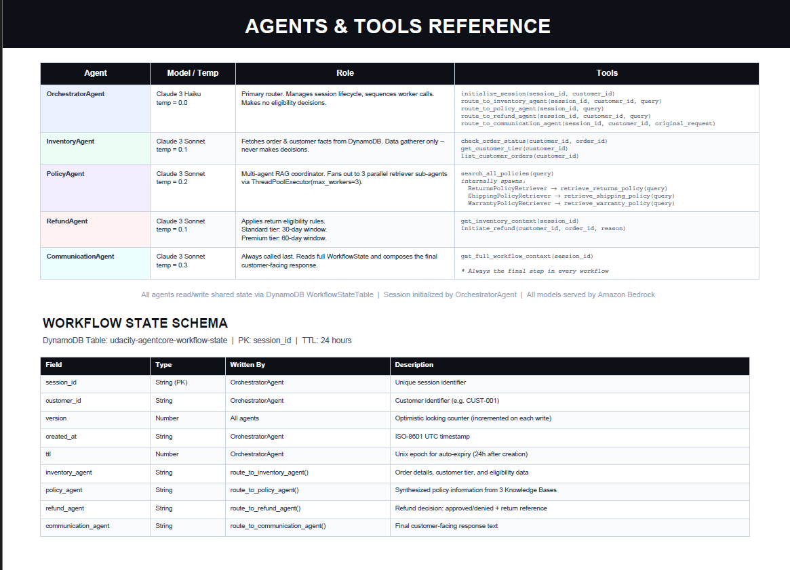

# Agent Architecture and Roles

This graph is the high-level design reference for the customer-support agent workflow. It shows the orchestrator delegating to specialist agents, the Policy Agent coordinating three parallel knowledge-base retrievers, and agents sharing workflow state in DynamoDB.

## Agent Responsibilities

| Agent | Responsibility in the design |
|---|---|
| Orchestrator Agent | Routes requests and coordinates workflow state |
| Inventory Agent | Looks up customer and order information |
| Policy Agent | Collects and synthesizes policy results from parallel retrievers |
| Refund Agent | Makes eligibility decisions using order and policy information |
| Communication Agent | Composes the final response for the customer |

The graph and responsibilities describe the intended design. The Python package is still a scaffold, so the agents and their tools are not implemented yet.

## Detailed Reference Snapshot

The following existing reference image contains a more detailed agent/tool and workflow-state sketch. Treat its model names, tool names, and schema details as design notes until they are verified against implemented code.

For the deployed DynamoDB table definitions, see [Milestone 3: Workflow State table](./progress-docs/milestone-03-dynamodb-workflow-state-table.md).