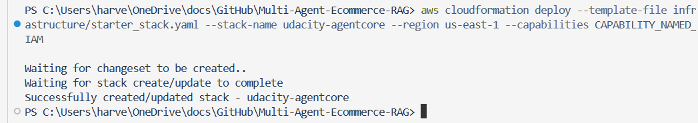
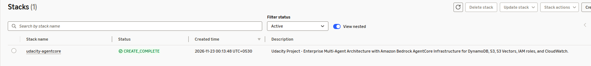
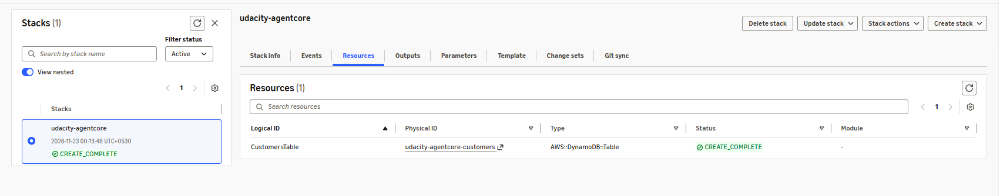
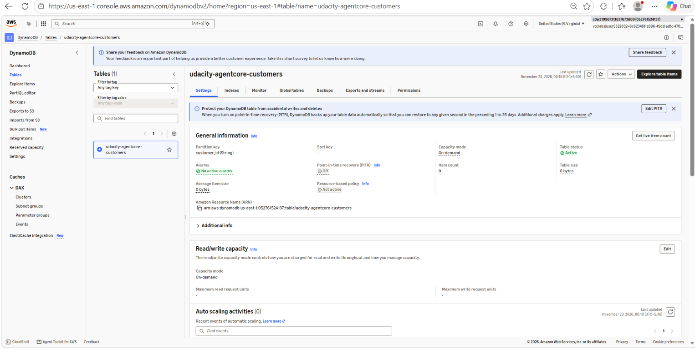
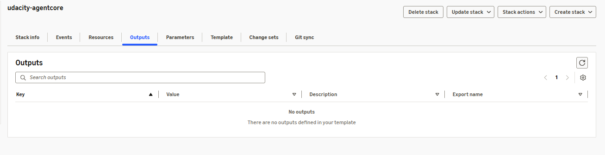

# Milestone 1: Deploy the Customer DynamoDB Table

**Date:** November 23, 2026  
**Region:** `us-east-1`  
**CloudFormation stack:** `udacity-agentcore`  
**Template:** [`infrastructure/starter_stack.yaml`](../infrastructure/starter_stack.yaml)

## Progress Summary

The first infrastructure milestone successfully deployed the `udacity-agentcore` CloudFormation stack. The template currently creates one application resource:

| Logical ID | Resource type | Physical table name | Key schema | Capacity |
|---|---|---|---:|---|
| `CustomersTable` | `AWS::DynamoDB::Table` | `udacity-agentcore-customers` | `customer_id` (`String`) partition key | On-demand |

This milestone establishes the first data source for the customer-support system. DynamoDB is prepared for customer lookup by a unique customer identifier, but the table does not contain application data yet.

## Resource Created

The `CustomersTable` resource uses a simple partition key:

```yaml
CustomersTable:
  Type: AWS::DynamoDB::Table
  Properties:
    TableName: !Sub '${ProjectName}-customers'
    BillingMode: PAY_PER_REQUEST
    AttributeDefinitions:
      - AttributeName: customer_id
        AttributeType: S
    KeySchema:
      - AttributeName: customer_id
        KeyType: HASH
```

### Schema Details

- `customer_id` is a required DynamoDB partition key.
- `S` means that the key is stored as a string.
- `HASH` identifies `customer_id` as the partition key.
- `PAY_PER_REQUEST` enables on-demand billing.
- No sort key is configured, so each customer must have a unique `customer_id`.
- No secondary indexes are configured yet.

## Deployment

The stack was deployed from the repository root with the AWS CLI:

```powershell
aws cloudformation deploy `
  --template-file infrastructure/starter_stack.yaml `
  --stack-name udacity-agentcore `
  --region us-east-1 `
  --capabilities CAPABILITY_NAMED_IAM
```

The deployment completed successfully:

```text
Waiting for changeset to be created..
Waiting for stack create/update to complete
Successfully created/updated stack - udacity-agentcore
```

## Verification

The following AWS Console views confirmed the deployed state:

1. CloudFormation reported the stack status as `CREATE_COMPLETE`.
2. The **Resources** tab listed `CustomersTable` with type `AWS::DynamoDB::Table` and status `CREATE_COMPLETE`.
3. DynamoDB listed `udacity-agentcore-customers`.
4. The table settings showed:
   - Partition key: `customer_id` (`String`)
   - Capacity mode: On-demand
   - Item count: `0`
   - Table size: `0 bytes`
   - Status: `Active`

At this stage, the table is created but contains no customer records.









## CloudFormation Outputs

The current template does not define an `Outputs` section. As a result:

- The CloudFormation **Outputs** tab has no output values.
- The table name is currently known from the template and `ProjectName` parameter rather than an exported stack output.
- No table name or ARN is passed to other resources yet.

This is intentional for the current milestone. Outputs will be added as later resources depend on the table.



## Current Template Scope

The starter template currently includes:

- A `ProjectName` parameter with default `udacity-agentcore`.
- A DynamoDB customer table.
- YAML comments explaining the parameter and resource sections.

It does not yet include:

- Customer table data or sample records.
- DynamoDB table outputs.
- Order or workflow-state tables.
- S3 buckets or S3 Vectors resources.
- IAM roles.
- Bedrock AgentCore resources.
- CloudWatch observability resources.

## Next Milestone

The next step was to add the Orders table with a composite key, TTL, and a DynamoDB Stream. This milestone is documented in [Milestone 2: Add the Orders DynamoDB Table](./milestone-02-dynamodb-orders-table.md).
