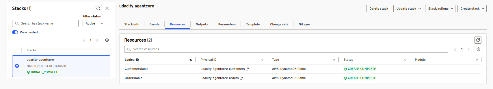
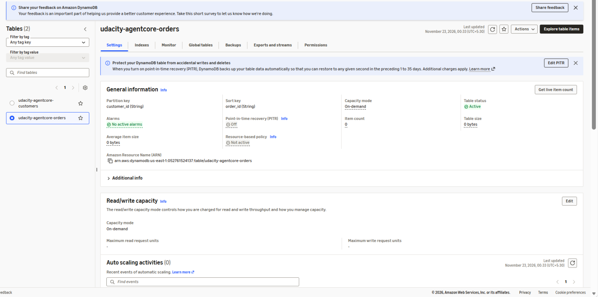
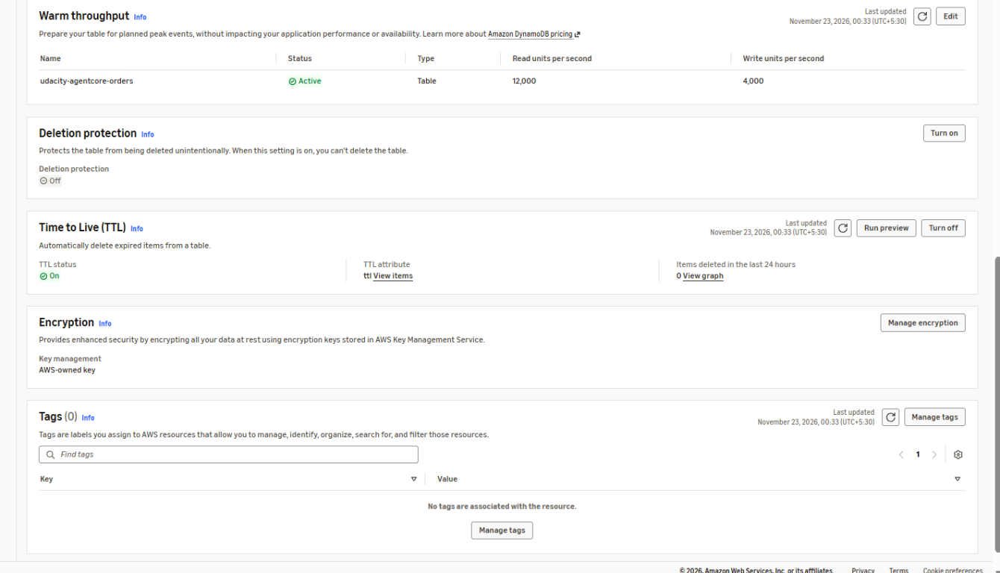

# Milestone 2: Add the Orders DynamoDB Table

**Date:** November 23, 2026  
**Region:** `us-east-1`  
**CloudFormation stack:** `udacity-agentcore`  
**Template:** [`infrastructure/starter_stack.yaml`](../infrastructure/starter_stack.yaml)

## Progress Summary

The CloudFormation stack was updated to add an Orders table alongside the existing Customers table.

| Logical ID | Resource type | Physical table name | Partition key | Sort key | Capacity |
|---|---|---|---|---|---|
| `CustomersTable` | `AWS::DynamoDB::Table` | `udacity-agentcore-customers` | `customer_id` (`String`) | None | On-demand |
| `OrdersTable` | `AWS::DynamoDB::Table` | `udacity-agentcore-orders` | `customer_id` (`String`) | `order_id` (`String`) | On-demand |

The `OrdersTable` resource uses a composite primary key and also enables TTL and DynamoDB Streams.

## The Orders Resource

```yaml
OrdersTable:
  Type: AWS::DynamoDB::Table
  Properties:
    TableName: !Sub '${ProjectName}-orders'
    BillingMode: PAY_PER_REQUEST
    AttributeDefinitions:
      - AttributeName: customer_id
        AttributeType: S
      - AttributeName: order_id
        AttributeType: S
    KeySchema:
      - AttributeName: customer_id
        KeyType: HASH
      - AttributeName: order_id
        KeyType: RANGE
    TimeToLiveSpecification:
      AttributeName: ttl
      Enabled: true
    StreamSpecification:
      StreamViewType: NEW_AND_OLD_IMAGES
```

## DynamoDB Primary-Key Concepts

### Partition key (`HASH`)

Every item in a DynamoDB table needs a unique identifier called the **primary key**. The simplest primary key is a **partition key**: one attribute whose value uniquely identifies each item.

For example, a Customers table could use `customer_id`:

| customer_id (key) | name | tier |
|---|---|---|
| CUST-001 | Asha | Premium |
| CUST-002 | Ravi | Standard |

Requesting `CUST-001` returns exactly one row. DynamoDB uses a hash function to determine where to store and retrieve the item, which is why CloudFormation calls this key role **`HASH`**.

In `KeySchema`, `KeyType: HASH` means "this attribute is the partition key."

In the current Customers table:

- `customer_id` is the partition key.
- Its value must be unique for each customer.
- There is no sort key.

### Composite key (`HASH + RANGE`)

Orders are different because one customer may have many orders. A `customer_id` partition key alone cannot identify a specific order uniquely.

The Orders table uses a **composite key**:

- **Partition key:** `customer_id`, with `KeyType: HASH`
- **Sort key:** `order_id`, with `KeyType: RANGE`

The combination of both values identifies an item.

| customer_id | order_id | status |
|---|---|---|
| CUST-001 | ORD-27176 | shipped |
| CUST-001 | ORD-30011 | delivered |
| CUST-002 | ORD-18452 | processing |

This key design supports two lookup patterns:

1. Fetch one order by providing both `customer_id` and `order_id`.
2. Query all orders for a customer by providing only `customer_id`.

The sort key also keeps the customer's orders in sorted order by `order_id`.

This explains the "key element does not match the schema" error that can occur when an order lookup provides only one key element. DynamoDB requires the correct partition-key and, for a direct item lookup, sort-key values.

## The Two Additional Settings

TTL and Streams are separate features and are not part of the DynamoDB primary key.

### TTL (Time To Live)

TTL configures DynamoDB to delete expired items automatically.

```yaml
TimeToLiveSpecification:
  AttributeName: ttl
  Enabled: true
```

`ttl` must contain an expiry timestamp in Unix epoch-time seconds. DynamoDB may take additional time to remove an expired item after its expiry time is reached.

TTL is useful for temporary records such as short-lived sessions or old cached data. It does not currently depend on application code in this project because no TTL values are created by the template.

The AWS DynamoDB Console currently shows:

- TTL status: On
- TTL attribute: `ttl`
- Items deleted in the last 24 hours: `0`

### DynamoDB Stream

A DynamoDB Stream is a change log for item operations. It can record items when they are added, modified, or deleted.

```yaml
StreamSpecification:
  StreamViewType: NEW_AND_OLD_IMAGES
```

`NEW_AND_OLD_IMAGES` records both the item after a change and, for updates or deletions, the item before the change. This allows another service to react to table changes.

The project agents do not currently appear to use this stream, but the template enables it for future event-driven processing.

## Deployment and Verification

The updated template was deployed with:

```powershell
aws cloudformation deploy `
  --template-file infrastructure/starter_stack.yaml `
  --stack-name udacity-agentcore `
  --region us-east-1 `
  --capabilities CAPABILITY_NAMED_IAM
```

The CloudFormation deployment reported `UPDATE_COMPLETE`.

The Resources tab now lists:

- `CustomersTable` - `AWS::DynamoDB::Table`
- `OrdersTable` - `AWS::DynamoDB::Table`

The DynamoDB Orders table settings show:

- Table name: `udacity-agentcore-orders`
- Partition key: `customer_id` (`String`)
- Sort key: `order_id` (`String`)
- Capacity mode: On-demand
- Item count: `0`
- Table size: `0 bytes`
- Table status: `Active`
- Encryption: AWS-owned key
- Deletion protection: Off
- Warm throughput: 12,000 read units per second and 4,000 write units per second
- TTL: On, using attribute `ttl`

At this milestone, the table is deployed but contains no order records.







## Current Scope

At the end of this milestone, the CloudFormation template defines:

- The `ProjectName` parameter.
- The Customers table with a partition key.
- The Orders table with a composite key.
- TTL on the Orders table.
- A DynamoDB Stream on the Orders table.

It does not yet define application records or CloudFormation outputs.
