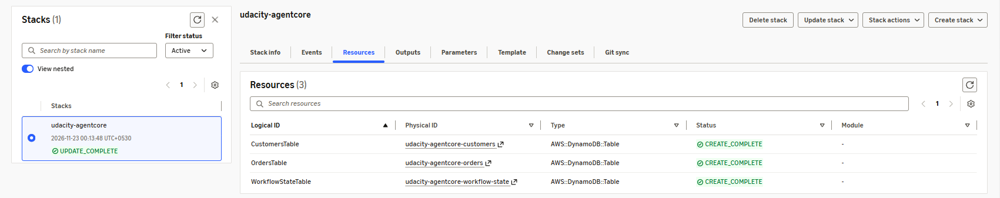

# Milestone 3: Add the Workflow State DynamoDB Table

**Date:** November 23, 2026  
**Region:** `us-east-1`  
**CloudFormation stack:** `udacity-agentcore`  
**Template:** [`infrastructure/starter_stack.yaml`](../infrastructure/starter_stack.yaml)

## Progress Summary

The CloudFormation stack was updated from two application tables to three DynamoDB resources:

| Logical ID | Resource type | Physical table name | Partition key | Sort key | Capacity |
|---|---|---|---|---|---|
| `CustomersTable` | `AWS::DynamoDB::Table` | `udacity-agentcore-customers` | `customer_id` (`String`) | None | On-demand |
| `OrdersTable` | `AWS::DynamoDB::Table` | `udacity-agentcore-orders` | `customer_id` (`String`) | `order_id` (`String`) | On-demand |
| `WorkflowStateTable` | `AWS::DynamoDB::Table` | `udacity-agentcore-workflow-state` | `session_id` (`String`) | None | On-demand |

The new table stores shared execution state for an agent conversation or workflow session.

## The Workflow State Resource

```yaml
WorkflowStateTable:
  Type: AWS::DynamoDB::Table
  Properties:
    TableName: !Sub '${ProjectName}-workflow-state'
    BillingMode: PAY_PER_REQUEST
    AttributeDefinitions:
      - AttributeName: session_id
        AttributeType: S
    KeySchema:
      - AttributeName: session_id
        KeyType: HASH
    TimeToLiveSpecification:
      AttributeName: ttl
      Enabled: true
```

## Why a Workflow State Table Is Needed

The multi-agent architecture consists of an orchestrator and several specialist agents. Each agent needs a shared, durable place to read and update the progress of a customer-support workflow.

The `session_id` partition key identifies one workflow or conversation session. It is the unique primary key for a single record in this table.

The table may store workflow values such as:

- The customer identifier.
- The order identifier.
- The detected customer intent.
- Which specialist agents have run.
- Intermediate agent results.
- The final communication result.
- A version number used for optimistic locking.

This milestone adds the DynamoDB resource; application code and real session records have not been added to the table yet.

## Simple Partition Key

`WorkflowStateTable` uses the simplest DynamoDB primary-key model:

- `session_id` is the partition key.
- `S` means the value is a string.
- `HASH` tells DynamoDB to use `session_id` to partition and locate the item.
- There is no sort key.
- One `session_id` can represent exactly one workflow-state record.

For example:

| session_id (key) | customer_id | intent | version |
|---|---|---|---:|
| SESSION-001 | CUST-001 | order_status | 3 |
| SESSION-002 | CUST-002 | refund | 1 |

In a real application, each agent would read the record for its session and update it as the workflow progresses.

## Optimistic Locking

The table is designed to support optimistic locking through a `version` attribute.

Optimistic locking prevents two agents or concurrent operations from overwriting state changes made by one another. A typical update would read the item, check that its `version` is the expected value, write the new state, and increment `version` in the same conditional write.

A DynamoDB conditional expression can ensure that the update only succeeds when the stored version still matches the version read by the application. If another agent changed the item first, DynamoDB rejects the stale update instead of silently overwriting newer state.

Optimistic locking is an application-level design. Adding a `version` attribute to the template is not required because DynamoDB allows items to contain arbitrary attributes.

## TTL for Session Records

The table also enables TTL through the `ttl` attribute:

```yaml
TimeToLiveSpecification:
  AttributeName: ttl
  Enabled: true
```

TTL can be used to expire temporary workflow sessions automatically. Application code must calculate and store a Unix epoch-time value in the `ttl` attribute. DynamoDB deletes expired items asynchronously; TTL is not a synchronous immediate deletion mechanism.

This is useful for session cleanup, but no TTL values or session records are created by CloudFormation.

## Deployment and Verification

The stack was updated with the AWS CLI:

```powershell
aws cloudformation deploy `
  --template-file infrastructure/starter_stack.yaml `
  --stack-name udacity-agentcore `
  --region us-east-1 `
  --capabilities CAPABILITY_NAMED_IAM
```

The deployment completed with `UPDATE_COMPLETE`.

The CloudFormation **Resources** tab lists three tables:

- `CustomersTable`
- `OrdersTable`
- `WorkflowStateTable`

Each resource has:

- Type: `AWS::DynamoDB::Table`
- Status: `CREATE_COMPLETE`

The deployed physical table name is `udacity-agentcore-workflow-state`.



## Current Scope

At the end of this milestone, the infrastructure defines:

- A Customer table for customer records.
- An Orders table with a composite `customer_id + order_id` key.
- TTL and a DynamoDB Stream on the Orders table.
- A Workflow State table with a `session_id` partition key.
- TTL on the Workflow State table.

The template still does not define:

- Application data for any table.
- CloudFormation outputs.
- S3 or S3 Vectors resources.
- IAM roles.
- Bedrock AgentCore runtime resources.
- CloudWatch observability resources.
