# Multi-Agent E-commerce RAG: Project Report

**Project:** Multi-Agent E-commerce RAG  
**Repository:** `harveenkaur282-web/Multi-Agent-Ecommerce-RAG`  
**Platform:** Amazon Web Services (AWS)  
**Primary language:** Python 3.13+  
**Infrastructure:** AWS CloudFormation  
**AWS region:** `us-east-1`  
**Stack name:** `udacity-agentcore`  
**Project name:** `udacity-agentcore`

> **Project status: In progress — not complete.** The three DynamoDB tables, policy-documents S3 bucket, S3 Vectors bucket, three vector indexes, AgentCore IAM role, and CloudWatch log group are visible in the AWS Console. The Returns index details confirm a 1024 dimension and cosine distance metric. The policy bucket's versioning and encryption settings have not yet been verified. Bedrock Knowledge Bases, agent implementation, AgentCore runtime, and production hardening are still planned. Architecture diagrams show the intended design, not a running end-to-end system.

## 1. Project Overview

This project demonstrates the design and progressive infrastructure implementation of a multi-agent customer-support system for a fictional NovaMart e-commerce company.

The intended system combines:

- An orchestrator that classifies and routes customer requests.
- Specialist agents for inventory, policy, refund, and communication work.
- DynamoDB tables for business data and shared workflow state.
- Amazon S3 for versioned policy documents.
- Amazon S3 Vectors for policy embeddings and semantic retrieval.
- Amazon Bedrock Knowledge Bases for retrieval-augmented generation.
- Strands Agents for agent behavior and Amazon Bedrock AgentCore for future runtime deployment.

The project is intentionally documented as both an implementation record and an architecture interview guide. This report distinguishes deployed and verified resources from template-only resources, design plans, and future implementation. The agents and end-to-end runtime are not yet implemented.

The report includes the repository's visual assets in section 19. AWS Console screenshots are evidence of the deployed DynamoDB tables; architecture diagrams and study images are references and do not indicate that planned components are operational.

## 2. Intended Architecture

```text
Customer Request
       |
       v
Orchestrator Agent
       |
       +----------------------+
       |                      |
       v                      v
Inventory Agent        Policy Agent
Customer/order data     Parallel policy retrieval
       |                      |
       |             +--------+--------+
       |             |                 |
       |             v                 v
       |       Returns KB        Shipping KB
       |             |
       |             v
       |       Warranty KB
       |             |
       +------> Refund Agent
                     |
                     v
              Communication Agent
                     |
                     v
              Customer Response
```

The orchestrator pattern is used because a central component makes routing decisions, coordinates the specialist agents, and owns the overall workflow. The orchestrator and worker agents share workflow state rather than passing an uncontrolled chain of ad-hoc variables.

The alternative peer-to-peer pattern allows agents to communicate directly. It can be useful for dynamic collaboration, but it is harder to audit and debug in this project because the orchestrator provides a clearer decision trail and sequence.

### Agent Responsibilities

| Agent | Responsibility |
|---|---|
| Orchestrator | Classify intent, route work, coordinate state, and determine completion |
| Inventory | Retrieve customer details and order information |
| Policy | Coordinate parallel retrieval from Returns, Shipping, and Warranty knowledge bases |
| Refund | Evaluate refund or return eligibility using order data and policy results |
| Communication | Produce the final customer-facing response |

Role specialization keeps each agent responsible for a distinct business function. It also makes prompts, tools, tests, permissions, and failure handling easier to isolate.

## 3. Project Structure

| Path | Purpose |
|---|---|
| `infrastructure/starter_stack.yaml` | CloudFormation resource definitions |
| `progress-docs/project-report.md` | Canonical project and interview report |
| `progress-docs/images/` | AWS deployment evidence |
| `diagrams/` | Architecture and workflow visualizations |
| `src/multi_agent_ecommerce_rag/` | Python package scaffold |
| `config.py` | Environment and project settings |
| `tests/` | Configuration unit tests |
| `pyproject.toml` | Python project metadata and dependencies |
| `uv.lock` | Reproducible resolved dependency versions |

## 4. CloudFormation: Foundations

CloudFormation reads a YAML or JSON template and creates, updates, lists, and deletes AWS resources as a single stack. The orchestration engine validates the template, determines resource dependencies, and makes AWS API calls in the required order.

The stack can therefore be reproduced and removed consistently. This is an advantage over manually creating resources in the AWS Console. The infrastructure is also reviewable in Git and changes can be previewed through a CloudFormation change set.

The project template is organized into these sections:

| Template section | What it describes | Project example |
|---|---|---|
| `AWSTemplateFormatVersion` | CloudFormation template format version | `'2010-09-09'` |
| `Description` | Human-readable summary | Initial customer, order, workflow, and knowledge-storage infrastructure |
| `Parameters` | Inputs supplied at deployment time | `ProjectName`, which prefixes resource names |
| `Resources` | AWS resources CloudFormation manages | DynamoDB tables, S3 bucket, S3 Vectors bucket and indexes |
| Intrinsic functions | Values and references resolved by CloudFormation | `!Ref`, `!Sub`, `!GetAtt`, `!Select`, `!Split` |

```yaml
AWSTemplateFormatVersion: '2010-09-09'
Description: >
  Initial project infrastructure for customer, order, and workflow-state tables,
  policy documents, and Bedrock Knowledge Base vector storage.

Parameters:
  ProjectName:
    Type: String
    Default: udacity-agentcore
    Description: Prefix used for resource names.
```

### Parameters

| Property | Template value | Meaning |
|---|---|---|
| `Type` | `String` | The parameter is text. |
| `Default` | `udacity-agentcore` | Used when deployment does not supply an override. |
| `Description` | `Prefix used for resource names.` | Explains how the parameter is used. |

The property name is `Default`, not `default`; CloudFormation property names are case-sensitive.

### Intrinsic Functions

| Function | Purpose |
|---|---|
| `!Ref` | References a parameter or resource |
| `!Sub` | Replaces variables in a string |
| `!GetAtt` | Reads an attribute produced by another resource |
| `!Select` | Selects an item from a list |
| `!Split` | Splits a string into a list |

An intrinsic function reference can create an **implicit dependency**. For example, `!GetAtt VectorStoreBucket.VectorBucketArn` tells CloudFormation that the vector index needs the vector bucket ARN. CloudFormation creates the bucket before the index instead of relying on deployment order in the YAML file.

### Template Validation

The repository uses `cfn-lint` to validate the CloudFormation template:

```powershell
uv run cfn-lint infrastructure/starter_stack.yaml
```

The project deployment command is:

```powershell
aws cloudformation deploy `
  --template-file infrastructure/starter_stack.yaml `
  --stack-name udacity-agentcore `
  --region us-east-1 `
  --capabilities CAPABILITY_NAMED_IAM
```

## 5. Customer DynamoDB Table

The first infrastructure resource was the customer table:

```yaml
CustomersTable:
  Type: AWS::DynamoDB::Table
  Properties:
    TableName: !Sub '${ProjectName}-customers'
    BillingMode: PAY_PER_REQUEST
    AttributeDefinitions:
      - AttributeName: customer_id
        AttributeType: S
    KeySchema:
      - AttributeName: customer_id
        KeyType: HASH
```

### How It Works

- The logical ID is `CustomersTable`.
- The physical deployed table name is `udacity-agentcore-customers`.
- `customer_id` is the partition key.
- `S` means the key type is a string.
- `HASH` means DynamoDB hashes the partition-key value to determine physical storage.
- `PAY_PER_REQUEST` means on-demand billing rather than provisioned read/write capacity.
- There is no sort key.
- The table is deployed but contains no application records yet.

The simple key is appropriate because each customer has a unique identifier and direct lookup is the expected access pattern.

The following Console views confirmed deployment:

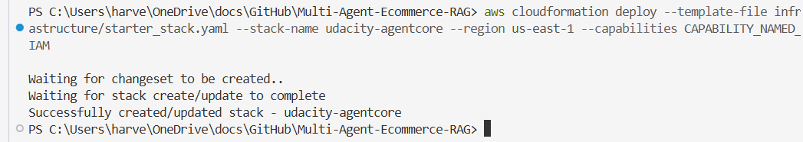

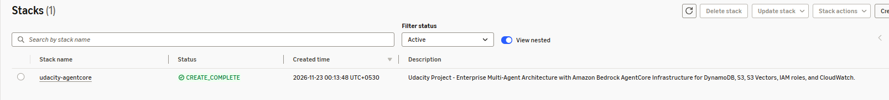

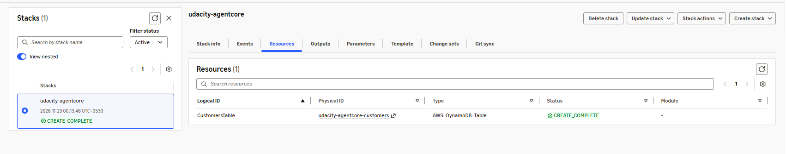


### CloudFormation Outputs

This table milestone does not define an `Outputs` section. CloudFormation therefore does not publish a reusable table name or ARN to another resource or a deployer.

This is deliberate for the current stage. Outputs should be added once an application runtime or IAM resource needs to discover the table names.

The absence of outputs is also visible in the AWS Console:

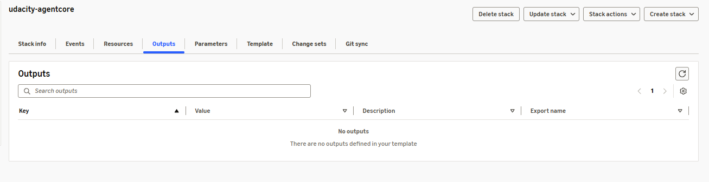

## 6. Partition Keys, Sort Keys, and the Orders Table

DynamoDB requires every item to have a primary key. There are two supported primary-key models:

| Primary key | Structure | Lookup meaning |
|---|---|---|
| Simple | One partition key | One attribute identifies the item |
| Composite | Partition key plus sort key | The combination identifies the item |

The Orders table uses a composite key:

```yaml
OrdersTable:
  Type: AWS::DynamoDB::Table
  Properties:
    TableName: !Sub '${ProjectName}-orders'
    BillingMode: PAY_PER_REQUEST
    AttributeDefinitions:
      - AttributeName: customer_id
        AttributeType: S
      - AttributeName: order_id
        AttributeType: S
    KeySchema:
      - AttributeName: customer_id
        KeyType: HASH
      - AttributeName: order_id
        KeyType: RANGE
    TimeToLiveSpecification:
      AttributeName: ttl
      Enabled: true
    StreamSpecification:
      StreamViewType: NEW_AND_OLD_IMAGES
```

The key design supports both:

1. Looking up one order using `customer_id` and `order_id`.
2. Querying all orders that belong to one customer using `customer_id`.

Example:

| customer_id | order_id | status |
|---|---|---|
| CUST-001 | ORD-27176 | shipped |
| CUST-001 | ORD-30011 | delivered |
| CUST-002 | ORD-18452 | processing |

The sort key keeps items for the same customer ordered by `order_id`. It is not a global index and does not make every order column searchable.

A lookup that supplies only `customer_id` can query a customer's orders. A direct `GetItem` lookup requires the complete composite key. Supplying only one key element produces a key-schema mismatch.

### TTL

```yaml
TimeToLiveSpecification:
  AttributeName: ttl
  Enabled: true
```

TTL is enabled for the `ttl` attribute. The application must store a Unix epoch-time-in-seconds value in that attribute. DynamoDB can then expire the item after the configured time, although physical deletion is asynchronous.

TTL is a separate lifecycle feature, not part of the primary key.

### DynamoDB Streams

```yaml
StreamSpecification:
  StreamViewType: NEW_AND_OLD_IMAGES
```

The stream records:

- The item after an operation with `NEW_AND_OLD_IMAGES`.
- The item before an update or deletion.

This is suitable for future event-driven processing such as inventory notifications or audit activity. It is currently infrastructure only; no consumer is implemented in this repository.

The Orders table verification showed:

- Physical table name: `udacity-agentcore-orders`.
- Partition key: `customer_id`.
- Sort key: `order_id`.
- Billing mode: on-demand.
- TTL: enabled on attribute `ttl`.
- Status: active.
- Item count: zero.

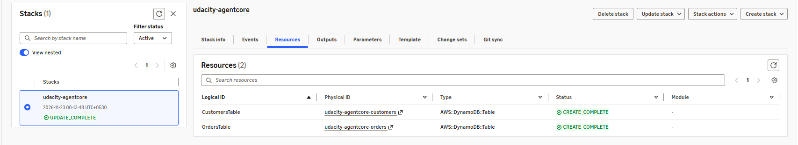

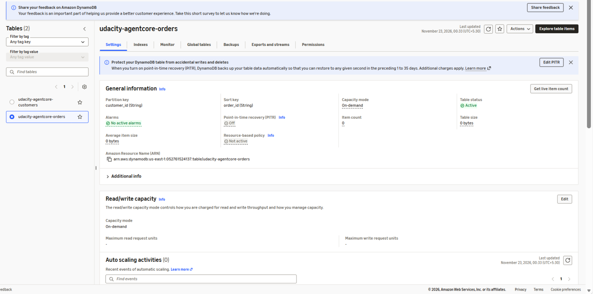

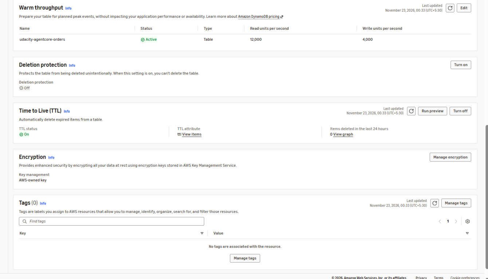

## 7. Workflow State DynamoDB Table

The Workflow State table stores shared execution state for a multi-agent session:

```yaml
WorkflowStateTable:
  Type: AWS::DynamoDB::Table
  Properties:
    TableName: !Sub '${ProjectName}-workflow-state'
    BillingMode: PAY_PER_REQUEST
    AttributeDefinitions:
      - AttributeName: session_id
        AttributeType: S
    KeySchema:
      - AttributeName: session_id
        KeyType: HASH
    TimeToLiveSpecification:
      AttributeName: ttl
      Enabled: true
```

`session_id` is the partition key. Each session has one workflow-state item.

Example state:

| session_id | customer_id | intent | version | status |
|---|---|---|---:|---|
| SESSION-001 | CUST-001 | order_status | 3 | awaiting_refund_result |
| SESSION-002 | CUST-002 | refund | 1 | policy_retrieval |

A real implementation could store:

- The customer identifier.
- The order identifier.
- Intent classification.
- Which specialist agents have run.
- Intermediate retrieval results.
- Refund eligibility.
- The final communication.
- A version for optimistic locking.

### Optimistic Locking

Optimistic locking prevents stale concurrent updates. An agent would:

1. Read the item and record its `version`.
2. Perform its work.
3. Submit a conditional update only if the stored version still matches.
4. Increment `version` if the update succeeds.

If another agent changes the item first, the stale update is rejected instead of silently overwriting the newer state.

The `version` attribute is application data. DynamoDB does not require it in `AttributeDefinitions` because `AttributeDefinitions` applies only to table indexes and primary-key attributes.

TTL can later remove expired session records. It does not remove or cancel live state immediately and still requires application code to write an epoch timestamp.

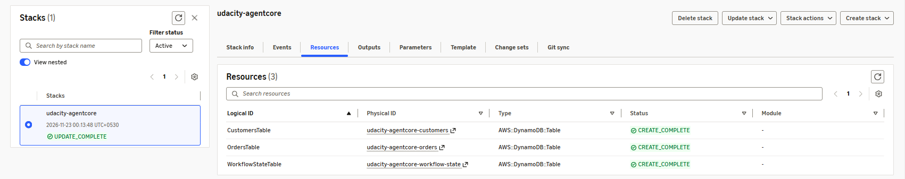

## 8. S3 and S3 Vectors

The template defines a regular S3 bucket for source policy documents and an S3 Vectors bucket for vector search:

```yaml
PolicyDocumentsBucket:
  Type: AWS::S3::Bucket
  Properties:
    BucketName: !Sub
      - '${ProjectName}-policy-docs-${AWS::AccountId}-${ShortUUID}'
      - ShortUUID: !Select [0, !Split ['-', !Select [2, !Split ['/', !Ref 'AWS::StackId']]]]
    VersioningConfiguration:
      Status: Enabled
    BucketEncryption:
      ServerSideEncryptionConfiguration:
        - ServerSideEncryptionByDefault:
            SSEAlgorithm: AES256
```

### Why S3 Is Used

The policy bucket stores source documents such as return, shipping, and warranty policies. Versioning preserves previous document versions, and server-side AES256 encryption protects stored objects.

A bucket is the container for objects. It does not by itself perform semantic search.

### Why S3 Vectors Is Used

The RAG architecture needs embeddings, which are numeric representations of text chunks. A vector bucket provides storage for vector search data.

An index belongs inside a vector bucket and is the searchable collection for one policy domain:

```yaml
VectorStoreBucket:
  Type: AWS::S3Vectors::VectorBucket
  Properties:
    VectorBucketName: !Sub
      - '${ProjectName}-vectors-${AWS::AccountId}-${ShortUUID}'
      - ShortUUID: !Select [0, !Split ['-', !Select [2, !Split ['/', !Ref 'AWS::StackId']]]]

ReturnsVectorIndex:
  Type: AWS::S3Vectors::Index
  Properties:
    VectorBucketArn: !GetAtt VectorStoreBucket.VectorBucketArn
    IndexName: returns-policy-index
    DataType: float32
    Dimension: 1024
    DistanceMetric: cosine
    MetadataConfiguration:
      NonFilterableMetadataKeys:
        - AMAZON_BEDROCK_TEXT
```

| Property | Template value | Meaning |
|---|---|---|
| `VectorBucketArn` | `!GetAtt VectorStoreBucket.VectorBucketArn` | Associates the index with the vector bucket. `!GetAtt` also creates an implicit dependency, so CloudFormation creates the bucket first. |
| `IndexName` | `returns-policy-index` (also `shipping-policy-index` and `warranty-policy-index`) | Names the searchable collection for a policy domain. |
| `DataType` | `float32` | Stores each embedding number as a 32-bit floating-point value. |
| `Dimension` | `1024` | Number of values in each vector; must match the embedding model's output. |
| `DistanceMetric` | `cosine` | Compares vector direction to estimate semantic similarity. |
| `NonFilterableMetadataKeys` | `AMAZON_BEDROCK_TEXT` | Carries each text chunk as metadata for retrieval results; it is not intended for metadata filtering. |

The property reference image in section 20.4 gives a visual summary of these fields. The configured index names are set in CloudFormation; when connecting an index to a Bedrock Knowledge Base, select the existing index rather than assuming a wizard-created name.

The intended design adds separate indexes for Returns, Shipping, and Warranty policies. Each index lets the Policy Agent search a focused policy domain.

### Bucket Versus Index

| Component | Stores | Purpose |
|---|---|---|
| S3 policy bucket | Original policy documents | Source of truth and version history |
| S3 Vectors bucket | Vector-search backing storage | Holds vector collections for the project |
| Vector index | Embeddings and retrieval metadata | Searches one policy domain |
| Knowledge Base | Retrieval configuration and data source | Connects Bedrock retrieval to stored vectors |

This design separates source documents from their searchable representation.

The policy-documents S3 bucket is visible in the AWS Console (see section 20.2), which is evidence that the bucket exists. This screenshot does not show its versioning or encryption properties. The S3 Vectors bucket and all three indexes are visible in the S3 Vectors console (see section 20.3). The Returns index details show dimension `1024` and cosine distance. The CloudFormation stack screenshot in section 20.1 also shows `UPDATE_COMPLETE` at the time it was captured.

## 9. RAG and Agent Workflow

RAG is useful because a foundation model should answer policy questions from project-controlled documents rather than from assumptions. The planned flow is:

1. Accept a customer request.
2. Classify the intent.
3. Retrieve relevant customer and order records.
4. Retrieve policy excerpts from the relevant knowledge base.
5. Pass retrieved context to the policy/refund decision logic.
6. Compose a grounded customer response.
7. Store final state and relevant trace metadata.

The Policy Agent is planned to issue parallel requests to the Returns, Shipping, and Warranty knowledge bases. Parallelism reduces end-to-end latency when all policy domains might be relevant.

The agent system is not a replacement for deterministic validation. Customer identifiers, order identifiers, refund amounts, stock quantities, and policy eligibility thresholds should still use explicit validation and tests.

## 10. Python Configuration

The package is currently a scaffold:

```python
def main() -> None:
    print("Hello from multi-agent-ecommerce-rag!")
```

The configuration module loads environment variables and an optional `.env` file:

```python
aws_region = AWS_REGION or "us-east-1"
project_name = PROJECT_NAME or "udacity-agentcore"
returns_kb_id = RETURNS_KB_ID or None
shipping_kb_id = SHIPPING_KB_ID or None
warranty_kb_id = WARRANTY_KB_ID or None
```

The settings are immutable through a frozen dataclass. This makes configuration consistent throughout the application and avoids accidental changes after startup.

Secrets and deployed Knowledge Base IDs should not be committed into Git. `.env` is intended for local configuration and is excluded from source control.

The declared dependencies include:

- `boto3` for AWS API access.
- `python-dotenv` for environment loading.
- `cfn-lint` for template validation.
- `strands-agents` for agent behavior.

## 11. Deployment and Verification Record

The CloudFormation deployment history demonstrates:

| Stage | Resources |
|---|---|
| 1 | Customer DynamoDB table |
| 2 | Customer table plus Orders table |
| 3 | Customer, Orders, and Workflow State tables |

Verified:

- The `udacity-agentcore` stack was deployed to `us-east-1`.
- `CustomersTable` has logical status `CREATE_COMPLETE`.
- `OrdersTable` has logical status `CREATE_COMPLETE`.
- `WorkflowStateTable` has logical status `CREATE_COMPLETE`.
- The customer table is empty.
- The Orders table is empty.
- The Workflow State table is deployed and empty.

Deployment evidence is stored in [progress-docs/images](./images/).

The current template defines an AgentCore execution IAM role and a CloudWatch Logs log group, but does not define runtime application code, Bedrock Guardrails, AgentCore runtime resources, X-Ray infrastructure, or populated business data.

## 12. Design Decisions and Tradeoffs

### Decision Log So Far

These are the decisions reflected in the current infrastructure or target design. Cost and operational consequences are tradeoffs to validate as the project grows, not guarantees about every AWS bill.

| Decision | Choice so far | Why | Tradeoff / caveat |
|---|---|---|---|
| Deployment rhythm | Deploy and verify in small, logical steps rather than waiting until the whole template is finished. | A failure is easier to narrow down to the latest changes; each successful update gives a known-good checkpoint. | More deployments mean more review and verification work. Use a change set for significant updates and check actual resource events. |
| DynamoDB billing | `PAY_PER_REQUEST` for all three tables. | No read/write capacity planning; avoids provisioned-throughput charges when there is no request traffic, which suits a low-traffic learning project. | Storage, Streams activity, backups, and other features can still cost money. At sustained high request volume, provisioned capacity may be cheaper, so compare real usage and pricing before production. |
| Customer table key | `customer_id` as a simple partition key. | A customer is retrieved by its unique customer identifier. | Other access patterns, such as lookup by email, would need a deliberately designed index or a different access path. |
| Orders table key | `customer_id` partition key plus `order_id` sort key. | Supports listing one customer's orders and identifying one order using both key values. | Queries must follow this access pattern; this key does not make arbitrary order attributes searchable. |
| Workflow state | One item per `session_id`, with TTL enabled. | Provides a shared durable record for the planned multi-agent workflow and a way to expire temporary sessions. | Application code still needs to write state and a Unix-epoch TTL value. Expiration is asynchronous; optimistic locking is planned but not implemented. |
| Orders stream | `NEW_AND_OLD_IMAGES`. | Retains before-and-after item images for possible future event-driven processing. | A stream consumer is not implemented. Stream processing adds operational complexity and may incur additional charges. |
| Policy storage | Regular S3 bucket for source documents; separate S3 Vectors bucket and one index per policy domain. | Keeps original documents separate from vector-search data and isolates Returns, Shipping, and Warranty retrieval. | Knowledge Bases, document ingestion/sync, and end-to-end retrieval are not yet implemented. |
| Vector settings | `float32`, dimension `1024`, cosine distance, and `AMAZON_BEDROCK_TEXT` as non-filterable metadata. | Matches the intended embedding and retrieval configuration documented for this project. | Dimension must match the embedding model; verify actual Knowledge Base configuration and retrieval behavior when implemented. |
| Naming | Prefix resource names with `ProjectName`; add account/stack-derived uniqueness to bucket names. | Gives resources a recognizable project identity while reducing global S3 name collisions. | AWS naming limits and uniqueness requirements still apply; generated names should be verified after deployment. |
| Agent coordination | Central orchestrator with specialist roles; policy retrieval is designed to be parallel. | Makes routing and ownership easier to reason about while allowing independent policy searches to run concurrently. | Agent runtime and retrieval workflow are design only; parallel calls can increase simultaneous usage and cost. |
| CloudWatch log retention | Dedicated log group with `RetentionInDays: 14`. | Keeps the planned AgentCore log destination explicit and limits how long log events are retained. | Retention controls stored log events, not whether logs are produced. Ingestion and retained data can incur charges; an empty log group is not proof of working runtime logging. |

### DynamoDB Versus a Relational Database

DynamoDB was chosen for the workflow and operational state because the access patterns are key-based and the system requires highly available, serverless scaling.

Tradeoffs:

- DynamoDB is excellent for known partition/sort-key access patterns.
- It requires deliberate key and index design.
- Cross-table joins are not performed by DynamoDB.
- A relational database may be easier for complex analytics or ad-hoc joins.

For this project, the three table access patterns are clearer as DynamoDB item lookups and queries.

### Orchestrated Versus Peer-to-Peer Agents

The orchestrator pattern was chosen for predictable routing and centralized state.

Tradeoffs:

- The orchestrator becomes a coordination bottleneck.
- It provides a clear audit trail and simpler debugging.
- Peer-to-peer communication can be more flexible.
- Peer-to-peer communication is harder to constrain and observe.

### Multiple Agents Versus an If-Else Function

An if-else workflow could solve a fixed set of business rules. It would be cheaper and easier to test for deterministic routing.

Agents are useful when:

- Intent is ambiguous.
- Policies require contextual retrieval.
- The application must compare structured data with natural-language documents.
- Specialist tools have to be selected dynamically.

Agents should not replace deterministic checks. Their use adds latency, cost, and nondeterminism, so agent boundaries and final validation rules must be controlled.

### Parallel Versus Sequential Policy Retrieval

Sequential retrieval is simpler but slower. Parallel retrieval across Returns, Shipping, and Warranty is appropriate when all policy domains could independently contribute context.

Tradeoffs include higher simultaneous API usage and cost. Results must be deduplicated and ranked before generating a final answer.

## 13. Reliability and Failure Handling

A production implementation should handle:

- Invalid or missing customer identifiers.
- Order-not-found responses.
- DynamoDB conditional-write conflicts.
- Knowledge Base timeouts.
- Partial policy retrieval failures.
- Tool-call validation failures.
- Embedding or vector-index errors.
- Incomplete agent responses.
- Rate limits and retry exhaustion.
- Conflicting policy information.

Recommended controls include:

- Typed tool inputs and outputs.
- Timeouts and bounded retries.
- Idempotency keys for mutations.
- Conditional writes for workflow state.
- Circuit breakers for external services.
- Structured logs with session and trace identifiers.
- Human escalation when policy confidence is low.
- Explicit fallbacks when a specialist fails.

## 14. Security and Permissions

The template defines `AgentCoreExecutionRole`, named from the `ProjectName` parameter. An execution role is an IAM identity that an AWS service can assume to obtain temporary credentials while running the workload.

IAM has two separate policy ideas:

| Policy | Template property | Meaning in this project |
|---|---|---|
| Trust policy | `AssumeRolePolicyDocument` | Defines who may assume the role. It trusts `bedrock.amazonaws.com` and `bedrock-agentcore.amazonaws.com` to call `sts:AssumeRole`. |
| Permissions policy | `Policies` → `PolicyDocument` | Defines what the role may do after a trusted service assumes it. The inline policy is named `AgentCoreProjectPolicy`. |
| Why both are required | Trust policy + permissions policy | The runtime service must be allowed to assume the role, and the role must have permission for the AWS actions the runtime needs. Trust alone does not grant data/API access; permissions alone do not make a service trusted to assume the role. |
| Why the developer user is absent from trust | Trusted principals list | This is an execution role for AWS services to assume, not a role intended for direct use by the developer's IAM user. |

### The Nine Permission Statements

The inline `AgentCoreProjectPolicy` contains nine statements. Each statement groups actions that serve one part of the runtime:

| # | Statement | Why the runtime needs it | Resource scope in the template |
|---:|---|---|---|
| 1 | `bedrock:InvokeModel`, `bedrock:InvokeModelWithResponseStream`, `bedrock:ApplyGuardrail`, `bedrock:GetGuardrail` | Invoke foundation models and apply/read guardrail configuration. | `"*"` |
| 2 | `bedrock:Retrieve`, `bedrock:GetKnowledgeBase` | Retrieve content from the policy Knowledge Bases. | `"*"` |
| 3 | `cloudformation:ListExports`, `cloudformation:DescribeStacks`, `sts:GetCallerIdentity` | Let runtime configuration code discover stack exports and caller/account identity. | `"*"` |
| 4 | CloudWatch Logs actions (`CreateLogGroup`, `CreateLogStream`, `CreateLogDelivery`, `PutLogEvents`, `DescribeLogGroups`, `DescribeLogStreams`) | Create and write agent execution logs and inspect log groups/streams. | `"*"` |
| 5 | X-Ray actions (`PutTraceSegments`, `PutTelemetryRecords`, `GetSamplingRules`, `GetSamplingTargets`) | Send distributed trace data and retrieve sampling configuration. | `"*"` |
| 6 | AgentCore Memory event, memory-record, and workload-token actions | Store and retrieve memory events/records and obtain workload access tokens. | `"*"` |
| 7 | DynamoDB `GetItem`, `PutItem`, `UpdateItem`, `Query`, `Scan` | Read or update customer, order, and workflow-state data. | The three table ARNs referenced by `!GetAtt`. |
| 8 | S3 `GetObject`, `GetObjectVersion`, `PutObject`, `DeleteObject`, `ListBucket` | List and manage policy documents, including uploads and reads for ingestion/sync. | The policy bucket ARN and its object ARNs. |
| 9 | `s3vectors:*` | Allow vector-store operations for the Knowledge Base integration. | `"*"` |

`"Resource": "*"` is broad: it is not restricted to one named resource. Some AWS actions do not support resource-level scoping, but where they do, production policies should use the narrowest applicable ARNs and actions. In particular, `s3vectors:*` grants every S3 Vectors action allowed by the service authorization model; review and narrow it before production.

### CloudFormation and YAML Syntax in the Policy

| Syntax | Meaning in this template |
|---|---|
| `!GetAtt OrdersTable.Arn` | Reads the Orders table ARN. It also creates an implicit dependency, so CloudFormation creates the table before the role policy that references it. |
| `!GetAtt CustomersTable.Arn` and `!GetAtt WorkflowStateTable.Arn` | Restrict DynamoDB actions to the other two table ARNs as well. |
| `!GetAtt PolicyDocumentsBucket.Arn` | Identifies the bucket itself; this ARN is used for bucket-level actions such as `s3:ListBucket`. |
| `!Sub ${PolicyDocumentsBucket.Arn}/*` | Builds the object ARN pattern for objects inside the bucket. The bucket ARN alone does not cover object-level actions. |
| `Resource: "*"` | Must be quoted in YAML because an unquoted leading `*` is the YAML alias indicator. |

| Review note | Why it matters |
|---|---|
| Current configuration is not yet a production least-privilege design. | Some service statements use `Resource: "*"`, and `s3vectors:*` allows all S3 Vectors actions supported by the service authorization model. |
| Narrow permissions before production. | Identify the exact required actions and resources, then use resource-level ARNs wherever AWS supports them. |
| Remove unneeded permissions. | Permissions for planned services should be removed until those services are actually required. |
| Consider per-agent roles. | Separate, narrower roles can reduce the impact of an agent or tool error compared with one shared execution role. |

The IAM screenshots in section 20.5 are deployment evidence for the `udacity-agentcore-agentcore-role`, its `AgentCoreProjectPolicy`, the trusted Bedrock service principals, and the policy permissions shown in the AWS Console. The role and policy are deployed. The CloudFormation template records the policy configuration maintained in the repository.

For the eventual per-agent design, permissions should be separated according to responsibility:

- The Inventory Agent gets read access only to the required DynamoDB tables.
- The Policy Agent gets read access only to its Knowledge Base resources.
- The Refund Agent gets no direct customer-data permissions beyond what is supplied.
- The Communication Agent gets no mutation permissions unrelated to response generation.
- The Orchestrator gets state-read/write permissions but does not need all underlying data permissions.

Additional controls should include:

- Bedrock Guardrails for blocked topics and sensitive data.
- AWS IAM roles for workload identity.
- AWS encryption for stored data.
- Secrets management for credentials and external services.
- Audit logs and trace identifiers.
- Input and output validation.
- Human approval for high-risk refund decisions.

## 15. Observability

The infrastructure now creates a CloudWatch Logs log group for the planned AgentCore runtime. The log destination exists, but the application/runtime is not implemented, so this does not yet prove that agent logs are being written. The template does not yet configure X-Ray infrastructure, though the IAM role contains X-Ray actions.

### CloudWatch Log Group

CloudWatch Logs organizes log events into **log groups** and **log streams**. A log group is the named container for related logs; a log stream is a sequence of events from a particular source or execution. The CloudFormation resource is:

```yaml
AgentLogGroup:
  Type: AWS::Logs::LogGroup
  Properties:
    LogGroupName: !Sub /aws/bedrock/agentcore/${ProjectName}
    RetentionInDays: 14
```

| Template line/property | Resolved value | Meaning |
|---|---|---|
| `Type` | `AWS::Logs::LogGroup` | Create a CloudWatch Logs log group. |
| `LogGroupName` | `/aws/bedrock/agentcore/udacity-agentcore` | `!Sub` replaces `${ProjectName}` with the stack parameter. The path is a naming convention. |
| `RetentionInDays` | `14` | CloudWatch Logs retains log events for 14 days, then deletes expired events. |

The role includes log-writing permissions, and the project configuration notes plan to provide this group name to runtime code. However, the current `config.py` does not define `AGENT_LOG_GROUP`, and the CloudFormation template does not yet export the log-group name under `Outputs`. Those are follow-up integration steps; do not imply the running agents already write here.

An empty log group has no log-event ingestion or stored log data yet, but it does not mean all CloudWatch resources or future logging are free. Ingestion, storage, and other features can incur charges. A finite retention period limits stored-event lifetime.

The first screenshot explains the intended log-group/stream relationship. The second shows the deployed log group and its two-week retention setting.


The broader planned observability stack may later combine:

- Amazon CloudWatch metrics and logs.
- AWS X-Ray distributed traces.
- Agent invocation IDs.
- Session IDs.
- Specialist-agent latency.
- Tool-call success and failure counts.
- Knowledge Base retrieval counts.
- Retry count.
- End-to-end request latency.
- Estimated model cost.

Useful operational measurements include:

| Metric | Why it matters |
|---|---|
| Agent success rate | Detects routing or tool failures |
| p95 latency | Identifies end-to-end slowdown |
| Retrieval latency | Measures RAG search cost |
| Model cost per session | Tracks expensive multi-agent usage |
| Retry rate | Shows upstream instability |
| Escalation rate | Measures unresolved or low-confidence requests |
| Conditional-write conflict rate | Shows concurrent workflow-state contention |

## 16. Testing Strategy

Tests should cover implementation and infrastructure at several levels:

### Unit Tests

- Configuration defaults and overrides.
- Agent intent classification.
- Tool input validation.
- DynamoDB key construction.
- TTL value calculations.
- Refund eligibility rules.

### Integration Tests

- DynamoDB CRUD and conditional writes.
- Bedrock Knowledge Base retrieval.
- S3 policy document ingestion.
- Agent-to-tool invocation.
- Shared workflow-state updates.

### Contract Tests

- Verify that each agent returns a typed, predictable result.
- Verify the orchestrator handles missing specialist results.
- Verify policy citations and source metadata are preserved.

### Infrastructure Tests

- Run `cfn-lint`.
- Validate CloudFormation through a change set.
- Verify resource names and key schemas.
- Verify stack deletion and recreation.

### Evaluation Tests

- Policy answer accuracy.
- Whether answers cite the correct knowledge source.
- Refusal behavior for unsupported or unsafe requests.
- Hallucination rate.
- Customer-facing tone.
- Latency and cost per sample request.

## 17. Current Scope and Future Work

The project is partially complete. The following status distinctions are important:

### Deployed and Verified in AWS

- DynamoDB Customers table.
- DynamoDB Orders table with TTL and Stream.
- DynamoDB Workflow State table.
- Policy-documents S3 bucket is visible in the AWS Console; versioning and encryption settings still need separate verification.
- S3 Vectors bucket and Returns, Shipping, and Warranty indexes are visible in the AWS Console.
- Returns vector index overview shows dimension `1024` and cosine distance metric.
- `udacity-agentcore-agentcore-role` is visible in IAM with the `AgentCoreProjectPolicy` inline policy name and Bedrock / Bedrock AgentCore trusted-service principals.
- CloudWatch log group `/aws/bedrock/agentcore/udacity-agentcore` is visible with a two-week retention setting; log-event ingestion by an application runtime is not yet verified.

### Present in the Repository

- CloudFormation definitions for the S3 policy-document bucket, S3 Vectors bucket, three indexes, AgentCore execution role with its trust and permissions policies, and CloudWatch log group; the template passes `cfn-lint`.
- Python configuration settings and a package scaffold.
- Unit-test scaffold and UV dependency management.
- Architecture diagrams and design notes.

### Not Yet Implemented or Verified

- Bedrock Knowledge Base creation and synchronization.
- Orchestrator and specialist-agent implementation.
- Inventory and policy tools.
- DynamoDB application records and CRUD operations.
- Workflow-state optimistic locking.
- Refund decision logic.
- AgentCore runtime deployment.
- Bedrock Guardrails.
- Production least-privilege IAM review and any further role separation.
- Runtime log configuration/export, actual log ingestion, and X-Ray observability.
- End-to-end RAG evaluation.

This project is an **in-progress architecture and infrastructure implementation**, not a completed or production-ready multi-agent application. The diagrams and planned flows describe the target state. They must not be presented as evidence that the full system is already running.

## 18. Interview Talking Points

### Why use DynamoDB?

The main access patterns are known and key-based: fetch a customer by `customer_id`, fetch an order by customer and order identifiers, and fetch workflow state by session identifier. DynamoDB is serverless and scales through partition-key design.

### Why use three DynamoDB tables?

Customers, Orders, and Workflow State have different access patterns and lifecycles. Keeping them separate avoids mixing operational customer data with temporary session state or storing one record with an unclear ownership boundary.

### Why use a partition key plus sort key for Orders?

A customer can have multiple orders. A partition key alone would not identify an individual order. `customer_id + order_id` identifies one order and also supports querying all orders for a customer.

### Why use a Workflow State table?

Agents need a shared, durable record of the session. The table provides one place for routing status and intermediate results. It should use optimistic locking to prevent stale concurrent updates.

### Why use RAG?

RAG grounds policy answers in customer-policy documents and can retrieve only the relevant sections instead of relying on the model's general knowledge.

### Why use multiple agents?

The work has separate responsibilities: data retrieval, policy retrieval, eligibility decisions, and response generation. Specialist agents can use specialist tools and smaller, clearer prompts.

### Why not use a simple function?

A deterministic function is preferable for fixed refund rules and routing known by exact conditions. Agents are appropriate when intent interpretation or policy synthesis requires dynamic reasoning. The strongest design combines both, using agents for uncertain decisions and functions for deterministic checks.

### How would you handle an incorrect agent tool call?

Validate tool inputs, validate tool outputs against a schema, require authorization, and treat invalid results as a recoverable workflow error. Use bounded retries and escalate or return a safe fallback response when the specialist cannot complete its task.

### How would you measure success?

Measure answer correctness, source grounding, policy accuracy, refusal quality, latency, cost, retry rate, escalation rate, tool failures, and customer satisfaction. Infrastructure metrics alone do not prove that responses are correct.

## 19. Consolidated Theory and Interview Preparation

This section consolidates the useful architecture and CloudFormation theory notes that previously lived in a separate preparation folder. These topics explain design choices for this project; future capabilities remain proposals until implemented and verified.

### 19.1 Architecture Fundamentals

Software architecture describes a system's components, their relationships, their operating environment, and the principles guiding its evolution. For an agent system, the design should make each agent's responsibilities, communication paths, shared state, and failure boundaries explicit.

Important terms:

- **Orchestrator pattern:** A central agent routes work to specialist agents and coordinates the workflow.
- **Peer-to-peer pattern:** Agents communicate directly without a central manager.
- **Role specialization:** Each agent owns a defined responsibility and limited tool set.
- **Data flow:** The path of request data, retrieved evidence, decisions, and results through the system.
- **Sequential workflow:** Steps run in order when later work depends on earlier output.
- **Parallel workflow:** Independent work, such as searching multiple policy sources, runs concurrently.
- **Conditional workflow:** A decision routes execution down a branch based on validated state or intent.
- **Saga-style coordination:** A long-running workflow records progress and uses compensating actions or recovery steps when a later operation fails.

The project favors a centralized orchestrator for a clearer decision trail and easier debugging. Peer-to-peer collaboration can be useful for dynamic expert collaboration, but it introduces more complex coordination and observability. Shared DynamoDB workflow state is the planned record of progress; AgentCore Memory is a future option for conversational memory, not currently configured here.

### 19.2 CloudFormation Service and Stack Concepts

A CloudFormation template is a declarative description of desired AWS resources. CloudFormation parses and validates the template, calculates dependencies, then calls the relevant AWS services to create or update resources. A **stack** groups those resources and manages them as a unit.

During an update, a **change set** previews the resource changes CloudFormation expects to apply. It helps review whether a change will add, modify, replace, or remove resources before execution. A stack is not a guarantee that every resource can be deleted without consequences: retention policies, external dependencies, and service-specific deletion constraints must be considered.

CloudFormation chooses resource ordering from dependencies, not simply from the order resources appear in YAML. `!Ref` and `!GetAtt` references commonly establish implicit dependencies. Use an explicit `DependsOn` only when a required ordering relationship is not expressed through a reference.

### 19.3 CloudFormation Parameter and Validation Lessons

The `ProjectName` parameter has a `Default`. With a default, a deployment can omit an explicit parameter value; without one, the deployer must supply it. `Default` is case-sensitive and must use the exact CloudFormation property name.

Run `cfn-lint` before deploying to catch template schema and resource configuration problems early. Passing lint is not the same as a successful AWS deployment: AWS may still reject a resource because of account permissions, region support, naming collisions, quotas, or service-side validation.

The deployment workflow should be:

1. Edit the template.
2. Run `uv run cfn-lint infrastructure/starter_stack.yaml`.
3. Review the diff and, for meaningful changes, create or inspect a CloudFormation change set.
4. Deploy only to the intended account and region.
5. Verify the stack events, resource status, and service-side configuration.
6. Record what was actually observed, separating it from planned behavior.

### 19.4 Multi-Agent Design Questions

Before adding an agent, ask whether the responsibility genuinely needs language understanding, contextual synthesis, or dynamic tool selection. If fixed rules fully define the behavior, a deterministic function is usually cheaper, faster, and easier to test. A hybrid design uses agents for ambiguity and deterministic code for validations, authorization, calculations, and consequential mutations.

Agent boundaries should identify:

- The agent's goal and the conditions for completion.
- The tools it is allowed to call.
- The typed input and output contracts.
- The data it may read or change.
- Timeouts, retry limits, and error behavior.
- What happens when evidence is missing or specialists disagree.
- When a request is escalated to a human.

Model selection (for example, smaller or larger models for different task complexity) is a future design decision. No model-to-agent assignments are implemented in the current Python scaffold.

## 20. Visual References and Deployment Evidence

This section embeds every image currently present in the repository so the report can serve as a single visual reference for review and interview preparation. Image captions identify whether an image is deployment evidence, an architecture design, or a study note. The DynamoDB screenshots show deployed tables; the S3 screenshot shows the policy-documents bucket; and the S3 Vectors screenshots show the vector bucket and its three indexes. The S3 screenshot does not verify the policy bucket's versioning or encryption configuration. Architecture diagrams and study images are references, not proof of a running agent application.

### 20.1 Deployed DynamoDB Evidence

These screenshots document the deployed CloudFormation stack and DynamoDB tables.

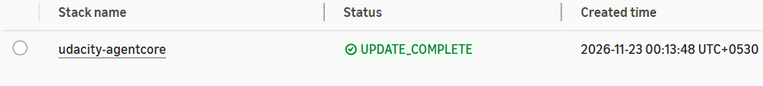


### 20.2 Policy Documents S3 Bucket

This AWS Console screenshot shows the regular S3 policy-documents bucket in `us-east-1`. The account-specific part of the name is obscured. It is not the S3 Vectors bucket and does not show vector indexes. Open the bucket's Properties page to capture evidence of versioning and default encryption separately.


### 20.3 S3 Vectors Bucket and Indexes

The first screenshot shows the S3 Vectors bucket in the Vector buckets console. The second shows all three indexes within that bucket. The third is a detail view of the Returns index and confirms its 1024 dimension and cosine distance metric. The detail screenshot is only for Returns; it does not independently show the Shipping and Warranty settings.


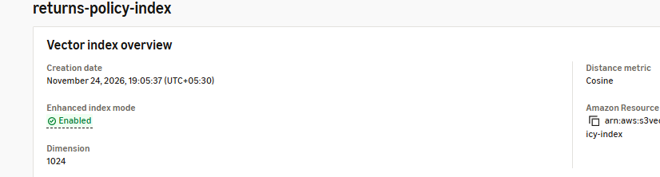

### 20.4 Vector Index Property Reference

This reference image summarizes the principal S3 Vectors index properties and their meanings. The table in section 8 gives the project-specific explanation alongside the CloudFormation values.

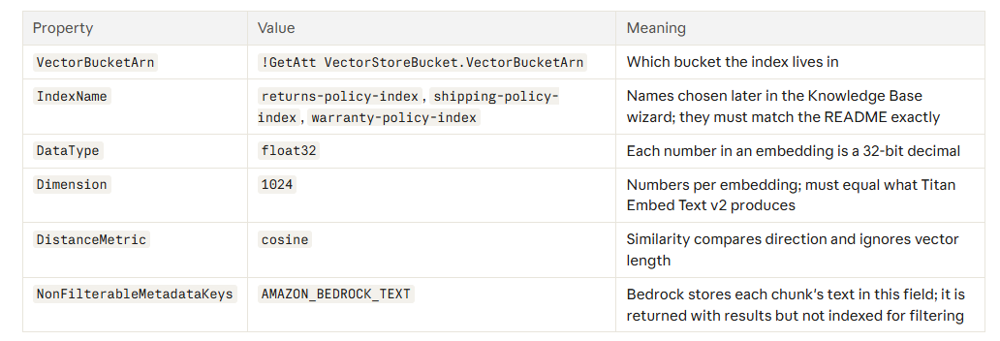

### 20.5 AgentCore IAM Role Evidence

These screenshots provide AWS Console evidence of the deployed IAM role and configuration: the role list shows the role, the permissions page shows the inline policy, the trust relationship shows its trusted service principals, and the policy editor shows the deployed policy statements.


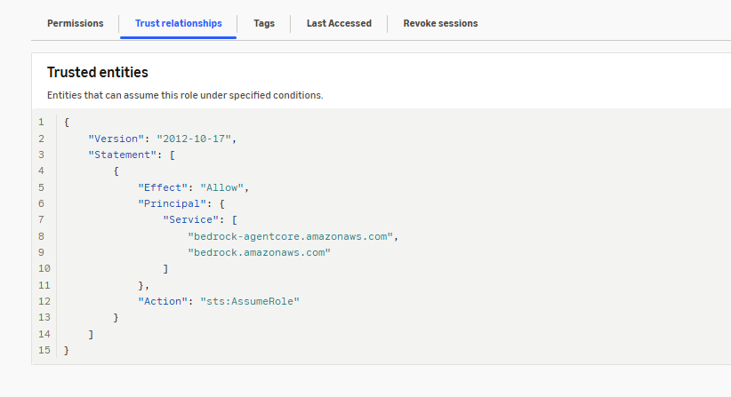


### 20.6 CloudWatch Log Group Evidence

The first image is a conceptual reference for log groups and log streams. The second is AWS Console evidence that the project log group exists and has a two-week retention setting. Neither image shows agent log events being emitted by a running application.


### 20.7 Intended Agent Architecture and Request Flows

These diagrams communicate the target design; they are not screenshots of a running agent application.


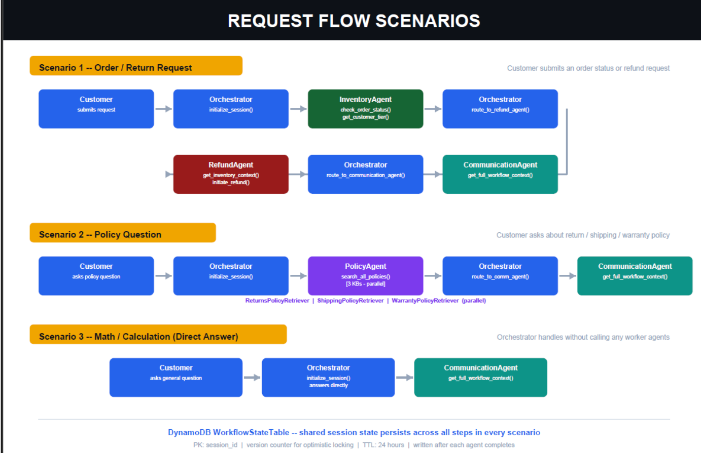

### 20.8 CloudFormation Study Diagrams

These images are retained from CloudFormation study and preparation notes. They support the concepts discussed in section 4 and are learning references, not deployment evidence.

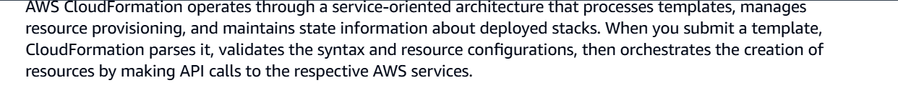

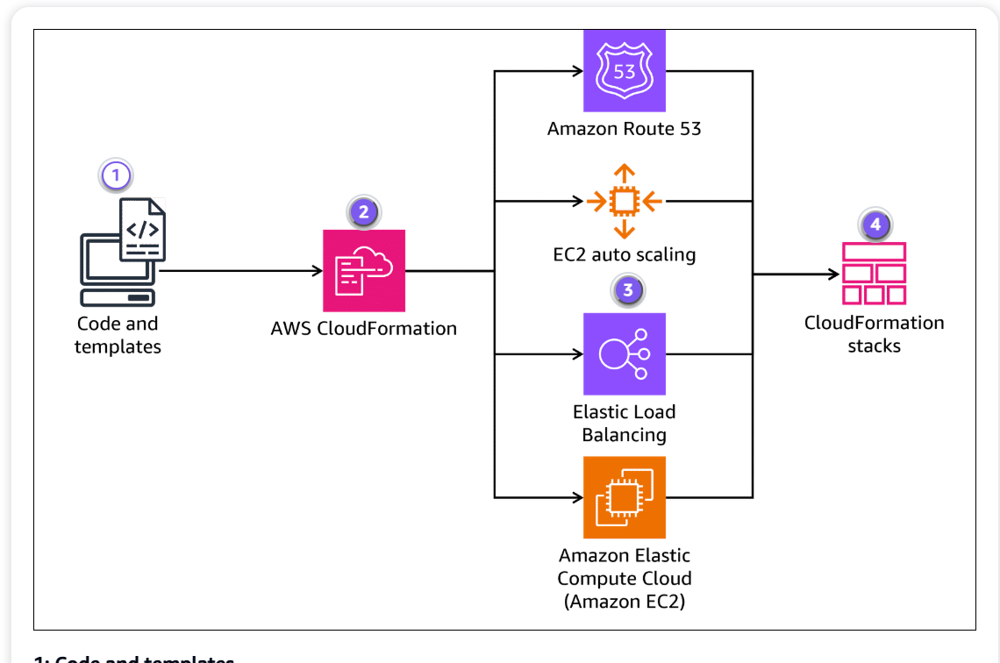

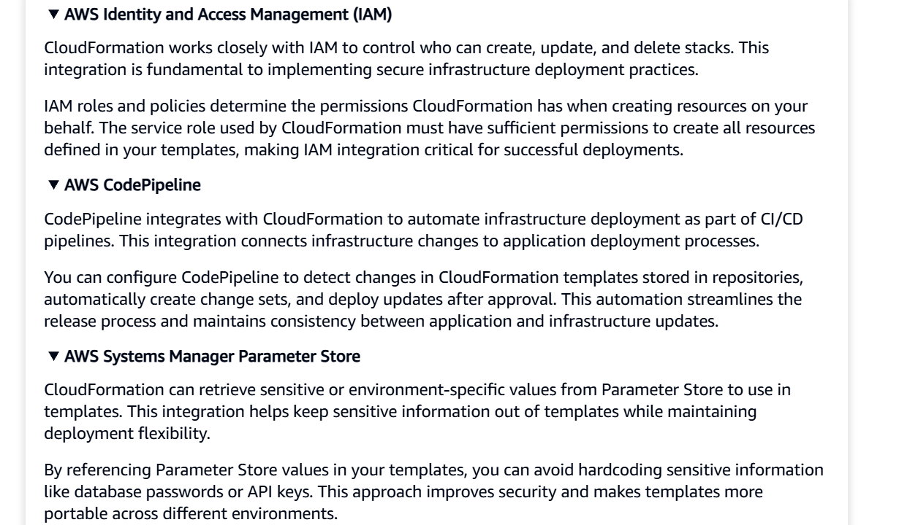

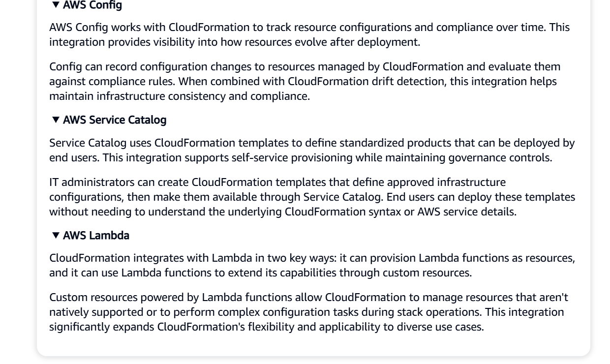

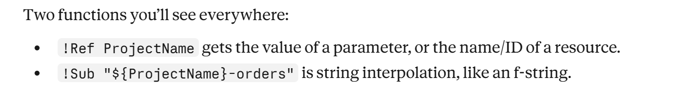

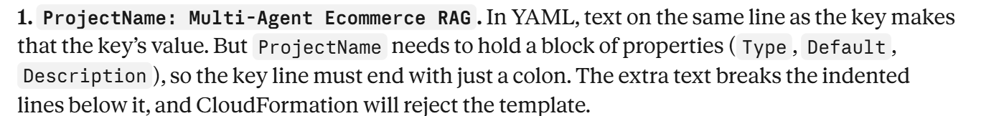

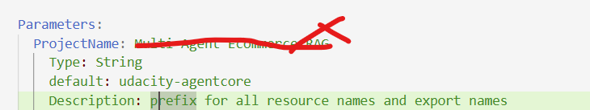

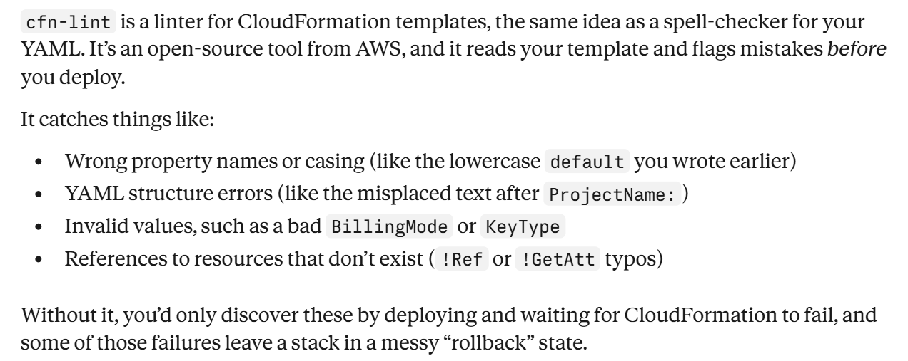

### 20.9 Architecture Preparation Sketches

These images are architecture-learning sketches kept in the preparation folder. They are references rather than implementation evidence.

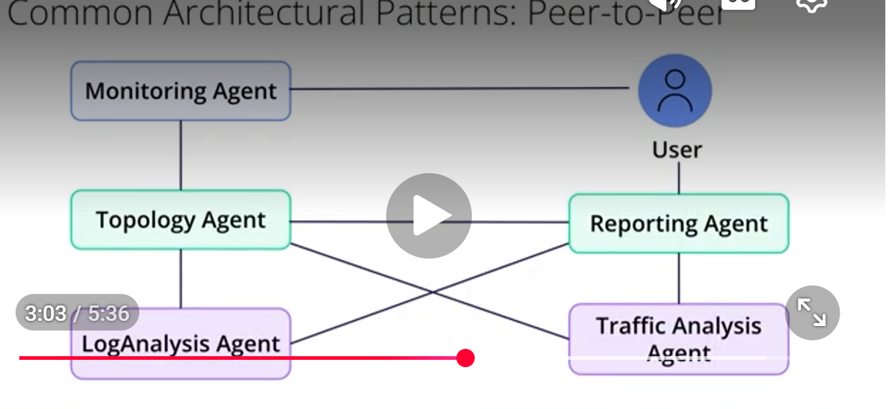

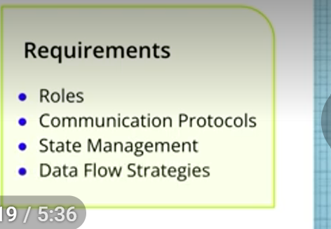

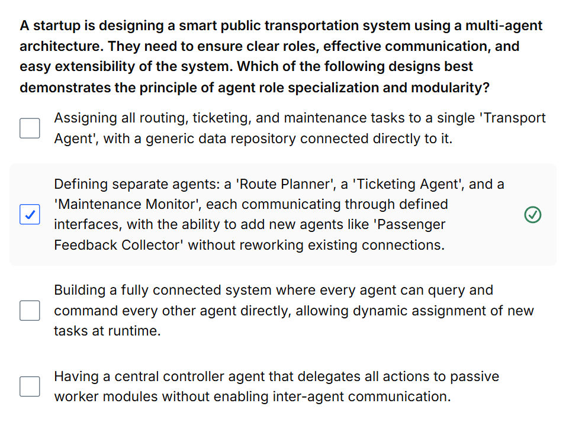

## 21. Interview Practice Questions

Use these questions to practice explaining the design decisions and current implementation honestly:

1. What is the difference between a CloudFormation template and a stack?
2. How does CloudFormation know to create the vector bucket before its index when the index uses `!GetAtt`?
3. What is the difference between an S3 bucket, an S3 Vectors bucket, and a vector index?
4. Why does the Orders table use both `customer_id` and `order_id` as its key?
5. What does DynamoDB TTL do, and why is expiration not immediate?
6. How would optimistic locking stop two agents from overwriting each other's workflow state?
7. When is a deterministic function preferable to an LLM agent?
8. What does the orchestrator pattern simplify, and what tradeoff does it introduce?
9. How would the system handle a failed or conflicting policy retrieval?
10. Which metrics would show that a multi-agent RAG workflow is reliable and cost-effective?
11. Which parts are actually deployed today, and which remain design or implementation work?
12. What would you implement next, and how would you verify it end-to-end?
