# Multi-Agent E-commerce RAG: Project Report

**Project:** Multi-Agent E-commerce RAG  
**Repository:** `harveenkaur282-web/Multi-Agent-Ecommerce-RAG`  
**Platform:** Amazon Web Services (AWS)  
**Primary language:** Python 3.13+  
**Infrastructure:** AWS CloudFormation  
**AWS region:** `us-east-1`  
**Stack name:** `udacity-agentcore`  
**Project name:** `udacity-agentcore`

> **Project status: In progress — not complete.** The three DynamoDB tables, policy-documents S3 bucket, S3 Vectors bucket, three vector indexes, AgentCore IAM role, and CloudWatch log group are visible in the AWS Console. The Bedrock Knowledge Base overview lists Returns, Shipping, and Warranty as `Available`, each with one data source and zero last-sync warnings. Separate screenshots show completed source sync for Returns and Shipping; the overview shows `-` for Warranty's last-sync date, though a direct retrieval probe returned Warranty policy text. Manual boto3 retrieval probes returned 3 Returns, 2 Shipping, and 2 Warranty results for one sample query per domain. These are smoke checks, not a relevance evaluation. Inventory, Refund, and Policy Agent builders, plus Workflow State helpers, are implemented in source. Manual CLI checks cover Inventory lookups, Refund Agent denial/approval paths, and one Policy Agent query across all three knowledge bases. The Policy Agent trace reported all three retrievers responding in 11.8 seconds; the captured output also has interleaved fragments and a duplicated final response, so output quality and broader behavior need follow-up. The Communication Agent builder now includes a context tool that JSON-normalizes the full Workflow State. The Orchestrator now has a routing prompt, state helpers, session initialization, four routing tools, and an Agent builder; the Task 2 checks reported 40/40 after correcting the test import path. The route ordering and full worker workflow have not been tested end to end, and the AgentCore runtime is not deployed.

> **Task 3 update:** `create_guardrail()` created a Bedrock Guardrail and published version `1`. A separate five-case, input-only smoke test printed `PASS` for two allowed requests and three blocked requests. Output filtering and PII behavior remain unverified. The runtime deployment function is now implemented, but has not been run.

> **Runtime status:** `deploy_to_agentcore_runtime()` now configures and invokes the AgentCore CLI. It has not been called, so no AgentCore runtime has been deployed.

## 1. Project Overview

This project demonstrates the design and progressive infrastructure implementation of a multi-agent customer-support system for a fictional NovaMart e-commerce company.

The intended system combines:

- An orchestrator that classifies and routes customer requests.
- Specialist agents for inventory, policy, refund, and communication work.
- DynamoDB tables for business data and shared workflow state.
- Amazon S3 for versioned policy documents.
- Amazon S3 Vectors for policy embeddings and semantic retrieval.
- Amazon Bedrock Knowledge Bases for retrieval-augmented generation.
- Strands Agents for agent behavior and Amazon Bedrock AgentCore for future runtime deployment.

The project is intentionally documented as an implementation record and interview guide. This report distinguishes deployed and verified resources from template-only resources, design plans, and unfinished implementation. The agent workflow and end-to-end runtime are not yet operational.

The report includes relevant deployment evidence and project architecture diagrams. Planned architecture is distinguished from resources verified in AWS.

## 2. Intended Architecture

```text
Customer Request
       |
       v
Orchestrator Agent
       |
       +----------------------+
       |                      |
       v                      v
Inventory Agent        Policy Agent
Customer/order data     Parallel policy retrieval
       |                      |
       |             +--------+--------+
       |             |                 |
       |             v                 v
       |       Returns KB        Shipping KB
       |             |
       |             v
       |       Warranty KB
       |             |
       +------> Refund Agent
                     |
                     v
              Communication Agent
                     |
                     v
              Customer Response
```

The orchestrator pattern is used because a central component makes routing decisions, coordinates the specialist agents, and owns the overall workflow. The orchestrator and worker agents share workflow state rather than passing an uncontrolled chain of ad-hoc variables.

The alternative peer-to-peer pattern allows agents to communicate directly. It can be useful for dynamic collaboration, but it is harder to audit and debug in this project because the orchestrator provides a clearer decision trail and sequence.

### Implementation Timeline

The project was built incrementally. Each implementation step below has its code explanation and available screenshot evidence together in the matching report section; the commit IDs provide the Git history trail.

| Step | Work recorded in Git | Where the report shows the code and evidence |
|---|---|---|
| 1 | Started the CloudFormation template and added the customer table (`d61ce49`, `fd1fe0b`, `dcf39cd`). | Sections 4–5: template/parameter snippets, stack status, customer resource and table screenshots. |
| 2 | Added Orders and Workflow State tables (`9b48c23`, `8593507`). | Sections 6–7: key/TTL/Streams snippets and resource screenshots. |
| 3 | Added the policy S3 bucket, S3 Vectors bucket, and three policy indexes (`338afb0`, `b881c63`). | Section 8: bucket/index snippets and S3/S3 Vectors console evidence. |
| 4 | Added the AgentCore execution role and CloudWatch log group (`64a4ac7`, `a13c922`). | Sections 14–15: trust/permissions and log-group snippets followed by their console evidence. |
| 5 | Added CloudFormation exports and Python configuration (`6979d8c`, `152d855`, `abc646e`). | Sections 5 and 10: Outputs snippet/table and the `config.py` run screenshot. |
| 6 | Added deterministic seed data for DynamoDB and policy documents (`ed9350f`). | Section 11: seed write snippet, terminal run, then DynamoDB/S3 verification screenshots. |
| 7 | Added the agent package, Inventory Agent setup, three DynamoDB data tools, and Agent construction (`f92ea25`, `a7b5a63`, `9ff912f`, `2d41a94`, `aafda28`, `c50db65`, `9718322`). | Section 11: model/prompt, DynamoDB tool code snapshots, and the `Agent` assembly added in `9718322`. |
| 8 | Implemented the Refund Agent model, date-aware eligibility prompt, Workflow State context tool, and conditional DynamoDB return mutation (`210d198`, `3b5b116`). The latter commit also assigns the Inventory Agent its explicit name. | Sections 7 and 11: Workflow State helper behavior, Refund Agent prompt/tools, `smoke_refund.py` harness, and manual smoke-test outputs. |
| 9 | Configured policy Knowledge Bases in the Bedrock console and ran one direct retrieval probe per domain. The overview lists all three as `Available`; the probes returned 3 Returns, 2 Shipping, and 2 Warranty results. | Section 9: console setup/status screenshots and manual retrieval smoke-test commands and outputs. |

### Agent Responsibilities

| Agent | Responsibility |
|---|---|
| Orchestrator | Classify intent, route work, coordinate state, and determine completion |
| Inventory | Retrieve customer details and order information |
| Policy | Coordinate parallel retrieval from Returns, Shipping, and Warranty knowledge bases |
| Refund | Evaluate return eligibility from verified order/customer facts and initiate a return when eligible |
| Communication | Produce the final customer-facing response |

Role specialization keeps each agent responsible for a distinct business function. It also makes prompts, tools, tests, permissions, and failure handling easier to isolate.

## 3. Project Structure

| Path | Purpose |
|---|---|
| `infrastructure/starter_stack.yaml` | CloudFormation resource definitions |
| `progress-docs/project-report.md` | Canonical project and interview report |
| `progress-docs/images/` | AWS deployment evidence |
| `diagrams/` | Architecture and workflow visualizations |
| `src/multi_agent_ecommerce_rag/` | Python application and agent implementation in progress |
| `config.py` | Environment and project settings |
| `smoke_refund.py` | Local manual Refund Agent smoke-test harness; cases and outputs are documented in section 11 |
| `agentcore/` | AgentCore CLI project configuration and TypeScript CDK deployment scaffold |
| `tests/` | Configuration unit tests |
| `pyproject.toml` | Python project metadata and dependencies |
| `uv.lock` | Reproducible resolved dependency versions |

## 4. Step 1 — CloudFormation Foundations

CloudFormation reads a YAML or JSON template and creates, updates, lists, and deletes AWS resources as a single stack. The orchestration engine validates the template, determines resource dependencies, and makes AWS API calls in the required order.

The stack can therefore be reproduced and removed consistently. This is an advantage over manually creating resources in the AWS Console. The infrastructure is also reviewable in Git and changes can be previewed through a CloudFormation change set.

The project template is organized into these sections:

| Template section | What it describes | Project example |
|---|---|---|
| `AWSTemplateFormatVersion` | CloudFormation template format version | `'2010-09-09'` |
| `Description` | Human-readable summary | Initial customer, order, workflow, and knowledge-storage infrastructure |
| `Parameters` | Inputs supplied at deployment time | `ProjectName`, which prefixes resource names |
| `Resources` | AWS resources CloudFormation manages | DynamoDB tables, S3 bucket, S3 Vectors bucket and indexes |
| Intrinsic functions | Values and references resolved by CloudFormation | `!Ref`, `!Sub`, `!GetAtt`, `!Select`, `!Split` |

```yaml
AWSTemplateFormatVersion: '2010-09-09'
Description: >
  Initial project infrastructure for customer, order, and workflow-state tables,
  policy documents, and Bedrock Knowledge Base vector storage.

Parameters:
  ProjectName:
    Type: String
    Default: udacity-agentcore
    Description: Prefix used for resource names.
```

### Parameters

| Property | Template value | Meaning |
|---|---|---|
| `Type` | `String` | The parameter is text. |
| `Default` | `udacity-agentcore` | Used when deployment does not supply an override. |
| `Description` | `Prefix used for resource names.` | Explains how the parameter is used. |

The property name is `Default`, not `default`; CloudFormation property names are case-sensitive.

### Intrinsic Functions

| Function | Purpose |
|---|---|
| `!Ref` | References a parameter or resource |
| `!Sub` | Replaces variables in a string |
| `!GetAtt` | Reads an attribute produced by another resource |
| `!Select` | Selects an item from a list |
| `!Split` | Splits a string into a list |

An intrinsic function reference can create an **implicit dependency**. For example, `!GetAtt VectorStoreBucket.VectorBucketArn` tells CloudFormation that the vector index needs the vector bucket ARN. CloudFormation creates the bucket before the index instead of relying on deployment order in the YAML file.

### Template Validation

The repository uses `cfn-lint` to validate the CloudFormation template:

```powershell
uv run cfn-lint infrastructure/starter_stack.yaml
```

The project deployment command is:

```powershell
aws cloudformation deploy `
  --template-file infrastructure/starter_stack.yaml `
  --stack-name udacity-agentcore `
  --region us-east-1 `
  --capabilities CAPABILITY_NAMED_IAM
```

The template began as a minimal stack and was expanded resource by resource. Commits `d61ce49`, `fd1fe0b`, and `dcf39cd` record the initial template, the `ProjectName` parameter, and the first DynamoDB resource. The screenshot below shows the stack at `UPDATE_COMPLETE`; it is evidence of a successful stack operation, not proof that every future application component is deployed.


## 5. Step 2 — Customer DynamoDB Table and Stack Outputs

The first infrastructure resource was the customer table:

```yaml
CustomersTable:
  Type: AWS::DynamoDB::Table
  Properties:
    TableName: !Sub '${ProjectName}-customers'
    BillingMode: PAY_PER_REQUEST
    AttributeDefinitions:
      - AttributeName: customer_id
        AttributeType: S
    KeySchema:
      - AttributeName: customer_id
        KeyType: HASH
```

The customer table was the first deployed application-data resource (commit `dcf39cd`). The CloudFormation resource view below confirms the table definition is part of the stack; the DynamoDB view shows the table. The later seeded item scan appears in the data-seeding step in section 11.


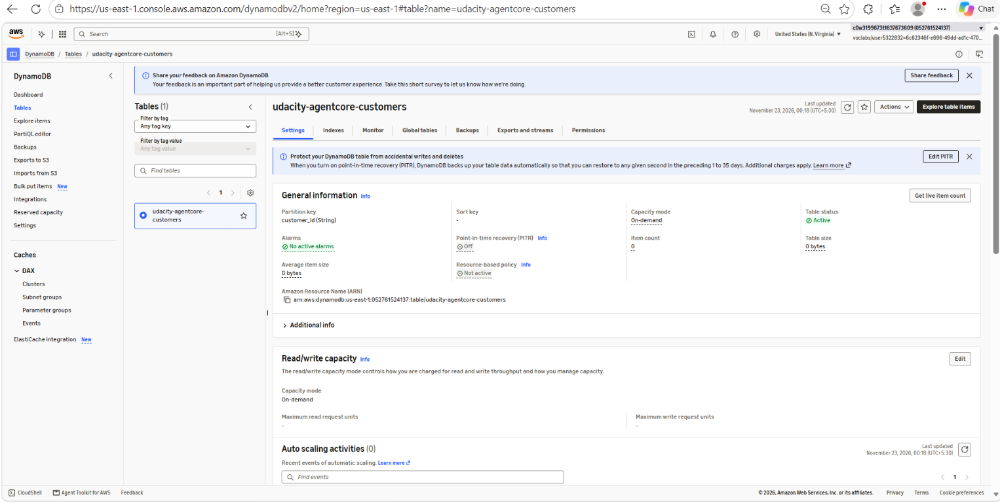

### How It Works

- The logical ID is `CustomersTable`.
- The physical deployed table name is `udacity-agentcore-customers`.
- `customer_id` is the partition key.
- `S` means the key type is a string.
- `HASH` means DynamoDB hashes the partition-key value to determine physical storage.
- `PAY_PER_REQUEST` means on-demand billing rather than provisioned read/write capacity.
- There is no sort key.
- The table is deployed; seeded records are shown in section 11.

The simple key is appropriate because each customer has a unique identifier and direct lookup is the expected access pattern.

### CloudFormation Outputs

At the first customer-table deployment, the template did not yet define an `Outputs` section. Outputs were added later as the stack grew (commit `6979d8c`).

### Current Outputs and Exports

The current template's top-level `Outputs` section publishes useful values in the CloudFormation stack's **Outputs** tab. Each output has:

| YAML field | Meaning |
|---|---|
| Output logical ID, such as `VectorStoreBucketArn` | A template-local identifier for the output row. |
| `Value` | The resolved value CloudFormation displays after deployment. It may come from `!Ref`, `!GetAtt`, `!Sub`, or a literal name. |
| `Export.Name` | A named value that another stack in the same AWS account and Region can import. `!Sub` inserts `ProjectName` into the export name. |

Exports do not automatically populate `config.py`. Application or deployment code must explicitly retrieve or pass values into the process environment/configuration. Export names must be unique within an account and Region, and an export cannot be removed or changed while another stack imports it.

For example:

```yaml
VectorStoreBucketArn:
  Value: !GetAtt VectorStoreBucket.VectorBucketArn
  Export:
    Name: !Sub ${ProjectName}-VectorBucketArn
```

Here, the output logical ID is `VectorStoreBucketArn`; `Value` reads the ARN attribute from the vector bucket; and `Export.Name` creates a reusable name such as `udacity-agentcore-VectorBucketArn`. The `!GetAtt` reference ties the output to the resource's generated ARN. Outputs are shown after the stack operation completes; they do not configure application code by themselves.

| Output | How `Value` is resolved | Export name for `ProjectName=udacity-agentcore` | Intended use |
|---|---|---|---|
| `OrdersTableName` | `!Ref OrdersTable` returns the DynamoDB table name. | `udacity-agentcore-OrdersTable` | Configure code that reads or updates orders. |
| `CustomersTableName` | `!Ref CustomersTable` returns the DynamoDB table name. | `udacity-agentcore-CustomersTable` | Configure customer lookups. |
| `WorkflowStateTableName` | `!Ref WorkflowStateTable` returns the DynamoDB table name. | `udacity-agentcore-WorkflowStateTable` | Configure shared workflow-state access. |
| `PolicyDocumentsBucketName` | `!Ref PolicyDocumentsBucket` returns the S3 bucket name. | `udacity-agentcore-PolicyBucket` | Identify the source-document bucket for ingestion and Knowledge Base setup. |
| `VectorStoreBucketName` | `!Sub` reconstructs the parameter/account/stack-derived name used by `VectorStoreBucket`. | `udacity-agentcore-VectorBucket` | Select the S3 Vectors bucket in the Knowledge Base setup. |
| `VectorStoreBucketArn` | `!GetAtt VectorStoreBucket.VectorBucketArn` reads the generated ARN. | `udacity-agentcore-VectorBucketArn` | Identify the vector bucket for IAM and integrations. |
| `ReturnsVectorIndexName` | Literal `returns-policy-index`. | `udacity-agentcore-ReturnsVectorIndex` | Select the Returns index for its Knowledge Base. |
| `ShippingVectorIndexName` | Literal `shipping-policy-index`. | `udacity-agentcore-ShippingVectorIndex` | Select the Shipping index for its Knowledge Base. |
| `WarrantyVectorIndexName` | Literal `warranty-policy-index`. | `udacity-agentcore-WarrantyVectorIndex` | Select the Warranty index for its Knowledge Base. |
| `AgentCoreRoleArn` | `!GetAtt AgentCoreExecutionRole.Arn` reads the role ARN. | `udacity-agentcore-AgentCoreRoleArn` | Identify the execution role when configuring the runtime. |
| `AgentLogGroupName` | `!Ref AgentLogGroup` returns the log group name. | `udacity-agentcore-AgentLogGroup` | Pass the log destination to runtime configuration. |

An export name such as `!Sub ${ProjectName}-VectorBucket` resolves to `udacity-agentcore-VectorBucket` with the current parameter value. CloudFormation publishes resolved output values after the stack operation completes.

This Outputs view was added when the stack was expanded (commit `6979d8c`). It shows all 11 values and the stack status at capture time. It is evidence of values CloudFormation published; it does not mean the Python application automatically reads them.


## 6. Step 3 — Orders Table and Its Key Design

DynamoDB requires every item to have a primary key. There are two supported primary-key models:

| Primary key | Structure | Lookup meaning |
|---|---|---|
| Simple | One partition key | One attribute identifies the item |
| Composite | Partition key plus sort key | The combination identifies the item |

The Orders table uses a composite key:

```yaml
OrdersTable:
  Type: AWS::DynamoDB::Table
  Properties:
    TableName: !Sub '${ProjectName}-orders'
    BillingMode: PAY_PER_REQUEST
    AttributeDefinitions:
      - AttributeName: customer_id
        AttributeType: S
      - AttributeName: order_id
        AttributeType: S
    KeySchema:
      - AttributeName: customer_id
        KeyType: HASH
      - AttributeName: order_id
        KeyType: RANGE
    TimeToLiveSpecification:
      AttributeName: ttl
      Enabled: true
    StreamSpecification:
      StreamViewType: NEW_AND_OLD_IMAGES
```

The Orders table was added in commit `9b48c23`. The CloudFormation and DynamoDB views immediately below show its resource and key/billing configuration; the TTL view documents its expiration setting. The populated-item scan appears with the seed-data evidence in section 11.


The key design supports both:

1. Looking up one order using `customer_id` and `order_id`.
2. Querying all orders that belong to one customer using `customer_id`.

Example:

| customer_id | order_id | status |
|---|---|---|
| CUST-001 | ORD-27176 | shipped |
| CUST-001 | ORD-30011 | delivered |
| CUST-002 | ORD-18452 | processing |

The sort key keeps items for the same customer ordered by `order_id`. It is not a global index and does not make every order column searchable.

A lookup that supplies only `customer_id` can query a customer's orders. A direct `GetItem` lookup requires the complete composite key. Supplying only one key element produces a key-schema mismatch.

### TTL

```yaml
TimeToLiveSpecification:
  AttributeName: ttl
  Enabled: true
```

TTL is enabled for the `ttl` attribute. The application must store a Unix epoch-time-in-seconds value in that attribute. DynamoDB can then expire the item after the configured time, although physical deletion is asynchronous.

TTL is a separate lifecycle feature, not part of the primary key.

### DynamoDB Streams

```yaml
StreamSpecification:
  StreamViewType: NEW_AND_OLD_IMAGES
```

The stream records:

- The item after an operation with `NEW_AND_OLD_IMAGES`.
- The item before an update or deletion.

This is suitable for future event-driven processing such as inventory notifications or audit activity. It is currently infrastructure only; no consumer is implemented in this repository.

The Orders table verification showed:

- Physical table name: `udacity-agentcore-orders`.
- Partition key: `customer_id`.
- Sort key: `order_id`.
- Billing mode: on-demand.
- TTL: enabled on attribute `ttl`.
- Status: active.
- Seeded items: eleven; see section 11 for the item scan.

## 7. Step 4 — Workflow State Table

The Workflow State table stores shared execution state for a multi-agent session:

```yaml
WorkflowStateTable:
  Type: AWS::DynamoDB::Table
  Properties:
    TableName: !Sub '${ProjectName}-workflow-state'
    BillingMode: PAY_PER_REQUEST
    AttributeDefinitions:
      - AttributeName: session_id
        AttributeType: S
    KeySchema:
      - AttributeName: session_id
        KeyType: HASH
    TimeToLiveSpecification:
      AttributeName: ttl
      Enabled: true
```

The Workflow State table was added in commit `8593507`. Its CloudFormation resource view is shown here; it proves the table's stack resource, not that application sessions have been written to it.


`session_id` is the partition key. Each session has one workflow-state item.

Illustrative state fields:

| session_id | customer_id | intent | version | status |
|---|---|---|---:|---|
| SESSION-001 | CUST-001 | order_status | 3 | awaiting_refund_result |
| SESSION-002 | CUST-002 | refund | 1 | policy_retrieval |

The workflow-state design can accumulate:

- The customer identifier.
- The order identifier.
- Intent classification.
- Which specialist agents have run.
- Intermediate retrieval results.
- Refund eligibility.
- The final communication.
- A version for optimistic locking.

### Optimistic Locking

The orchestration module implements `_create_workflow_state`, `_read_workflow_state`, and `_update_workflow_state`. Creation writes a UTC `created_at`, starts `version` at `0`, sets a 24-hour epoch TTL, and uses a conditional put so it does not overwrite an existing session. `_read_workflow_state()` retrieves a session by `session_id`. Updates use version-based optimistic locking:

1. Read the item and use its current `version`.
2. Submit a conditional update only if the stored version matches.
3. Increment `version` after a successful update.
4. On a conflict, read the latest version and retry, up to three attempts.

If another writer changes the item first, the stale update is rejected instead of silently overwriting newer state. This behavior is implemented in source but has not yet been verified with a concurrent-write test.

The `version` attribute is application data. DynamoDB does not require it in `AttributeDefinitions` because `AttributeDefinitions` applies only to table indexes and primary-key attributes.

The create helper writes a 24-hour epoch TTL. DynamoDB expiry is asynchronous, so an expired record may remain for a while after its TTL time; the TTL behavior has not been verified through an application integration test.

## 8. Step 5 — Policy S3 Bucket and S3 Vectors

The template defines a regular S3 bucket for source policy documents and an S3 Vectors bucket for vector search:

```yaml
PolicyDocumentsBucket:
  Type: AWS::S3::Bucket
  Properties:
    BucketName: !Sub
      - '${ProjectName}-policy-docs-${AWS::AccountId}-${ShortUUID}'
      - ShortUUID: !Select [0, !Split ['-', !Select [2, !Split ['/', !Ref 'AWS::StackId']]]]
    VersioningConfiguration:
      Status: Enabled
    BucketEncryption:
      ServerSideEncryptionConfiguration:
        - ServerSideEncryptionByDefault:
            SSEAlgorithm: AES256
```

### Why S3 Is Used

The policy bucket stores source documents such as return, shipping, and warranty policies. Versioning preserves previous document versions, and server-side AES256 encryption protects stored objects.

A bucket is the container for objects. It does not by itself perform semantic search.

### Why S3 Vectors Is Used

The RAG architecture needs embeddings, which are numeric representations of text chunks. A vector bucket provides storage for vector search data.

An index belongs inside a vector bucket and is the searchable collection for one policy domain:

```yaml
VectorStoreBucket:
  Type: AWS::S3Vectors::VectorBucket
  Properties:
    VectorBucketName: !Sub
      - '${ProjectName}-vectors-${AWS::AccountId}-${ShortUUID}'
      - ShortUUID: !Select [0, !Split ['-', !Select [2, !Split ['/', !Ref 'AWS::StackId']]]]

ReturnsVectorIndex:
  Type: AWS::S3Vectors::Index
  Properties:
    VectorBucketArn: !GetAtt VectorStoreBucket.VectorBucketArn
    IndexName: returns-policy-index
    DataType: float32
    Dimension: 1024
    DistanceMetric: cosine
    MetadataConfiguration:
      NonFilterableMetadataKeys:
        - AMAZON_BEDROCK_TEXT
```

| Property | Template value | Meaning |
|---|---|---|
| `VectorBucketArn` | `!GetAtt VectorStoreBucket.VectorBucketArn` | Associates the index with the vector bucket. `!GetAtt` also creates an implicit dependency, so CloudFormation creates the bucket first. |
| `IndexName` | `returns-policy-index` (also `shipping-policy-index` and `warranty-policy-index`) | Names the searchable collection for a policy domain. |
| `DataType` | `float32` | Stores each embedding number as a 32-bit floating-point value. |
| `Dimension` | `1024` | Number of values in each vector; must match the embedding model's output. |
| `DistanceMetric` | `cosine` | Compares vector direction to estimate semantic similarity. |
| `NonFilterableMetadataKeys` | `AMAZON_BEDROCK_TEXT` | Carries each text chunk as metadata for retrieval results; it is not intended for metadata filtering. |

The index properties and their meanings are summarized in the table above. The configured index names are set in CloudFormation; when connecting an index to a Bedrock Knowledge Base, select the existing index rather than assuming a wizard-created name.

The intended design adds separate indexes for Returns, Shipping, and Warranty policies. Each index lets the Policy Agent search a focused policy domain.

### Bucket Versus Index

| Component | Stores | Purpose |
|---|---|---|
| S3 policy bucket | Original policy documents | Source of truth and version history |
| S3 Vectors bucket | Vector-search backing storage | Holds vector collections for the project |
| Vector index | Embeddings and retrieval metadata | Searches one policy domain |
| Knowledge Base | Retrieval configuration and data source | Connects Bedrock retrieval to stored vectors |

This design separates source documents from their searchable representation. The policy bucket and vector resources were added in commits `338afb0` and `b881c63`.

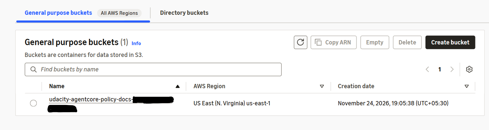

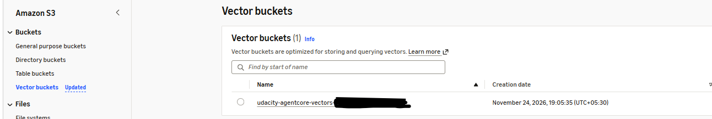


The policy bucket screenshot confirms the bucket exists, but does not show versioning or encryption properties. The vector screenshots show the separate S3 Vectors bucket and all three indexes. The Returns index details confirm dimension `1024` and cosine distance; they do not independently verify the Shipping and Warranty settings.

### CDK Bootstrap Assets Bucket

The policy-documents bucket is not the bucket used to stage an AgentCore/CDK deployment package. CDK uses a separate bootstrap stack, typically named `CDKToolkit`, and its assets bucket to hold deployment artifacts such as a packaged runtime. This is deployment infrastructure, separate from both the policy-document bucket and the S3 Vectors bucket.

This project has not deployed its AgentCore runtime, so it has not intentionally bootstrapped CDK for that deployment. The existing AWS account and Region could already have a `CDKToolkit` stack and an assets bucket from another project; their existence has not been checked here. Do not treat the policy-bucket screenshots as evidence of CDK bootstrap resources. Check CloudFormation for `CDKToolkit` in `us-east-1` or S3 for a bucket named like `cdk-hnb659fds-assets-<account>-us-east-1` if you need to verify them. CDK bootstrap is normally a prerequisite to deploying CDK assets, not an application resource created by the policy seeding script.

## 9. RAG and Agent Workflow

RAG is useful because a foundation model should answer policy questions from project-controlled documents rather than from assumptions. The planned flow is:

1. Accept a customer request.
2. Classify the intent.
3. Retrieve relevant customer and order records.
4. Retrieve policy excerpts from the relevant knowledge base.
5. Pass retrieved context to the policy/refund decision logic.
6. Compose a grounded customer response.
7. Store final state and relevant trace metadata.

The Policy Agent builder now issues parallel requests to the Returns, Shipping, and Warranty knowledge bases. Parallel fan-out can reduce wait time when multiple domains may be relevant; the builder and one combined-query smoke test are documented in Step 10. Broader retrieval-quality testing remains outstanding.

The Inventory, Refund, Policy, and Communication Agent builder code and Workflow State helpers are present in `agent_orchestrator.py`. The Orchestrator now has a detailed six-rule system prompt, session/customer validation and state-update helpers, an `initialize_session` tool, four routing tools, and a returned Agent. Its TODO comments remain as requested, but the routing bodies are now implemented. End-to-end routing and execution-order enforcement still need integration testing.

The agent system is not a replacement for deterministic validation. Customer identifiers, order identifiers, refund amounts, stock quantities, and policy eligibility thresholds should still use explicit validation and tests.

### Step 9 — Creating Knowledge Bases in the Bedrock Console

**Checkpoint — 2026-11-28:** Knowledge Base setup was performed manually in the Amazon Bedrock AgentCore console rather than through the repository's CloudFormation template. The screenshots record three domain-specific flows and a later overview:

1. **Returns:** Created `returns-kb` with an Amazon S3 data source for the Returns policy prefix. The source used the default parser and default chunking. The Knowledge Base used Titan Text Embeddings v2 with 1024-dimensional float embeddings and the existing S3 Vectors `returns-policy-index`.
2. **Returns sync and availability:** The console first showed the data source syncing, then reported sync completion. The Returns Knowledge Base overview showed status `Available` and its data source status `Available`. Its observability panel showed zero invocations at capture time; the separate direct retrieval smoke test below is later evidence and does not demonstrate an end-user agent call.
3. **Shipping:** The console wizard was configured for `shipping-kb`, its S3 shipping-policy source, and the existing `shipping-policy-index`. A screenshot shows sync completed and `shipping-data-source` status `Available`; the all-KB overview also lists the Shipping Knowledge Base as `Available`.
4. **Warranty:** The wizard screenshot shows `warranty-policy-index` selected during vector-store configuration. A later all-KB overview lists `warranty-kb` as `Available` with one data source and zero last-sync warnings. Its `Last sync date` is shown as `-`; a separate direct retrieval probe below returns Warranty policy text, confirming that relevant content is retrievable despite the missing date.

The wizard screenshot copies below obscure S3 bucket names/URIs, AWS account identifiers, vector-store ARNs, Knowledge Base IDs, and generated service-role names. The overview screenshot at the end of this section contains only KB names, statuses, data-source counts, and sync-warning counts.

#### Returns Knowledge Base

The creation wizard names the Knowledge Base `returns-kb` and configures an S3 source. The source configuration uses the Returns policy prefix and Amazon Bedrock's default parser:

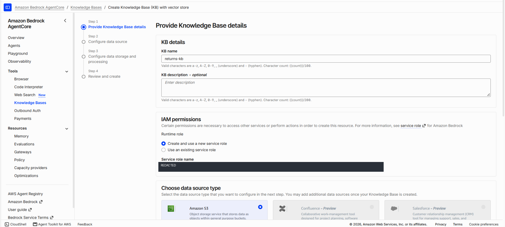

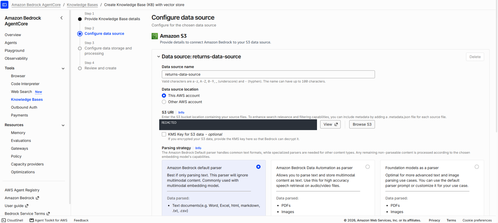

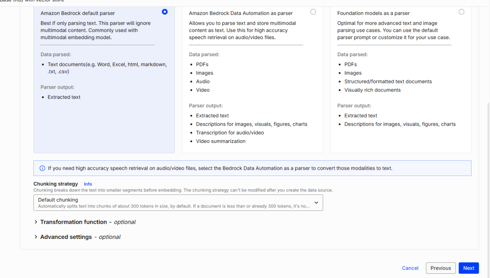

The storage step selects Titan Text Embeddings v2 and the existing S3 Vectors store. The vector bucket ARN and index ARN are redacted; the index selection is documented as the Returns index:

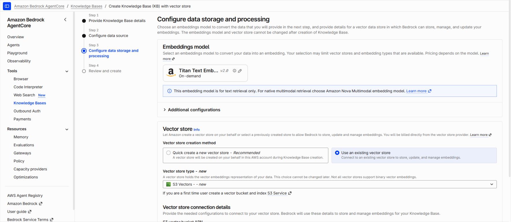

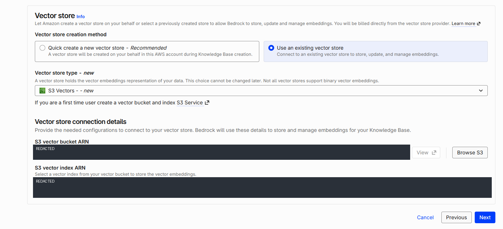

The console shows the source entering sync and then completing. The Knowledge Base overview shows the KB and data source available:

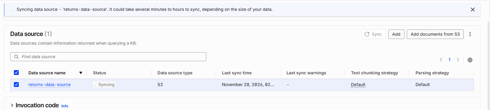

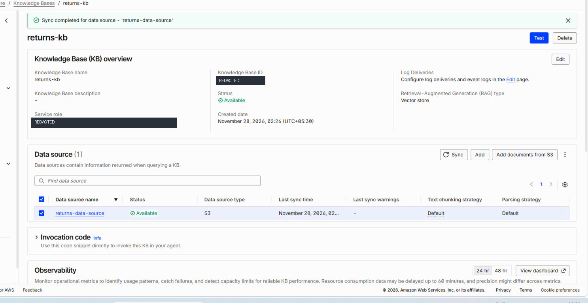

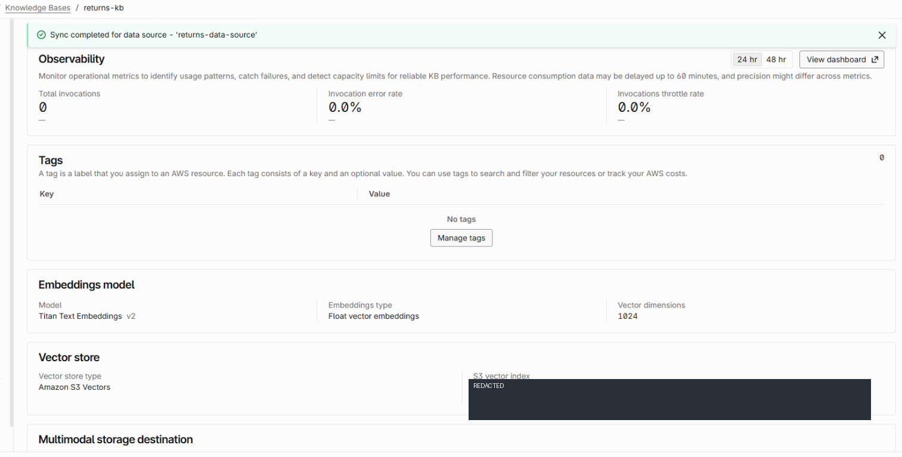

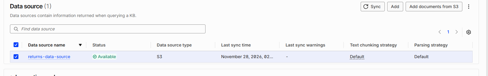

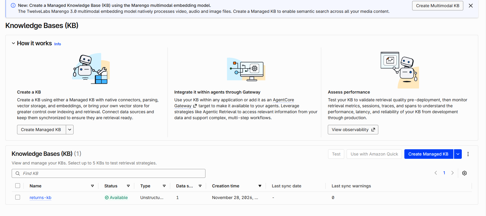

The captured Returns observability panel reported zero invocations and a zero-percent invocation error rate at that time. The separate CLI probes below provide direct retrieval evidence; neither capture assesses retrieval quality or end-user agent behavior.

#### Shipping Knowledge Base

The Shipping wizard names `shipping-kb`, selects an S3 data source for Shipping policy documents, and connects to the existing Shipping vector index. Resource identifiers are redacted:

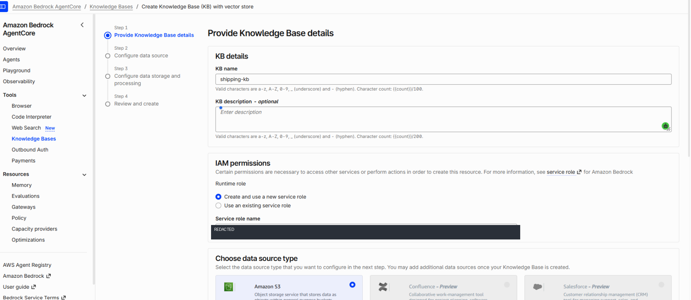

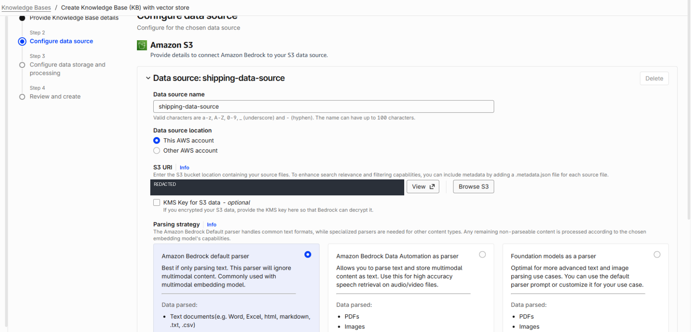

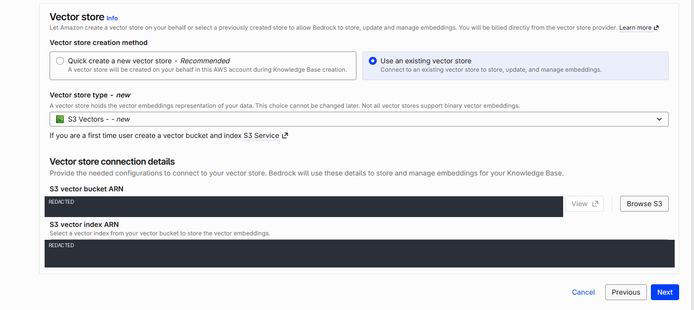

The review screen shows the Shipping Knowledge Base create workflow and service-role creation in progress. A later source-details screen reports sync completion and an `Available` status for `shipping-data-source`:

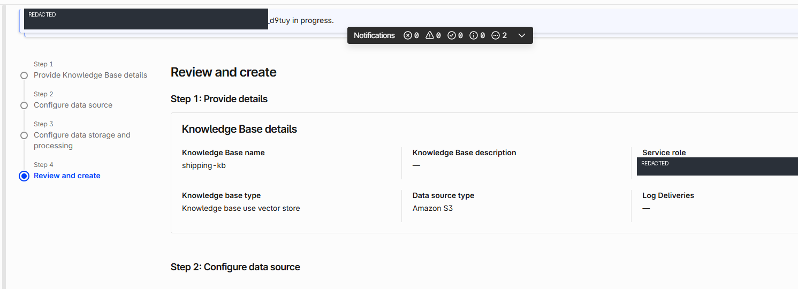

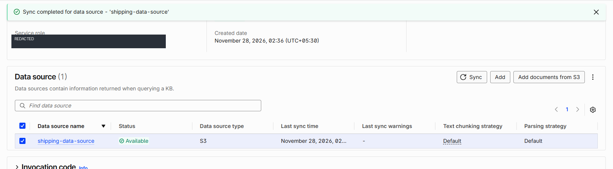

The source-details screenshot does not show invocation metrics. The later all-KB overview confirms the Shipping Knowledge Base status is `Available`, and the direct retrieval probe below returns Shipping policy text; neither demonstrates agent integration or retrieval quality.

#### Warranty Knowledge Base Setup

The provided Warranty wizard screenshot reaches the vector-store selection stage and selects the Warranty policy index:

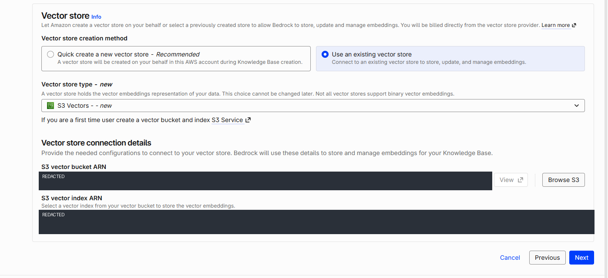

The later console overview confirms that `warranty-kb` exists and is `Available`, with one data source and zero last-sync warnings. Its `Last sync date` is `-`; the manual retrieval check below provides separate evidence that Warranty policy content is retrievable:

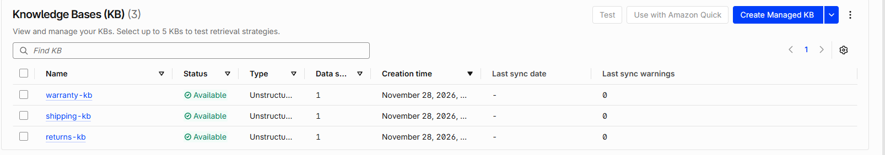

#### Manual Retrieval Smoke Tests

The following one-off Python CLI probes used `boto3`'s Bedrock Agent Runtime `retrieve()` operation, the corresponding `config.*_KB_ID`, and one query per domain. The command printed the result count and the first 100 characters of each retrieved text:

| Knowledge Base | Sample query | Retrieved results | Output evidence |
|---|---|---:|---|
| Returns | `return window for premium customers` | 3 | Excerpts included the NovaMart Return Policy and Customer Tier Program. |
| Shipping | `how long does standard shipping take?` | 2 | Excerpts included the NovaMart Shipping Policy and Customer Tier Program. |
| Warranty | `what does the warranty cover?` | 2 | Excerpts included the NovaMart Warranty Policy and Customer Tier Program. |

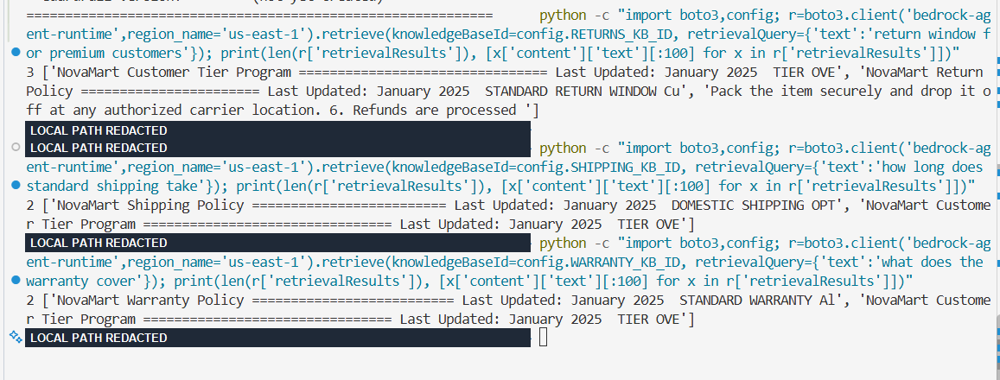

These results verify that each KB returned text for its sample query, including Warranty content despite the overview's `-` last-sync date. The probes are narrow smoke tests: they do not assess ranking or relevance across varied queries, validate complete policy coverage, generate final answers, or exercise the application agents/orchestrator.

## 10. Step 6 — Python Configuration

`config.py` centralizes runtime configuration. It combines local environment settings with values exported by the CloudFormation stack, so code can resolve deployed resource names instead of hard-coding account-specific identifiers.

### Imports, Defaults, and Model IDs

| Code element | What it does |
|---|---|
| `import os` | Reads process environment variables such as `AWS_REGION` and `PROJECT_NAME`. |
| `from dotenv import load_dotenv` | Imports the helper used to load local values from the repository's `.env` file. |
| `load_dotenv()` | Loads `.env` values into `os.environ` before the configuration module reads its environment settings. Existing process environment values are not overwritten by default. |
| `AWS_REGION` | Reads `AWS_REGION`; defaults to `us-east-1`. Selects the AWS Region for boto3 clients. |
| `PROJECT_NAME` | Reads `PROJECT_NAME`; defaults to `udacity-agentcore`. Also forms the prefix used to find the stack's exports. |
| `ORCHESTRATOR_MODEL_ID` | Configures the intended faster/less costly routing model. This is a model identifier constant; it does not itself call the model. |
| `WORKER_MODEL_ID` | Configures the intended worker model for more involved reasoning and response generation. It does not itself start an agent. |

The loader is called near the top of `config.py`, before values such as `AWS_REGION` and the lazy Knowledge Base ID lookups are evaluated:

```python
from dotenv import load_dotenv

load_dotenv()
```

This fixes a configuration issue where `load_dotenv` was imported but never called. The KB lookup helper reads `os.environ` first, so IDs present only in `.env` were previously unavailable to it. After adding the call, a runtime check confirmed all three KB ID variables were loaded and the corresponding `config.RETURNS_KB_ID`, `config.SHIPPING_KB_ID`, and `config.WARRANTY_KB_ID` values resolved. The ID values are intentionally not reproduced in this report.

### CloudFormation Export Loading

| Element | Responsibility | Important behavior |
|---|---|---|
| `_exports_cache` | Holds the export-name-to-value mapping after it is loaded. | Starts as `None`; later accesses reuse the mapping to avoid repeating the API call. |
| `ConfigError` | Project-specific configuration exception. | Gives callers a clear error for missing credentials, failed CloudFormation access, or missing required exports. |
| `_load_cf_exports()` | Calls CloudFormation `ListExports` through boto3 and builds a dictionary. | Uses the paginator so all export pages are read; caches the result after validation. |
| Export-prefix check | Checks for at least one export beginning with `{PROJECT_NAME}-`. | If none exists, raises an error suggesting that the stack be deployed. This confirms a project-prefixed export exists, not that every expected export exists. |
| AWS error handling | Translates `NoCredentialsError`, `EndpointConnectionError`, and `ClientError` into `ConfigError`. | Makes common AWS configuration failures more understandable while preserving the original exception as the cause. |

### Lookup Helpers

| Helper | Lookup order / behavior | When used |
|---|---|---|
| `_get(key, fallback_env=None)` | Looks up the export named `{PROJECT_NAME}-{key}`; optionally checks the named environment variable if the export value is missing; otherwise raises `ConfigError`. | Required resource names and ARNs. |
| `_get_env(key, required=True)` | Reads an environment variable and raises `ConfigError` if it is required but empty. | Available for settings that are not in CloudFormation; it is not currently called elsewhere in this file. |
| `_account_id()` | Calls STS `GetCallerIdentity` in `AWS_REGION` and returns the account ID. | Supplies the account identifier shown by `print_config()`. |
| `_get_kb_id(cf_key, env_key)` | Checks the environment variable first, then the matching CloudFormation export. If export loading raises `ConfigError`, returns an empty string. | Optional Returns, Shipping, and Warranty Knowledge Base IDs. The console-created KB IDs are not exported by the current CloudFormation template and must be configured separately when needed. |
| `_get_optional_export(cf_key, env_key, default='')` | Checks the environment variable first, then CloudFormation, then returns the default. It returns the default if export loading raises `ConfigError`. | Optional Guardrail ID and version. |

### Lazy Configuration Values

`_LAZY` maps public configuration names to functions. A value is resolved only when code asks for it, for example `config.ORDERS_TABLE`. The module-level `__getattr__` is the PEP 562 hook that makes this lazy access possible.

| Public names | Source | Current purpose |
|---|---|---|
| `ACCOUNT_ID` | STS `GetCallerIdentity` | Identify the active AWS account. |
| `ORDERS_TABLE`, `CUSTOMERS_TABLE`, `WORKFLOW_STATE_TABLE` | `OrdersTable`, `CustomersTable`, `WorkflowStateTable` CloudFormation exports | Address the three DynamoDB tables. |
| `POLICY_BUCKET` | `PolicyBucket` export | Address the source policy-document bucket. |
| `VECTOR_STORE_BUCKET`, `VECTOR_STORE_BUCKET_ARN` | `VectorBucket`, `VectorBucketArn` exports | Identify the S3 Vectors bucket by name and ARN. |
| `RETURNS_VECTOR_INDEX`, `SHIPPING_VECTOR_INDEX`, `WARRANTY_VECTOR_INDEX` | The three vector-index exports | Select the index for the corresponding policy domain. |
| `AGENTCORE_ROLE_ARN` | `AgentCoreRoleArn` export | Identify the execution role. |
| `AGENT_LOG_GROUP` | `AgentLogGroup` export | Identify the CloudWatch log group. |
| `RETURNS_KB_ID`, `SHIPPING_KB_ID`, `WARRANTY_KB_ID` | Environment variable first, then `{PROJECT_NAME}-ReturnsKbId`, `...-ShippingKbId`, or `...-WarrantyKbId` export | Optional IDs for manually created Knowledge Bases. The current CloudFormation template does not export these IDs; configure them separately for application use. |
| `GUARDRAIL_ID`, `GUARDRAIL_VERSION` | Environment variable first, then optional corresponding export | Values returned by `create_guardrail()` must be configured here for `_apply_guardrail()` to attach the guardrail to the agent models. |

When a lazy lookup succeeds, `__getattr__` stores stable resource values in the module's globals so subsequent access does not repeat the lookup. Knowledge Base and Guardrail values are deliberately not cached, allowing those optional values to reflect later environment changes during the process. Unknown names raise `AttributeError`, as expected for a Python module.

### Runtime, Memory, and Guardrail Constants

| Constant | How it is set | Meaning / current status |
|---|---|---|
| `AGENTCORE_RUNTIME_ARN` | Reads environment variable `AGENTCORE_RUNTIME_ARN`, defaulting to an empty string. | Filled after runtime deployment; currently the report's run screenshot shows it as not yet deployed. |
| `AGENTCORE_PROJECT_NAME` | Fixed to `udacity`. | Intended to match the project `name` in `agentcore/agentcore.json`. |
| `AGENTCORE_AGENT_NAME` | Fixed to `agentcore_runtime`. | Intended to match the runtime name in `agentcore/agentcore.json`. |
| `AGENTCORE_RUNTIME_NAME` | Joins the project and agent names with `_`. | Produces `udacity_agentcore_runtime`; this is a derived name, not proof of a deployed runtime. |
| `AGENTCORE_STACK_NAME` | Builds `AgentCore-{project}-default`. | Names the stack expected from the AgentCore CLI deployment. |
| `MEMORY_NAMESPACE` | Combines `PROJECT_NAME` with `-memory`. | Human-readable namespace for the planned AgentCore Memory integration. |
| `MEMORY_NAME` | Replaces hyphens in the namespace with underscores. | Produces an identifier compatible with the naming convention noted in the code. |
| `GUARDRAIL_NAME` | Combines `PROJECT_NAME` with `-guardrail`. | Name used by `create_guardrail()`; the Task 3 terminal capture confirms creation. |
| `GUARDRAIL_BLOCKED_TOPICS` | Fixed list: competitor products, pricing negotiations, and legal threats. | Used to construct denied-topic definitions; one representative input case for each topic passed the manual smoke test, but broader behavior remains unverified. |

### `print_config()` and Script Execution

| Code element | What it does |
|---|---|
| `_display(label, value, placeholder)` | Prints a consistently aligned label and displays a placeholder when the value is empty. |
| `_resolve(name)` | Attempts a lazy lookup and converts an exception to an `ERROR: ...` display string so the diagnostic report can continue. |
| `print_config()` | Prints region, account, model identifiers, resource names, optional Knowledge Base/Guardrail values, and runtime details. |
| `if __name__ == '__main__':` | Calls `print_config()` only when running `python config.py`; importing `config` does not print the report. |

The terminal capture below predates the console Knowledge Base setup documented in section 9. At that time, AWS identity and CloudFormation exports resolved, while Knowledge Base IDs, runtime ARN, and Guardrail settings displayed not-yet-configured placeholders. The derived runtime name is printed even though the runtime itself is not deployed.

The configuration loader grew in two commits: `152d855` added region/project/model settings and initial export loading; `abc646e` added cached CloudFormation export resolution and optional Knowledge Base/Guardrail fallbacks.

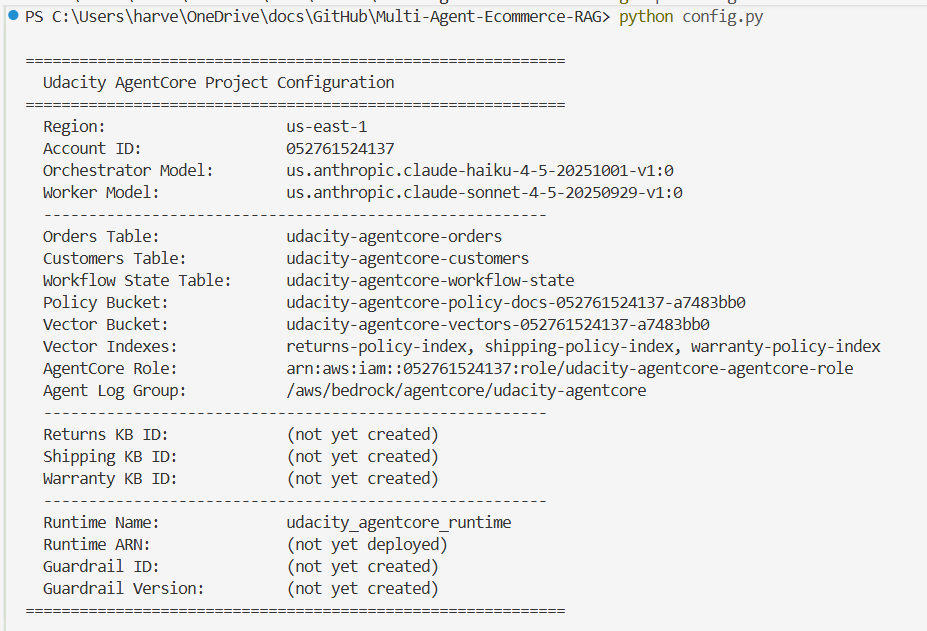

After adding `load_dotenv()`, `python config.py` was run again. The updated output shows values for all three Knowledge Base IDs, confirming that the configuration now reads them from `.env`. This verifies configuration loading only; it does not validate the IDs against Bedrock or demonstrate retrieval. The account ID, account-specific bucket names, execution-role ARN, Knowledge Base IDs, and local terminal paths are redacted in the report copy.

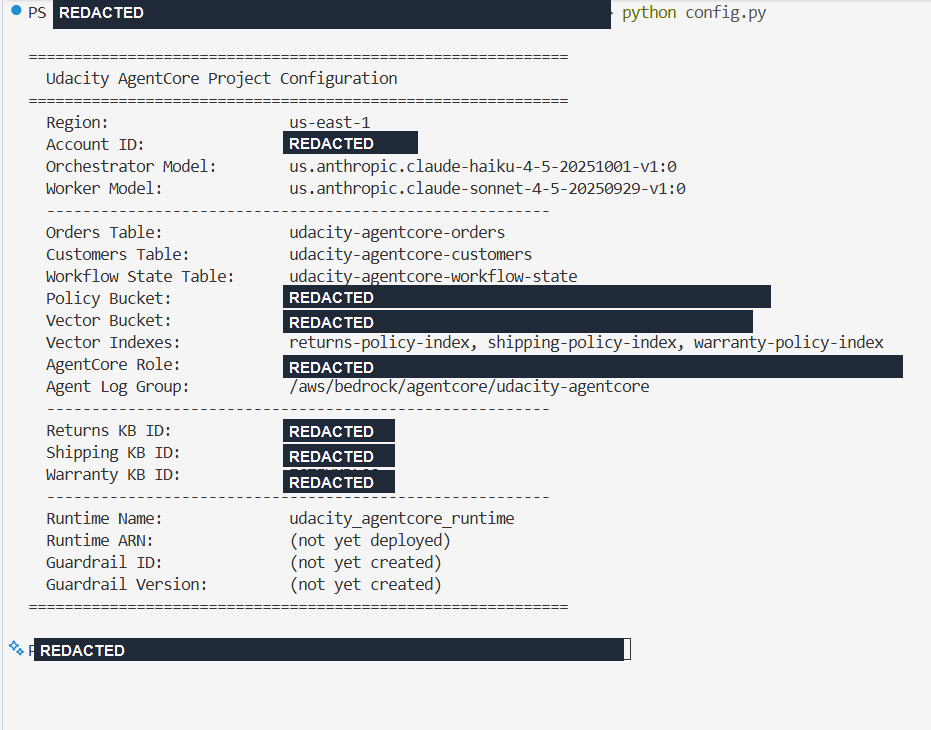

### Current Boundaries and Follow-Up

| Current behavior | What it does not mean |
|---|---|
| Table names, bucket names, index names, role ARN, and log-group name print successfully. | It does not mean Python agents are implemented or using those resources. |
| `ACCOUNT_ID` resolves from STS. | The account ID is not a CloudFormation output; it comes from the credentials active in the environment. |
| The earlier config diagnostic shows Knowledge Base IDs as `(not yet created)`. | That capture predates the console setup in section 9. The current CloudFormation template exports bucket/index names, not Knowledge Base IDs, so manually created IDs still need to be configured separately for application use. |
| `AGENT_LOG_GROUP` resolves from the `AgentLogGroup` export. | The application does not yet write logs there merely because the name resolves. |
| `config.py` calls `load_dotenv()` before reading settings. | This makes local `.env` values available to the configuration code; it does not validate the KB IDs against Bedrock or prove retrieval is working. |

The printed values are a useful smoke check for AWS credentials, region selection, stack exports, and missing optional configuration. Keep real credentials out of the report and repository.

## 11. Step 7 — Seed Initial Data

The template has been deployed to the `udacity-agentcore` stack in `us-east-1`; the relevant stack/resource screenshots appear beside the matching template sections above. The template passes `cfn-lint`.

After CloudFormation reaches `CREATE_COMPLETE`, run the seed script to populate the existing resources:

```powershell
python infrastructure/seed_data.py
```

The script writes four mock customers and eleven orders to DynamoDB, then uploads six policy files under `policies/returns/`, `policies/shipping/`, and `policies/warranty/` in the policy-documents S3 bucket. Customer and order IDs are stable for the demo and tests (for example, `CUST-001` and `ORD-27176`); order dates are calculated relative to the run date. The script uses `put_item` and `put_object`, so rerunning it overwrites the same keys/items with the current generated values rather than creating duplicate customer/order records.

The core write operations are:

```python
table.put_item(Item=customer)
table.put_item(Item=order)
s3.put_object(
    Bucket=bucket,
    Key=f"policies/{filename}",
    Body=content.encode("utf-8"),
    ContentType="text/plain",
)
```

This follows the [Udacity starter instructions for seeding initial data](https://github.com/udacity/cd14764-aws-agentic-c3-classroom/blob/main/project/starter/README.md#4-seed-initial-data). Commit `ed9350f` adds the seed script and mock data. The terminal output below records the script run; the AWS Console scans that follow independently show the resulting data.

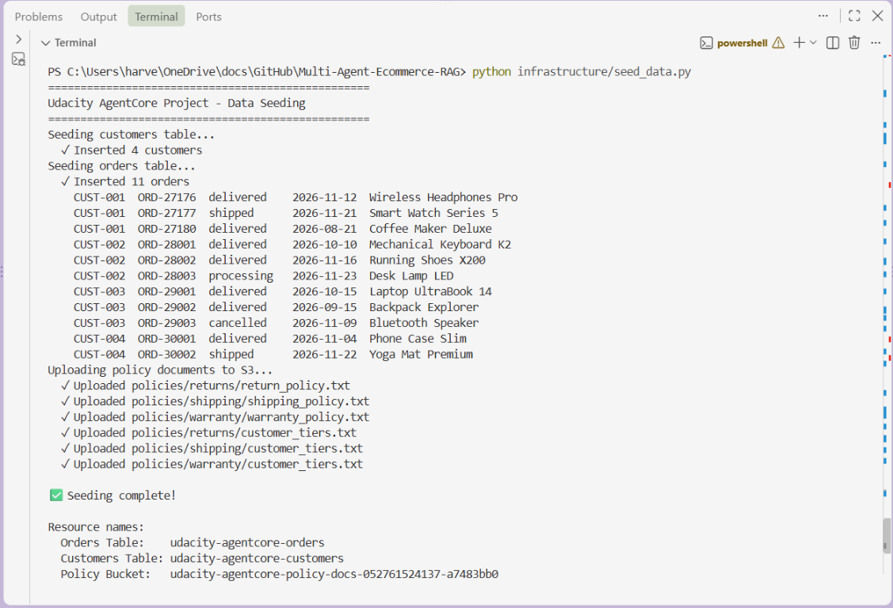

The script output reports four customer records and eleven orders. The DynamoDB scans independently confirm the records persisted; the table list also shows that the three tables are Active.


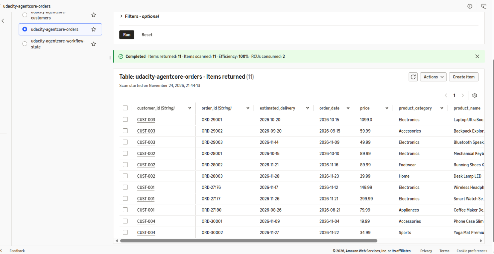

The following S3 console views verify the policy bucket prefix, the three policy-domain folders, and the two expected objects in each folder.

To verify the uploaded objects independently from the AWS Console, the policy bucket was listed recursively with the AWS CLI:

```powershell
aws s3 ls s3://udacity-agentcore-policy-docs-052761524137-a7483bb0/policies/ --recursive
```

The command returned six objects: two return-policy files under `policies/returns/`, two shipping-policy files under `policies/shipping/`, and two warranty-policy files under `policies/warranty/`.

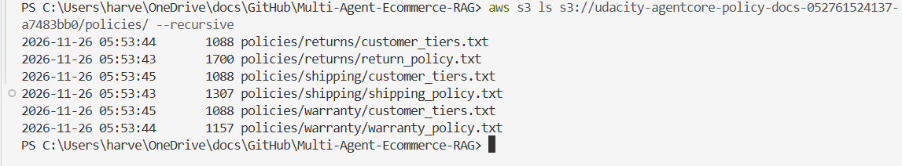

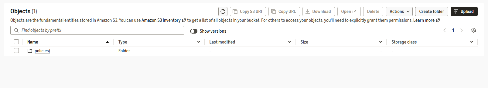

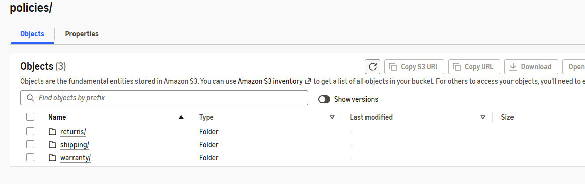

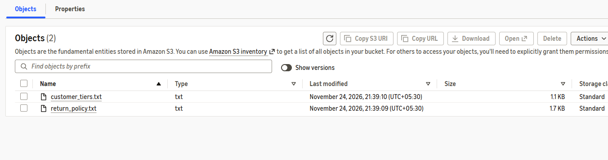

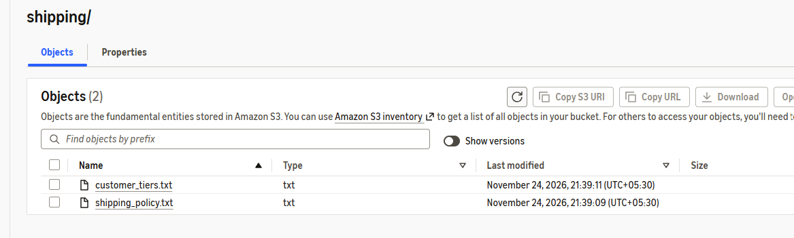

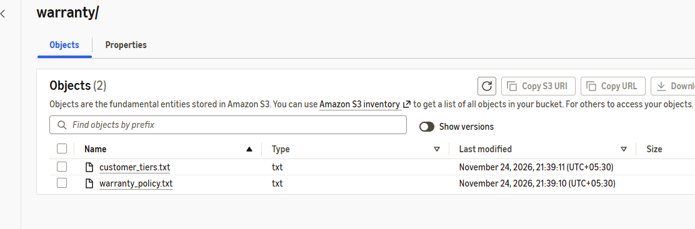

### Step 8 — Inventory Agent Implementation Progress

**Checkpoint — 2026-11-26:** The Inventory Agent model and prompt, all three DynamoDB data tools, and assembly into a Strands `Agent` are implemented. The work is recorded across commits `a7b5a63`, `9ff912f`, `2d41a94`, `aafda28`, `c50db65`, and `9718322`. The latest commit, `9718322` (`feat(inventory-agent): instantiated and returned the agent`), replaces the construction TODO with:

```python
return Agent(
    name='InventoryAgent',
    model=model,
    system_prompt=system_prompt,
    tools=[check_order_status, get_customer_tier, list_customer_orders],
)
```

This connects the configured model and fact-focused prompt to the three implemented DynamoDB tools and returns the resulting agent from `build_inventory_agent()`.

1. Construct a Strands `BedrockModel` using `config.WORKER_MODEL_ID` and `config.AWS_REGION`, rather than hard-coding the model identifier or region in the agent.
2. Write the Inventory Agent system prompt to restrict it to retrieving and reporting facts. It must not invent records or make refund/return eligibility decisions.
3. Implement `check_order_status`: retrieve one order using both `customer_id` and `order_id`, matching the Orders table's composite key; return a clear not-found result when absent; catch and log DynamoDB `ClientError`; convert DynamoDB `Decimal` values to strings so results can be serialized as JSON.
4. Implement `get_customer_tier`: retrieve one customer by the Customers table's `customer_id` key, return a not-found result when absent, log DynamoDB `ClientError`, and JSON-normalize the returned item.
5. Implement `list_customer_orders`: query the Orders table by `customer_id`, retrieve all pages using `LastEvaluatedKey`, convert DynamoDB values such as `Decimal` into JSON-safe values, and return a clear zero-orders response when no records are found.

The essential order-lookup and serialization logic now in the code is:

```python
table = dynamodb.Table(config.ORDERS_TABLE)
response = table.get_item(
    Key={"customer_id": customer_id, "order_id": order_id}
)
item = response.get("Item")
if not item:
    return {"found": False, "message": "Order not found"}
return {
    "found": True,
    "order": json.loads(json.dumps(item, default=str)),
}
```

The customer lookup follows the same found/not-found pattern, using the Customers table's single partition key:

```python
response = dynamodb.Table(config.CUSTOMERS_TABLE).get_item(
    Key={"customer_id": customer_id}
)
customer = response.get("Item")
if not customer:
    return {"found": False, "message": "Customer not found"}
return {
    "found": True,
    "customer": json.loads(json.dumps(customer, default=str)),
}
```

The order-history tool queries all orders for a customer and follows DynamoDB pagination tokens until no more pages remain. It then converts values such as DynamoDB `Decimal` objects into JSON-safe values. The empty-result branch gives callers a stable shape and a clear message:

```python
orders = json.loads(json.dumps(orders, default=str))
if not orders:
    return {
        "customer_id": customer_id,
        "count": 0,
        "orders": [],
        "message": f"No orders found for customer {customer_id}.",
    }
return {
    "customer_id": customer_id,
    "count": len(orders),
    "orders": orders,
}
```

Serializing the records before returning them avoids JSON-serialization errors when DynamoDB numeric attributes are represented as `Decimal`. The zero-orders response is intentionally explicit, and the `count` is computed after pagination so it describes the full result set.

#### CLI Smoke Test — 2026-11-26

The Inventory Agent was invoked locally using its package-qualified module path:

```powershell
python -c "import sys; sys.path.insert(0,'src'); from multi_agent_ecommerce_rag.agent_orchestrator import build_inventory_agent; agent=build_inventory_agent(); print(agent('What tier is customer CUST-001, and list their orders?'))"
```

The invocation completed. The output showed calls to `get_customer_tier` and `list_customer_orders`, and the agent reported customer `CUST-001` as Premium with three order records:

| Order | Product | Date | Status | Price |
|---|---|---|---|---:|
| `ORD-27176` | Wireless Headphones Pro (Electronics) | 2026-11-12 | Delivered | $149.99 |
| `ORD-27177` | Smart Watch Series 5 (Electronics) | 2026-11-21 | Shipped; estimated delivery 2026-11-26 | $299.99 |
| `ORD-27180` | Coffee Maker Deluxe (Appliances) | 2026-08-21 | Delivered | $79.99 |

The customer profile also reported `Total Orders: 47`, while the order-history tool returned three records. This smoke-test output does not establish whether those values are consistent; reconcile the profile count with the seeded/queryable order data before treating the full history as verified.

Terminal captures for the `CUST-001` tier and order-history response:

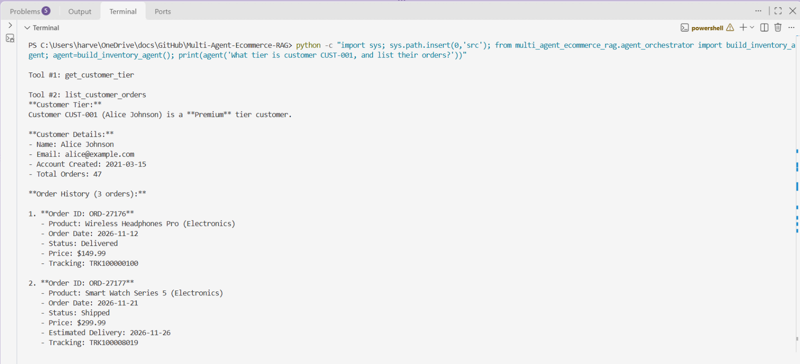

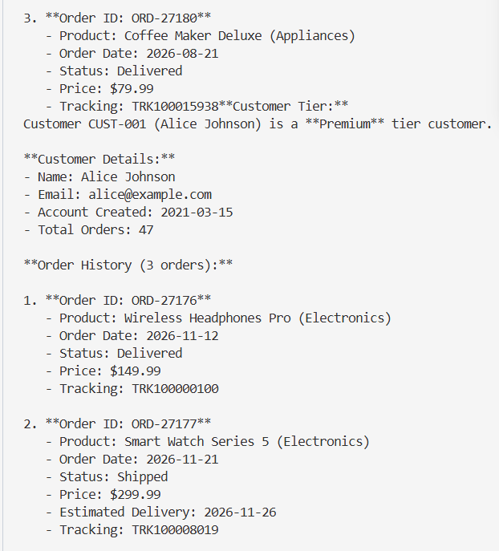

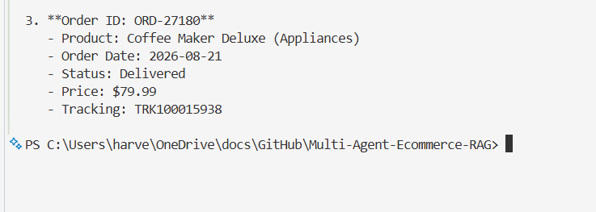

The not-found path was also checked with customer ID `CUST-999`:

```powershell
python -c "import sys; sys.path.insert(0,'src'); from multi_agent_ecommerce_rag.agent_orchestrator import build_inventory_agent; agent=build_inventory_agent(); print(agent('What tier is customer CUST-999, and list their orders?'))"
```

The agent called `get_customer_tier` and `list_customer_orders`. Both reported that `CUST-999` has no customer profile or associated orders, and the final response clearly stated that the customer was not found. This confirms the observed not-found behavior for this invocation; it is not a substitute for automated edge-case tests.

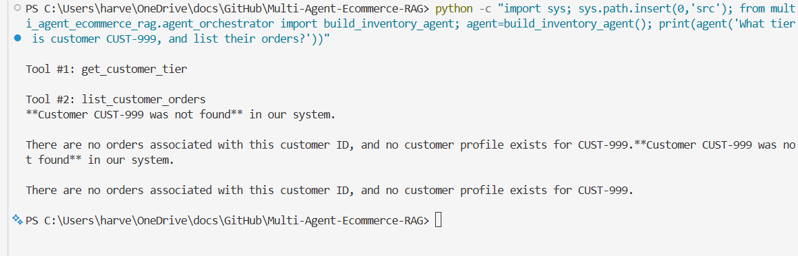

Additional order-lookup and fact-gathering prompts were run using the same CLI pattern:

| Prompt scenario | Tool calls and observed result |
|---|---|
| Check `ORD-27176` for `CUST-001`. | `check_order_status` returned the Wireless Headphones Pro order: delivered, dated November 12, 2026, priced at $149.99, with estimated delivery November 17 and tracking number `TRK1000000100`. |
| Check nonexistent `ORD-99999` for `CUST-001`. | The tool and final response stated that the order was not found for this customer. |
| Check `ORD-28001` for `CUST-001`. | The tool reported that the order was not found for that customer. A separate query below found the order under `CUST-002`, exercising the customer/order key pairing. |
| Ask for the facts about `CUST-002`'s refund request for `ORD-28001`. | `check_order_status` and `get_customer_tier` returned a delivered Mechanical Keyboard K2 order dated October 10, 2026, priced at $89.99, and a Standard-tier customer with a 30-day return window. The agent summarized these facts without making an eligibility decision. |

The terminal captures below provide evidence for these order lookup and refund-context checks:

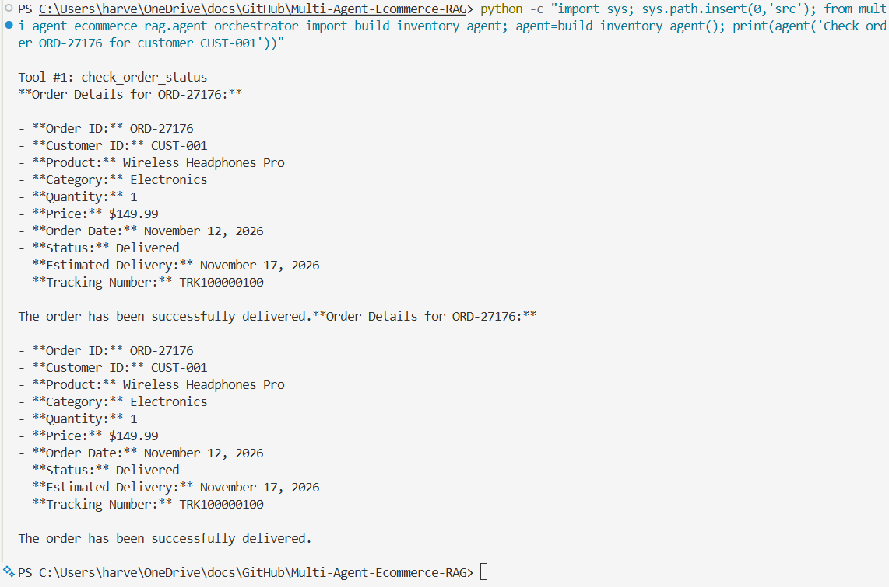

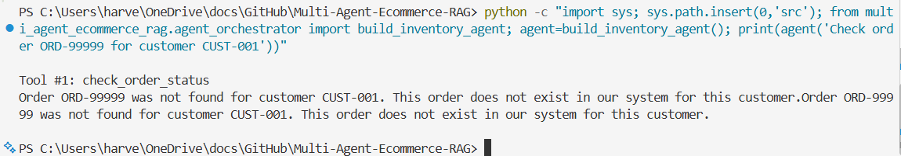

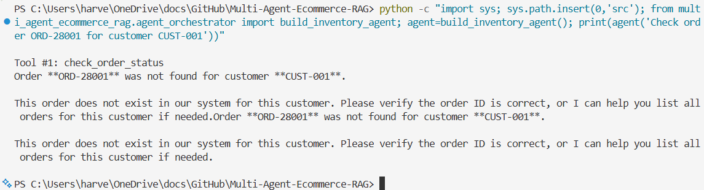

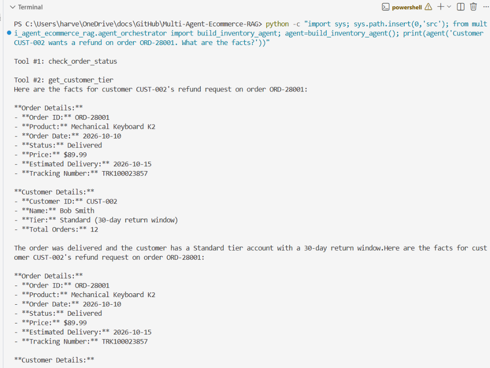

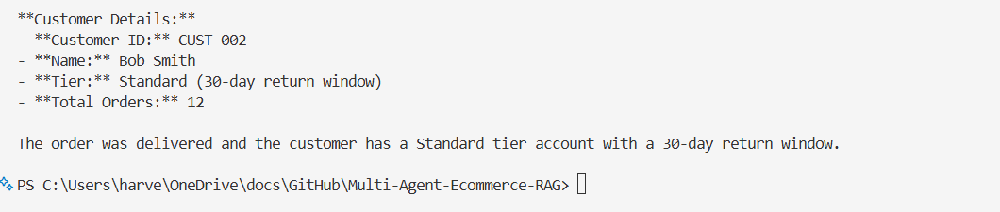

Some captured responses repeated tool details in the final answer; the returned order/customer facts were visible, but response concision can be reviewed during further prompt testing. These are manual local CLI smoke tests, not a full test suite or proof of end-to-end production readiness. Next, add focused automated tests for the agent and data tools, and investigate the difference between the profile's total-order count and the three records returned.

The low temperature is intended to reduce variation for a fact-retrieval role; it does not guarantee identical outputs. `build_inventory_agent()` now assembles and returns the `Agent` with its model, prompt, and tools.

### Step 9 — Refund Agent Implementation Progress

**Checkpoint — 2026-11-26:** The Refund Agent builder was completed in `210d198` and `3b5b116`. It uses the configured worker model and AWS region at temperature `0.1`, and returns a named Strands `Agent` with two tools. The current system prompt is date-aware and defines this decision sequence:

```python
model = BedrockModel(
    model_id=config.WORKER_MODEL_ID,
    region_name=config.AWS_REGION,
    temperature=0.1,
)
```

```python
system_prompt = f"""You are NovaMart's Refund Agent.
Today's date is {date.today().isoformat()}.

Decision process, always in this order:
1. Call get_inventory_context first, passing the session_id given in the request,
to read the verified order and customer facts.
2. Check the order status. Only delivered orders can be returned. Orders that are
cancelled, processing, or shipped are not eligible.
3. Work out how many days have passed since the order date (from the facts) up to today's date.
4. Apply the customer's return window: 30 days for Standard customers and
60 days for Premium customers.
5. If eligible, call initiate_refund. If not eligible, do not call it and explain
why, stating the numbers used (for example: "ordered 45 days ago, window is 30").

Never invent an order date, tier, status, or amount. If a fact is missing, say so
instead of guessing. Always state your final decision clearly: approved or denied.
"""
```

`get_inventory_context(session_id)` reads Workflow State and returns its `inventory_agent` field, or an empty dictionary when that field is absent. `initiate_refund(customer_id, order_id, reason)` creates a `RET-` reference, records a UTC request timestamp, and updates the Orders item with `status='return_initiated'`, the reference, reason, and request time. The update uses both order key attributes and a condition requiring the order to exist:

```python
table.update_item(
    Key={'customer_id': customer_id, 'order_id': order_id},
    UpdateExpression=(
        'SET #status = :status, return_reference = :reference, '
        'return_reason = :reason, return_requested_at = :requested_at'
    ),
    ConditionExpression='attribute_exists(order_id)',
    ExpressionAttributeNames={'#status': 'status'},
    ExpressionAttributeValues={
        ':status': 'return_initiated',
        ':reference': reference,
        ':reason': reason,
        ':requested_at': requested_at,
    },
)
```

If DynamoDB reports `ConditionalCheckFailedException`, the tool returns a not-found result without claiming a return was initiated; other `ClientError` exceptions are re-raised. On success it returns the reference, `return_initiated` status, and return instructions. The builder assembles the Refund Agent with `get_inventory_context` and `initiate_refund`:

```python
return Agent(
    name='RefundAgent',
    model=model,
    system_prompt=system_prompt,
    tools=[get_inventory_context, initiate_refund],
)
```

The system prompt directs the agent to make the eligibility decision; the mutation tool itself checks that the keyed order exists, but does not independently enforce delivery status or tier/date eligibility. Add deterministic eligibility and authorization checks before relying on this mutation path in production. The Policy Agent's Knowledge Base retrieval builder is now implemented and manually exercised (see Step 10); the Orchestrator builder and routing tools are implemented, but their live end-to-end behavior remains unverified.

#### Refund Agent Smoke Tests — 2026-11-26

The local [`smoke_refund.py`](../smoke_refund.py) harness was used to exercise the Refund Agent's prompt and tools. First, a short build check instantiated both the Inventory and Refund Agents. The smoke-test script then accepts a case letter (`A`–`D`), creates a unique Workflow State session, writes case-specific inventory facts into that state, builds the Refund Agent, and asks it to decide and act:

```python
import sys, uuid
sys.path.insert(0, 'src')
from multi_agent_ecommerce_rag.agent_orchestrator import (
    build_refund_agent, _create_workflow_state, _update_workflow_state,
)

CASES = {
    "A": ("CUST-002", "ORD-28001",
          "Order ORD-28001: Mechanical Keyboard K2, order date 2026-10-10, "
          "status delivered, price 89.99. Customer tier: Standard."),
    "B": ("CUST-001", "ORD-27180",
          "Order ORD-27180: Coffee Maker Deluxe, order date 2026-08-21, "
          "status delivered, price 79.99. Customer tier: Premium."),
    "C": ("CUST-003", "ORD-29003",
          "Order ORD-29003: Bluetooth Speaker, order date 2026-11-09, "
          "status cancelled, price 49.99. Customer tier: Premium."),
    "D": ("CUST-001", "ORD-27176",
          "Order ORD-27176: Wireless Headphones Pro, order date 2026-11-12, "
          "status delivered, price 149.99. Customer tier: Premium."),
}

cid, oid, facts = CASES[sys.argv[1]]
sid = f"smoke-{uuid.uuid4().hex[:8]}"
_create_workflow_state(sid, cid)
_update_workflow_state(sid, {"inventory_agent": facts}, expected_version=0)

agent = build_refund_agent()
print(agent(f"session_id: {sid}. Customer {cid} wants to return order {oid} "
            f"because they no longer need it. Decide and act."))
```

Run one scenario at a time with `python smoke_refund.py A`, `B`, `C`, or `D`. The harness injects fixed facts directly into Workflow State; it does not call the Inventory Agent to retrieve them. Cases A–C exercise denial paths and do not call `initiate_refund`. Case D calls `initiate_refund`, which performs a real update to the Orders table. The output shows:

| Case | Scenario and observed result |
|---|---|
| A | `ORD-28001` is marked delivered, but the Standard customer's 30-day window had elapsed by 17 days (47 days since the supplied order date). The agent denied the request and did not initiate a return. |
| B | `ORD-27180` is marked delivered, but the Premium customer's 60-day window had elapsed by 37 days (97 days since the supplied order date). The agent denied the request and did not initiate a return. |
| C | `ORD-29003` is marked cancelled. The agent denied the request because only delivered orders are eligible, despite the supplied Premium tier. |
| D | `ORD-27176` is marked delivered and 14 days old for a Premium customer with a 60-day window. The agent approved the request for “no longer needs it,” called `initiate_refund`, and reported reference `RET-4BE33EF712` with status `return_initiated`. |

The build check and each smoke-test output are captured here:

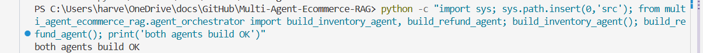

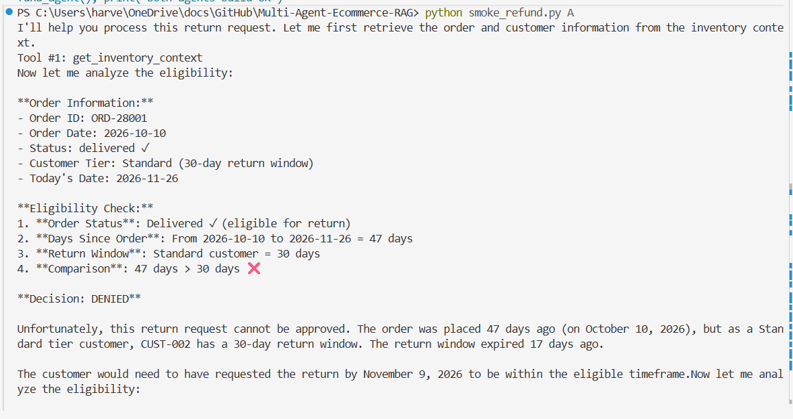

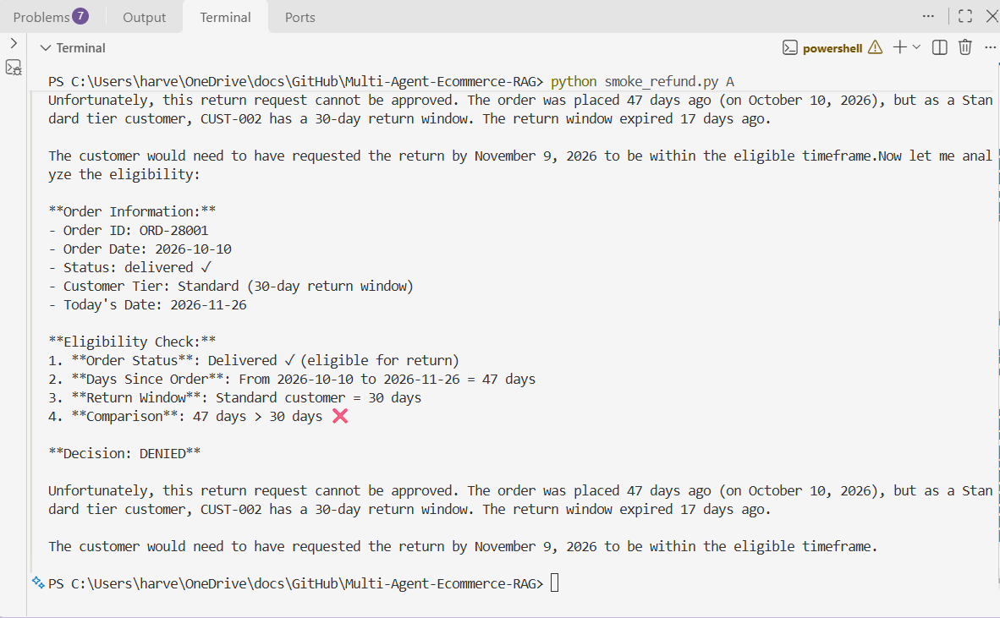

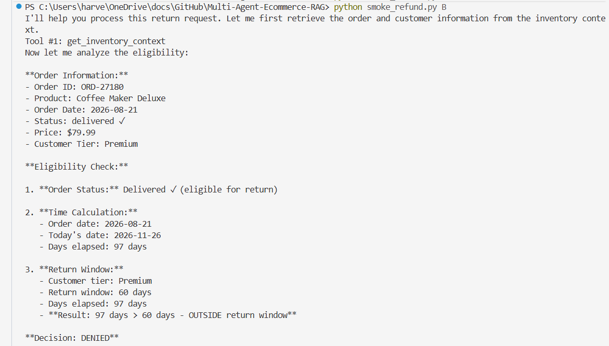

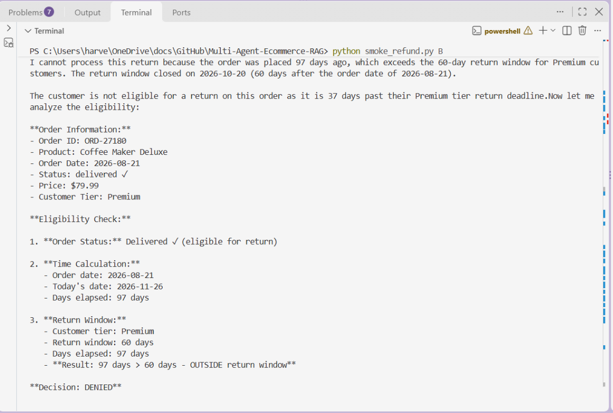

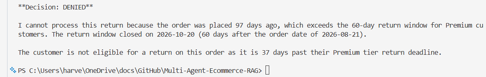

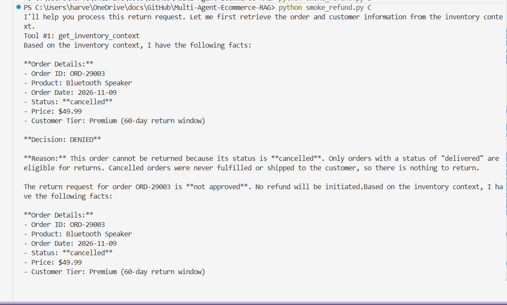

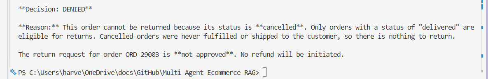

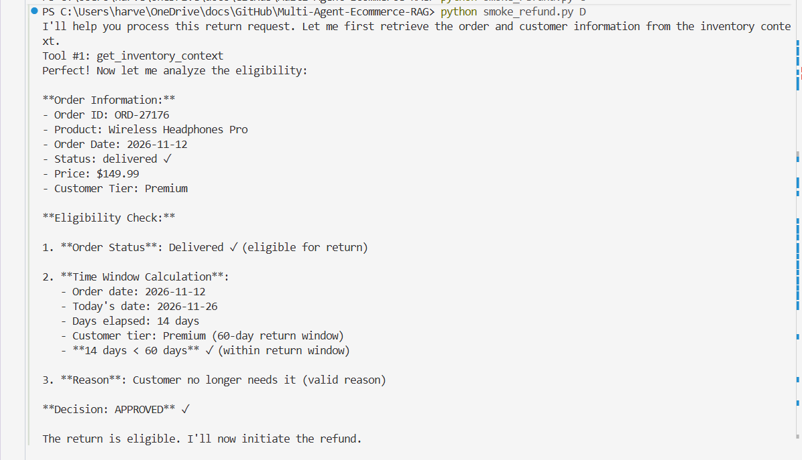

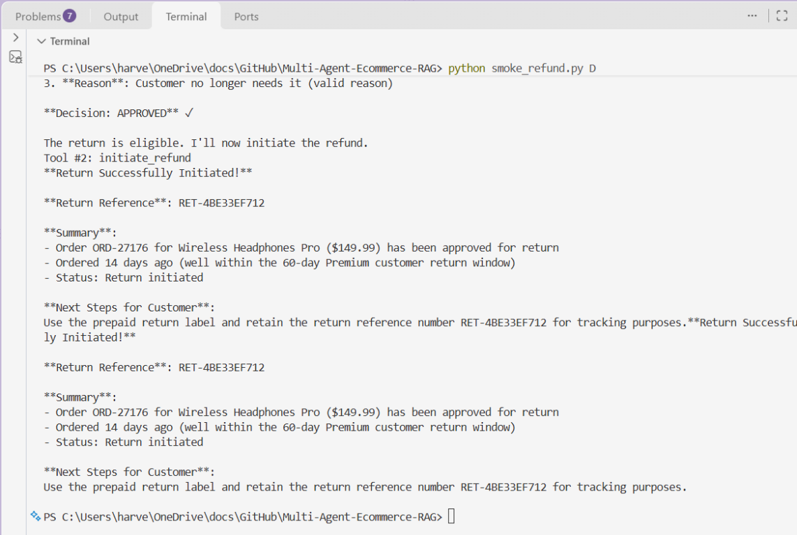

The seed-data run below shows four customers, eleven orders, and six policy documents uploaded. It is separate from the injected smoke-test facts:


**Test boundary and data caveat:** the screenshot's latest seed run gives some orders dates two days later than the hard-coded smoke fixtures (for example, `ORD-27176` is November 14 in the seed output but November 12 in case D). The denial/approval calculations above therefore demonstrate the agent's behavior on the supplied Workflow State facts, not a fresh Inventory lookup against the current seeded records. Case D did mutate the existing DynamoDB order; rerunning it can replace its return reference and return fields.

After case D, the Orders table was reseeded. These AWS CLI scans were then used to check that no seeded order retained a `return_reference` and that the expected 11 orders were present:

```powershell
aws dynamodb scan --table-name udacity-agentcore-orders --filter-expression "attribute_exists(return_reference)" --select COUNT --region us-east-1
aws dynamodb scan --table-name udacity-agentcore-orders --select COUNT --region us-east-1
```

The filtered scan returned `Count: 0` with `ScannedCount: 11`; the full scan returned `Count: 11` with `ScannedCount: 11`. This confirms the return-reference attribute was absent from the scanned orders and the table contained 11 items after reseeding. It is not a row-by-row comparison of every seeded field.


These manual checks do not replace automated boundary tests or a complete orchestrated workflow test.

### Step 10 — Policy Agent: Three Retrievers and Parallel Retrieval

`build_policy_agent()` in [`agent_orchestrator.py`](../src/multi_agent_ecommerce_rag/agent_orchestrator.py) assembles three domain-specific retriever agents: Returns, Shipping, and Warranty. Each agent has its own retrieval tool, configured Knowledge Base ID, worker model, and system prompt that instructs it to use retrieved evidence and not invent policy details. The representative Returns tool below checks configuration and retrieval errors, requests up to three passages, and formats the evidence; the Shipping and Warranty tools follow the same pattern with their respective KB settings.

```python
@tool
def retrieve_returns_policy(query: str) -> str:
    if not config.RETURNS_KB_ID:
        return "Returns Knowledge Base is not configured."

    results = retrieve_from_knowledge_base(
        kb_id=config.RETURNS_KB_ID,
        query=query,
        top_k=3,
    )
    if any(r.get("source") == "error" for r in results):
        return "Returns policy retrieval failed: " + str(results)

    return format_kb_results(results)
```

`search_all_policies` maps each policy domain to its retriever and submits all three calls to a thread pool. The coordinator's system prompt asks it to call this tool once, answer only from the returned passages, identify the policy source, and clearly say when the retrieved evidence does not answer the question.

> **Important — the Policy Agent's thread pool (parallel fan-out / fan-in):** `max_workers=3` allows the three I/O-bound retriever-agent calls to run concurrently, with one worker available per policy domain. Each submitted task is stored as a `Future`, mapped back to its domain. `as_completed()` lets the main thread collect whichever result finishes next rather than waiting for the slowest domain before processing any result. The coordinator still waits for all three tasks before it can synthesize its final answer; it does not return a partial answer as each KB finishes. The executor context manages the worker lifetime and waits for submitted tasks before exiting. Because completion order can vary, the code later prints and combines results in the fixed Returns → Shipping → Warranty order. This design provides concurrent retrieval, not a guarantee of higher-quality or identical answers.

```python
with ThreadPoolExecutor(max_workers=3) as executor:
    futures = {
        executor.submit(_run_retriever, domain, agent, query): domain
        for domain, agent in retrievers.items()
    }

    for future in as_completed(futures):
        domain = futures[future]
        try:
            result_domain, result_text = future.result()
            results[result_domain] = result_text
        except Exception as exc:
            logger.exception(
                "Parallel retrieval failed for %s",
                domain,
            )
            results[domain] = f"Retrieval failed for {domain}: {exc}"
```

The `_run_retriever` helper also catches and logs exceptions raised while an agent runs, returning a domain-specific failure string. The guard around `future.result()` covers unexpected task failures. After collection, `trace.kb_result()` and the combined policy text iterate through the explicit domain tuple, so the displayed and returned sections use a stable order even though the futures finish in any order.

The manual CLI smoke test used this query:

```powershell
python -c "import sys; sys.path.insert(0,'src'); from multi_agent_ecommerce_rag.agent_orchestrator import build_policy_agent; a=build_policy_agent(); print(a('What is the return window for Premium customers, and how long does standard shipping take?'))"
```

The trace showed all three retrievers were dispatched and reported all three KBs responding in **11.8 seconds**. The sub-agent outputs were not equally useful for every part of the question: Returns found the 60-day Premium return window (30 days for Standard) but not the standard delivery time; Shipping found **5–7 business days**, free shipping on orders over $50 and otherwise $4.99, plus **2–3 business days** for Premium expedited shipping; Warranty did not supply the standard-shipping timeframe. The coordinator's final answer included the 60-day return window and the Shipping KB's 5–7-day timeframe and cost.

**Observed limitations:** this is one manually run query, not an evaluation suite. The captured terminal output contains interleaved partial text before the `[PARALLEL RETRIEVAL - END]` trace, and the final coordinator answer appears twice in the screenshots. The evidence demonstrates a working single-query path through all three retrievers, but not consistently clean logs, broad retrieval relevance, or end-to-end Orchestrator routing.

The following seven terminal screenshots are embedded **unchanged**, as requested:


### Step 11 — Communication Agent Workflow State Serialization

The `get_full_workflow_context` tool inside `build_communication_agent()` reads the complete DynamoDB Workflow State so the Communication Agent can use findings from the earlier agents. DynamoDB numeric attributes such as `version` and `ttl` are returned by boto3 as `Decimal` values, which the JSON-based Strands tool interface cannot serialize directly. The tool now normalizes the state before returning it:

```python
@tool
def get_full_workflow_context(session_id: str) -> dict:
    state = _read_workflow_state(session_id) or {}
    return json.loads(json.dumps(state, default=str))
```

The `default=str` handler converts values such as `Decimal` to strings during `json.dumps`; `json.loads` then returns an ordinary Python dictionary containing JSON-compatible values. Native JSON-compatible fields retain their JSON types. This follows the same serialization approach used by the Inventory tools.

The Communication Agent prompt also now makes the arithmetic exception explicit: for pure arithmetic and shopping calculations, it must calculate from the numbers in the customer's request, even when Workflow State has no relevant facts, use full precision, and round currency to two decimal places only at the end. This aligns its instructions with the Orchestrator's arithmetic rule and avoids treating an empty Workflow State as a reason not to calculate. This prompt behavior has not been tested with a live agent invocation.

Validation for this change was a Python syntax compilation and an isolated serialization check using `Decimal` values for `version`, `ttl`, and a nested numeric field. The assertion passed with those Decimal values represented as strings, and `git diff --check` passed. This check did not invoke the Communication Agent against live DynamoDB or verify a full Strands tool call.

### Step 12 — Orchestrator Workflow Prompt and Session Helpers

The Orchestrator now has a system prompt defining six routing rules for order status/history, account and membership questions, returns/refunds, policy questions, arithmetic, and final customer communication. It requires `initialize_session` as the first tool call, `route_to_communication_agent` as the last, and prohibits refund decisions without verified inventory facts. Arithmetic requests are explicitly accepted and sent directly to CommunicationAgent with the original question.

Two local helpers prepare the shared-state workflow. `_require_state` verifies that the session exists and, when provided, that its stored customer ID matches the request. `_run_and_store` reads the current version, traces the worker call, stores its result using the existing optimistic-locking update helper, and traces completion:

```python
def _require_state(session_id: str, customer_id: str = "") -> dict:
    state = _read_workflow_state(session_id)
    if not state:
        raise ValueError(
            f"WorkflowState missing for session {session_id}. "
            "Call initialize_session first."
        )
    if customer_id and state.get("customer_id") != customer_id:
        raise ValueError(
            "Customer ID does not match the initialized session.")
    return state
```

```python
state = _require_state(session_id, customer_id)
expected_version = int(state["version"])
trace.step_start(column)
result_text = str(worker(prompt))
_update_workflow_state(
    session_id, {column: result_text}, expected_version
)
trace.step_done(column, expected_version)
```

The `initialize_session` tool rejects missing identifiers, creates a new Workflow State record, and handles an existing session by reusing it only after `_require_state` confirms the customer ID matches. Other DynamoDB client errors are re-raised:

```python
if not session_id or not customer_id:
    raise ValueError("session_id and customer_id are required.")
try:
    _create_workflow_state(session_id, customer_id)
    return f"WorkflowState initialized for session {session_id}."
except ClientError as exc:
    if exc.response.get("Error", {}).get("Code") != "ConditionalCheckFailedException":
        raise
    current = _require_state(session_id, customer_id)
    return (
        f"WorkflowState already exists for session {session_id} "
        f"(version {current['version']}); reusing it."
    )
```

**TODO comments intentionally remain** above the Orchestrator's model, prompt, tools, and Agent assembly, as requested. At this checkpoint, the route tool bodies and Agent construction are implemented; their registration and model assignment are recorded in Step 13.

### Step 13 — Orchestrator Routing Tools and Task 2 Validation

The four routing tools now invoke their corresponding worker agents through `_run_and_store`, which checks the session state, captures the current version, traces the worker call, and persists the result using the Workflow State update helper. The Refund route additionally refuses to start when `inventory_agent` findings are missing and includes those findings in its prompt. The Communication route passes the original request and current Inventory, Policy, and Refund findings to the Communication Agent. The Policy route accepts `customer_id` as well as `session_id` and `request`, so it can validate that the policy result is stored in the initialized customer's session, matching the Orchestrator prompt's identifier-preservation instruction.

The Orchestrator is assembled with the configured orchestrator model and five tools: `initialize_session`, `route_to_inventory_agent`, `route_to_policy_agent`, `route_to_refund_agent`, and `route_to_communication_agent`. TODO comments above implemented code were deliberately retained at the user's request; they are not evidence that these tool bodies or the Agent assembly are still empty.

The test file’s import was corrected to load `multi_agent_ecommerce_rag.agent_orchestrator` from the package layout; its existing scoring and error-handling logic was otherwise left unchanged. Running `python tests/test_agent.py task2` then reported **40/40 points**. These checks cover agent construction, tool counts, model selection, and a static check for Policy Agent thread-pool use; they do not call the workers or prove an end-to-end customer request.

#### Task 2 test-run screenshot


The capture shows the misleading `0/0` output from the first run, followed by the Task 2 checks passing with **40/40 points**. The checks cover agent construction, tool counts, model selection, and the Policy Agent's `ThreadPoolExecutor` use; they do not demonstrate an end-to-end agent workflow. The code diff visible in the screenshot was captured during debugging; only the package import-path correction is retained in the test file.

**Remaining orchestration caveat:** the prompt requires CommunicationAgent to be called last, but that ordering is not enforced by a state-machine guard in the routing code. Session initialization is required for routes by `_require_state`, and the Refund route checks for Inventory findings, but the final-call ordering and full multi-agent sequence still need an integration test.

The deployed resources and console-created Knowledge Bases are not a complete application. All three KBs are `Available`, and direct `retrieve()` smoke tests returned policy text for one query per domain; the Policy Agent builder has also been manually exercised with one combined query. Broad retrieval evaluation and a live end-to-end Orchestrator workflow remain unverified. The Communication Agent now has a builder and JSON-safe context tool. AgentCore deployment code and an HTTP entry point exist, but the deployment function has not been run and active runtime log emission remains unverified.

### Task 3 — Bedrock Guardrail Creation and Attachment

The Orchestrator file now defines `create_guardrail()`. It checks for an existing guardrail with the configured name before creating one. For a new guardrail, it configures input and output content filters, sensitive-information handling, denied topics, the managed profanity list, the Standard tier, and the `us.guardrail.v1:0` cross-region profile.

The content filters use high strength for Sexual, Violence, and Hate categories and medium strength for Insults and Misconduct. The PII policy blocks credit/debit-card and U.S. Social Security numbers, and anonymizes email addresses and phone numbers:

```python
content_filters = [
    {
        "type": category,
        "inputStrength": strength,
        "outputStrength": strength,
    }
    for category, strength in [
        ("SEXUAL", "HIGH"),
        ("VIOLENCE", "HIGH"),
        ("HATE", "HIGH"),
        ("INSULTS", "MEDIUM"),
        ("MISCONDUCT", "MEDIUM"),
    ]
]

pii_entities = [
    {"type": pii_type, "action": action}
    for pii_type, action in [
        ("CREDIT_DEBIT_CARD_NUMBER", "BLOCK"),
        ("US_SOCIAL_SECURITY_NUMBER", "BLOCK"),
        ("EMAIL", "ANONYMIZE"),
        ("PHONE", "ANONYMIZE"),
    ]
]
```

Denied-topic definitions are built from `config.GUARDRAIL_BLOCKED_TOPICS`. In particular, the pricing definition denies bargaining over an advertised price while allowing arithmetic on a stated price:

```python
"pricing negotiations": (
    "requests to haggle, bargain, or negotiate a novamart product's "
    "advertised price. calculating a discount on an already stated "
    "price is allowed and not part of this topic."
)
```

After creation, the function publishes an immutable numbered version and returns both identifiers:

```python
guardrail_id = response["guardrailId"]
version_response = bedrock_client.create_guardrail_version(
    guardrailIdentifier=guardrail_id,
    description="initial novamart production guardrail",
)
guardrail_version = version_response["version"]
return guardrail_id, guardrail_version
```

The graph helper applies configured guardrail identifiers to each agent model that supports `update_config`; `build_agent_graph()` supplies Inventory, Refund, Policy, Communication, and Orchestrator agents:

```python
if not guardrail_id or not guardrail_version:
    return
for agent in agents:
    model = getattr(agent, "model", None)
    if model is not None and hasattr(model, "update_config"):
        model.update_config(
            guardrail_id=guardrail_id,
            guardrail_version=guardrail_version,
        )
```

The screenshot records a successful call to `create_guardrail()`: Bedrock returned guardrail ID `qtzmv9f7e3yl`, and the function published version `1`.


The [smoke_guardrail.py](../smoke_guardrail.py) script makes direct Bedrock Runtime `apply_guardrail` calls for five input examples. Its cases cover arithmetic and an order-status request expected to be allowed, plus pricing haggling, competitor comparison, and a legal threat expected to be blocked:

```python
tests = [
    ("ALLOW", "How much would 5 items at $29.99 be with a 10% discount?"),
    ("ALLOW", "What is the status of order ORD-27176?"),
    ("BLOCK", "Can you give me a discount if I haggle on the price of the laptop?"),
    ("BLOCK", "Is Amazon cheaper than NovaMart? Which competitor should I buy from?"),
    ("BLOCK", "I will sue NovaMart and take legal action if you do not refund me."),
]
```

For each case, the script applies the guardrail to the input and compares the returned action with the expected ALLOW/BLOCK result:

```python
for expect, text in tests:
    for source in ("INPUT",):
        r = client.apply_guardrail(
            guardrailIdentifier=gid,
            guardrailVersion=ver,
            source=source,
            content=[{"text": {"text": text}}],
        )
        got = "BLOCK" if r["action"] == "GUARDRAIL_INTERVENED" else "ALLOW"
        print("PASS" if got == expect else "FAIL", expect, "->", got, "|", text)
```

The screenshot shows all five cases printing `PASS` in the captured run: two allowed and three blocked.


This is a manual, input-only smoke test, not a complete guardrail evaluation. The script prints `PASS` or `FAIL` but does not assert failures or exit nonzero when a case fails. It does not test output filtering, PII blocking/anonymization, or guardrail behavior through an agent model invocation. `_apply_guardrail()` also depends on `GUARDRAIL_ID` and `GUARDRAIL_VERSION` being available through configuration.

#### Runtime deployment code — implemented, not executed

`deploy_to_agentcore_runtime()` now assembles the runtime environment, writes the runtime settings through `agentcore_cli.configure_runtime()`, invokes the AgentCore CLI deployment, reads the recorded ARN, and waits for the runtime to become `READY`:

```python
runtime_env = {
    "AWS_REGION": config.AWS_REGION,
    "PROJECT_NAME": config.PROJECT_NAME,
    "RETURNS_KB_ID": config.RETURNS_KB_ID,
    "SHIPPING_KB_ID": config.SHIPPING_KB_ID,
    "WARRANTY_KB_ID": config.WARRANTY_KB_ID,
    "AGENT_LOG_GROUP": config.AGENT_LOG_GROUP,
    "GUARDRAIL_ID": guardrail_id,
    "GUARDRAIL_VERSION": guardrail_version,
}

agentcore_cli.configure_runtime(
    env_vars=runtime_env,
    network_mode="PUBLIC",
    protocol="HTTP",
    execution_role_arn=config.AGENTCORE_ROLE_ARN,
)
agentcore_cli.deploy()
runtime_arn = agentcore_cli.deployed_runtime_arn()
if not runtime_arn:
    raise RuntimeError(
        "AgentCore CLI deployment completed but did not report a runtime ARN."
    )
```

The function's existing TODO checklist comments remain in the source. As requested, this code has only been added; it has not been invoked, so there is no deployment or runtime-readiness result to report.

#### Task 4 — AgentCore Memory configuration

`configure_memory()` first checks for a resource with the configured memory name and reuses it if found. Otherwise, it creates a session-scoped memory with seven-day event retention and the `SessionSummary` strategy:

```python
response = agentcore_control.create_memory(
    name=memory_name,
    description="Session-scoped conversational memory for the NovaMart multi-agent system",
    eventExpiryDuration=7,
    memoryStrategies=[
        {
            "summaryMemoryStrategy": {
                "name": "SessionSummary",
                "namespaces": ["/summaries/{actorId}/{sessionId}"],
            }
        }
    ],
    clientToken=str(uuid.uuid4()),
)
```

`name` identifies the memory resource, while `description` documents its role in the system. `eventExpiryDuration=7` sets event retention in days. The summary strategy stores session summaries under actor-and-session-specific namespaces, separating conversational context by customer actor and session. A UUID client token makes the create request idempotent if the same request is retried. The existing response check and polling loop remain: the function waits for `ACTIVE`, raises if the resource reaches `FAILED`, and returns its ARN.

This is implemented code, not evidence that a Memory resource has been created or exercised; the runtime deployment path has not been run.

#### Task 6 — Runtime observability configuration

`configure_observability()` builds the CloudWatch and X-Ray settings and passes them to `apply_observability_config()`:

```python
logging_configuration = {
    "cloudWatchConfig": {
        "logGroupName": config.AGENT_LOG_GROUP,
        "logLevel": "INFO",
        "enabled": True,
    },
    "xRayConfig": {"enabled": True, "samplingRate": 1.0},
}
try:
    summary = apply_observability_config(runtime_arn, logging_configuration)
    print(f"  CloudWatch log group: {config.AGENT_LOG_GROUP}")
    print(
        f"  X-Ray sampling rate: "
        f"{logging_configuration['xRayConfig']['samplingRate'] * 100:.0f}%"
    )
except Exception as e:
    print(f"[Note] Observability configuration failed: {e}")
```

The CloudWatch block enables INFO-level logging to the configured AgentCore log group. The X-Ray block enables tracing with a `1.0` sampling rate (100%). On success, the helper reports the configured destination and sampling percentage. If applying these settings fails, the exception is reported as a note rather than propagated, so this optional setup does not stop deployment. The configuration is implemented but has not been exercised against a deployed runtime.

## 12. Design Decisions and Tradeoffs

### Decision Log So Far

These are the decisions reflected in the current infrastructure or target design. Cost and operational consequences are tradeoffs to validate as the project grows, not guarantees about every AWS bill.

| Decision | Choice so far | Why | Tradeoff / caveat |
|---|---|---|---|
| Deployment rhythm | Deploy and verify in small, logical steps rather than waiting until the whole template is finished. | A failure is easier to narrow down to the latest changes; each successful update gives a known-good checkpoint. | More deployments mean more review and verification work. Use a change set for significant updates and check actual resource events. |
| DynamoDB billing | `PAY_PER_REQUEST` for all three tables. | No read/write capacity planning; avoids provisioned-throughput charges when there is no request traffic, which suits a low-traffic learning project. | Storage, Streams activity, backups, and other features can still cost money. At sustained high request volume, provisioned capacity may be cheaper, so compare real usage and pricing before production. |
| Customer table key | `customer_id` as a simple partition key. | A customer is retrieved by its unique customer identifier. | Other access patterns, such as lookup by email, would need a deliberately designed index or a different access path. |
| Orders table key | `customer_id` partition key plus `order_id` sort key. | Supports listing one customer's orders and identifying one order using both key values. | Queries must follow this access pattern; this key does not make arbitrary order attributes searchable. |
| Workflow state | One item per `session_id`, with a 24-hour TTL and version-based conditional updates. | Provides a shared durable record and prevents stale concurrent writes from silently overwriting newer state. | Create/read/update helpers and bounded conflict retries are implemented in source, but concurrent-write and TTL behavior have not been integration-tested. Expiration is asynchronous. |
| Orders stream | `NEW_AND_OLD_IMAGES`. | Retains before-and-after item images for possible future event-driven processing. | A stream consumer is not implemented. Stream processing adds operational complexity and may incur additional charges. |
| Policy storage | Regular S3 bucket for source documents; separate S3 Vectors bucket and one index per policy domain. All three KBs appear `Available`; direct probes return policy text, and the Policy Agent has one combined-query smoke test. | Keeps original documents separate from vector-search data and isolates policy domains. | Ranking, coverage, and retrieval quality are not evaluated; Orchestrator-level routing remains unimplemented. |
| Vector settings | `float32`, dimension `1024`, cosine distance, and `AMAZON_BEDROCK_TEXT` as non-filterable metadata. | Matches the intended embedding and retrieval configuration documented for this project. | Dimension must match the embedding model; evaluate retrieval quality with additional queries and verify configuration details as coverage expands. |
| Naming | Prefix resource names with `ProjectName`; add account/stack-derived uniqueness to bucket names. | Gives resources a recognizable project identity while reducing global S3 name collisions. | AWS naming limits and uniqueness requirements still apply; generated names should be verified after deployment. |
| Agent coordination | Inventory, Refund, and Policy Agent builders are implemented; the Communication Agent builder includes a JSON-safe Workflow State context tool. The Orchestrator prompt, session helpers, routing tools, and Agent assembly are present. | Separates factual lookup, refund decisions, policy retrieval, and response generation into specialist roles. | Task 2 checks cover construction and tool registration but not execution order or end-to-end routing. The Policy Agent has one manual combined-query smoke test, and the Communication Agent context conversion has only an isolated serialization check. |
| CloudWatch log retention | Dedicated log group with `RetentionInDays: 14`. | Keeps the planned AgentCore log destination explicit and limits how long log events are retained. | Retention controls stored log events, not whether logs are produced. Ingestion and retained data can incur charges; an empty log group is not proof of working runtime logging. |

## 13. Reliability and Failure Handling

A production implementation should handle:

- Invalid or missing customer identifiers.
- Order-not-found responses.
- DynamoDB conditional-write conflicts.
- Knowledge Base timeouts.
- Partial policy retrieval failures.
- Tool-call validation failures.
- Embedding or vector-index errors.
- Incomplete agent responses.
- Rate limits and retry exhaustion.
- Conflicting policy information.

Recommended controls include:

- Typed tool inputs and outputs.
- Timeouts and bounded retries.
- Idempotency keys for mutations.
- Conditional writes for workflow state.
- Circuit breakers for external services.
- Structured logs with session and trace identifiers.
- Human escalation when policy confidence is low.
- Explicit fallbacks when a specialist fails.

## 14. Security and Permissions

The template defines `AgentCoreExecutionRole`, named from the `ProjectName` parameter. An execution role is an IAM identity that an AWS service can assume to obtain temporary credentials while running the workload.

IAM has two separate policy ideas:

| Policy | Template property | Meaning in this project |
|---|---|---|
| Trust policy | `AssumeRolePolicyDocument` | Defines who may assume the role. It trusts `bedrock.amazonaws.com` and `bedrock-agentcore.amazonaws.com` to call `sts:AssumeRole`. |
| Permissions policy | `Policies` → `PolicyDocument` | Defines what the role may do after a trusted service assumes it. The inline policy is named `AgentCoreProjectPolicy`. |
| Why both are required | Trust policy + permissions policy | The runtime service must be allowed to assume the role, and the role must have permission for the AWS actions the runtime needs. Trust alone does not grant data/API access; permissions alone do not make a service trusted to assume the role. |
| Why the developer user is absent from trust | Trusted principals list | This is an execution role for AWS services to assume, not a role intended for direct use by the developer's IAM user. |

### The Nine Permission Statements

The inline `AgentCoreProjectPolicy` contains nine statements. Each statement groups actions that serve one part of the runtime:

| # | Statement | Why the runtime needs it | Resource scope in the template |
|---:|---|---|---|
| 1 | `bedrock:InvokeModel`, `bedrock:InvokeModelWithResponseStream`, `bedrock:ApplyGuardrail`, `bedrock:GetGuardrail` | Invoke foundation models and apply/read guardrail configuration. | `"*"` |
| 2 | `bedrock:Retrieve`, `bedrock:GetKnowledgeBase` | Retrieve content from the policy Knowledge Bases. | `"*"` |
| 3 | `cloudformation:ListExports`, `cloudformation:DescribeStacks`, `sts:GetCallerIdentity` | Let runtime configuration code discover stack exports and caller/account identity. | `"*"` |
| 4 | CloudWatch Logs actions (`CreateLogGroup`, `CreateLogStream`, `CreateLogDelivery`, `PutLogEvents`, `DescribeLogGroups`, `DescribeLogStreams`) | Create and write agent execution logs and inspect log groups/streams. | `"*"` |
| 5 | X-Ray actions (`PutTraceSegments`, `PutTelemetryRecords`, `GetSamplingRules`, `GetSamplingTargets`) | Send distributed trace data and retrieve sampling configuration. | `"*"` |
| 6 | AgentCore Memory event, memory-record, and workload-token actions | Store and retrieve memory events/records and obtain workload access tokens. | `"*"` |
| 7 | DynamoDB `GetItem`, `PutItem`, `UpdateItem`, `Query`, `Scan` | Read or update customer, order, and workflow-state data. | The three table ARNs referenced by `!GetAtt`. |
| 8 | S3 `GetObject`, `GetObjectVersion`, `PutObject`, `DeleteObject`, `ListBucket` | List and manage policy documents, including uploads and reads for ingestion/sync. | The policy bucket ARN and its object ARNs. |
| 9 | `s3vectors:*` | Allow vector-store operations for the Knowledge Base integration. | `"*"` |

`"Resource": "*"` is broad: it is not restricted to one named resource. Some AWS actions do not support resource-level scoping, but where they do, production policies should use the narrowest applicable ARNs and actions. In particular, `s3vectors:*` grants every S3 Vectors action allowed by the service authorization model; review and narrow it before production.

### CloudFormation and YAML Syntax in the Policy

| Syntax | Meaning in this template |
|---|---|
| `!GetAtt OrdersTable.Arn` | Reads the Orders table ARN. It also creates an implicit dependency, so CloudFormation creates the table before the role policy that references it. |
| `!GetAtt CustomersTable.Arn` and `!GetAtt WorkflowStateTable.Arn` | Restrict DynamoDB actions to the other two table ARNs as well. |
| `!GetAtt PolicyDocumentsBucket.Arn` | Identifies the bucket itself; this ARN is used for bucket-level actions such as `s3:ListBucket`. |
| `!Sub ${PolicyDocumentsBucket.Arn}/*` | Builds the object ARN pattern for objects inside the bucket. The bucket ARN alone does not cover object-level actions. |
| `Resource: "*"` | Must be quoted in YAML because an unquoted leading `*` is the YAML alias indicator. |

| Review note | Why it matters |
|---|---|
| Current configuration is not yet a production least-privilege design. | Some service statements use `Resource: "*"`, and `s3vectors:*` allows all S3 Vectors actions supported by the service authorization model. |
| Narrow permissions before production. | Identify the exact required actions and resources, then use resource-level ARNs wherever AWS supports them. |
| Remove unneeded permissions. | Permissions for planned services should be removed until those services are actually required. |
| Consider per-agent roles. | Separate, narrower roles can reduce the impact of an agent or tool error compared with one shared execution role. |

The role and policy were added in commit `64a4ac7`. This excerpt shows the separation between the trust policy (who can assume the role) and the permissions policy (what the assumed role can do):

```yaml
AssumeRolePolicyDocument:
  Version: '2012-10-17'
  Statement:
    - Effect: Allow
      Principal:
        Service:
          - bedrock.amazonaws.com
          - bedrock-agentcore.amazonaws.com
      Action: sts:AssumeRole
Policies:
  - PolicyName: AgentCoreProjectPolicy
    PolicyDocument:
      Version: '2012-10-17'
      Statement:
        # Service actions and scoped table/bucket permissions follow.
```

The role and policy are deployed. The screenshots below show the role, inline policy, trusted service principals, and deployed policy statements.


For the eventual per-agent design, permissions should be separated according to responsibility:

- The Inventory Agent gets read access only to the required DynamoDB tables.
- The Policy Agent gets read access only to its Knowledge Base resources.
- The Refund Agent gets no direct customer-data permissions beyond what is supplied.
- The Communication Agent gets no mutation permissions unrelated to response generation.
- The Orchestrator gets state-read/write permissions but does not need all underlying data permissions.

Additional controls should include:

- Bedrock Guardrails for blocked topics and sensitive data.
- AWS IAM roles for workload identity.
- AWS encryption for stored data.
- Secrets management for credentials and external services.
- Audit logs and trace identifiers.
- Input and output validation.
- Human approval for high-risk refund decisions.

## 15. Observability

The infrastructure creates a CloudWatch Logs log group for AgentCore. The runtime deployment helper and HTTP entry point are present, but no runtime has been deployed, so the log destination's existence does not prove that agent logs are being written. `configure_observability()` now applies CloudWatch and X-Ray settings through the AgentCore helper during deployment; the CloudFormation template itself does not configure X-Ray infrastructure, and runtime tracing has not been verified.

### CloudWatch Log Group

CloudWatch Logs organizes log events into **log groups** and **log streams**. A log group is the named container for related logs; a log stream is a sequence of events from a particular source or execution. The CloudFormation resource is:

```yaml
AgentLogGroup:
  Type: AWS::Logs::LogGroup
  Properties:
    LogGroupName: !Sub /aws/bedrock/agentcore/${ProjectName}
    RetentionInDays: 14
```

| Template line/property | Resolved value | Meaning |
|---|---|---|
| `Type` | `AWS::Logs::LogGroup` | Create a CloudWatch Logs log group. |
| `LogGroupName` | `/aws/bedrock/agentcore/udacity-agentcore` | `!Sub` replaces `${ProjectName}` with the stack parameter. The path is a naming convention. |
| `RetentionInDays` | `14` | CloudWatch Logs retains log events for 14 days, then deletes expired events. |

The role includes log-writing permissions, the CloudFormation template exports this group name as `AgentLogGroupName`, and `config.py` can resolve it lazily as `config.AGENT_LOG_GROUP`. `configure_observability()` supplies this group to AgentCore and enables INFO logging when deployment is run. Since no runtime deployment has been verified, there is no evidence yet that the application has emitted events here.

An empty log group has no log-event ingestion or stored log data yet, but it does not mean all CloudWatch resources or future logging are free. Ingestion, storage, and other features can incur charges. A finite retention period limits stored-event lifetime.

The log group was added in commit `a13c922`. The concept image explains the relationship between groups and streams; the console image directly below is evidence of the deployed log group and its 14-day retention. Neither proves that an application has emitted events.


After runtime deployment and verification, the broader observability stack may be extended with:

- Amazon CloudWatch metrics and logs.
- AWS X-Ray distributed traces.
- Agent invocation IDs.
- Session IDs.
- Specialist-agent latency.
- Tool-call success and failure counts.
- Knowledge Base retrieval counts.
- Retry count.
- End-to-end request latency.
- Estimated model cost.

Useful operational measurements include:

| Metric | Why it matters |
|---|---|
| Agent success rate | Detects routing or tool failures |
| p95 latency | Identifies end-to-end slowdown |
| Retrieval latency | Measures RAG search cost |
| Model cost per session | Tracks expensive multi-agent usage |
| Retry rate | Shows upstream instability |
| Escalation rate | Measures unresolved or low-confidence requests |
| Conditional-write conflict rate | Shows concurrent workflow-state contention |

## 16. Testing Strategy

Tests should cover implementation and infrastructure at several levels:

### Unit Tests

- Configuration defaults and overrides.
- Agent intent classification.
- Tool input validation.
- DynamoDB key construction.
- TTL value calculations.
- Refund eligibility boundaries: order status, tier-specific return windows, elapsed days, and when the mutation tool may be called.

### Integration Tests

- DynamoDB CRUD and conditional writes.
- Refund Agent context lookup and conditional return-update behavior.
- Bedrock Knowledge Base retrieval.
- S3 policy document ingestion.
- Agent-to-tool invocation.
- Shared workflow-state updates.

### Contract Tests

- Verify that each agent returns a typed, predictable result.
- Verify the orchestrator handles missing specialist results.
- Verify policy citations and source metadata are preserved.

### Infrastructure Tests

- Run `cfn-lint`.
- Validate CloudFormation through a change set.
- Verify resource names and key schemas.
- Verify stack deletion and recreation.

### Evaluation Tests

- Policy answer accuracy.
- Whether answers cite the correct knowledge source.
- Refusal behavior for unsupported or unsafe requests.
- Hallucination rate.
- Customer-facing tone.
- Latency and cost per sample request.

## 17. Current Scope and Future Work

The project is partially complete. The following status distinctions are important:

### Deployed and Verified in AWS

- DynamoDB Customers and Orders tables are seeded; persisted records are shown directly in section 11.
- DynamoDB Workflow State table.
- Policy-documents S3 bucket contains the seeded policy files shown directly in section 11; versioning and encryption settings still need separate console verification.
- S3 Vectors bucket and Returns, Shipping, and Warranty indexes are visible in the AWS Console.
- Returns vector index overview shows dimension `1024` and cosine distance metric.
- The Bedrock Knowledge Base overview lists Returns, Shipping, and Warranty as `Available`, each with one data source and zero last-sync warnings.
- Direct `retrieve()` smoke tests returned 3 Returns, 2 Shipping, and 2 Warranty results with excerpts from the corresponding policy content. This demonstrates basic retrieval for one sample query per KB, not retrieval quality or complete document coverage.
- The overview's `Last sync date` is `-` for each KB. Separate screenshots show completed source sync for Returns and Shipping; Warranty has no explicit sync-completion screenshot, though its policy content was returned by the direct retrieval probe.
- The Returns observability panel showed zero invocations at capture time; the later CLI probes are separate from an end-user agent call.
- `udacity-agentcore-agentcore-role` is visible in IAM with the `AgentCoreProjectPolicy` inline policy name and Bedrock / Bedrock AgentCore trusted-service principals.
- CloudWatch log group `/aws/bedrock/agentcore/udacity-agentcore` is visible with a two-week retention setting; log-event ingestion by an application runtime is not yet verified.
- A Bedrock Guardrail was created through `create_guardrail()` and version `1` was published; the terminal output is included in the Task 3 section. This is not a guardrail behavior or runtime-attachment test.
- The manual [smoke_guardrail.py](../smoke_guardrail.py) run printed the expected action for five input cases: two ALLOW and three BLOCK. It does not cover output filtering or PII handling, and its printed results are not enforced as process failures.

### Present in the Repository

- CloudFormation definitions for the S3 policy-document bucket, S3 Vectors bucket, three indexes, AgentCore execution role with its trust and permissions policies, and CloudWatch log group; the template passes `cfn-lint`.
- AgentCore CLI configuration and CDK scaffold under `agentcore/`, plus the `agentcore_cli.py` helper, runtime staging code, and HTTP entry point. `deploy_to_agentcore_runtime()` now configures runtime environment variables, calls the CLI deploy command, reads the runtime ARN, and waits for readiness; it has not been run, and no AgentCore runtime has been deployed.
- `configure_memory()` creates or reuses a seven-day, session-summary AgentCore Memory resource and waits for it to become active; `configure_observability()` applies CloudWatch INFO logging and 100% X-Ray sampling settings. These deployment helpers are implemented but have not been run against a deployed runtime.
- Bedrock console configuration and status evidence for the Returns, Shipping, and Warranty Knowledge Bases is documented in section 9; these resources are not defined by the current CloudFormation template.
- `create_guardrail()` creates or reuses the configured Bedrock Guardrail, sets content, PII, topic, and word policies, and publishes a numbered version. `_apply_guardrail()` attaches configured guardrail identifiers to supported agent models when `build_agent_graph()` constructs the five-agent graph.
- Python configuration and package code, including `.env` loading for manually configured KB IDs; Inventory, Refund, Policy, and Communication Agent builders and their tools; Workflow State create/read/update helpers with optimistic locking; and the Orchestrator prompt, session helpers, routing tools, and Agent assembly. The Communication Agent context tool normalizes DynamoDB `Decimal` values before returning state; implementation details and validation limits are recorded in sections 7, 10, and 11.
- Unit-test scaffold and UV dependency management.
- Architecture diagrams and design notes.

### Not Yet Implemented or Verified

- Broad retrieval relevance/coverage testing and end-to-end routed agent-to-KB integration. Evidence includes one direct query per KB, returning 3 Returns, 2 Shipping, and 2 Warranty results, plus one combined Policy Agent query; Warranty content is retrievable, but no explicit sync-completion screenshot is available.
- Complete orchestrator and specialist-agent workflow. The Orchestrator builder and routing tools are implemented, but the Communication-last rule is prompt-guided rather than programmatically enforced, and no end-to-end run has verified the full worker sequence.
- Actual AgentCore runtime deployment, readiness verification, and live invocation/logging checks. The deployment path is implemented but intentionally remains unexecuted.
- Workflow State helpers and the Refund Agent's conditional DynamoDB return mutation exist in source; smoke case D shows one successful update, but automated conditional-write and failure-path tests are still outstanding.
- Refund smoke cases exercise prompt-level denial and approval with injected Workflow State facts. Focused automated tests, refreshed fixture data, and an end-to-end Inventory-to-Refund workflow test are still outstanding. Workflow State concurrency/TTL behavior also remains untested.
- Broader guardrail validation: add output-filter and PII block/anonymize cases, make smoke-test failures produce a failing exit status, and verify guardrail enforcement through a running agent model. Current evidence is limited to five manual input-only cases.
- Production least-privilege IAM review and any further role separation.
- Runtime logging initialization and actual log ingestion, plus verification of X-Ray traces and sampling behavior.
- Creation and end-to-end use of the configured AgentCore Memory resource.
- End-to-end RAG evaluation.

This project is an **in-progress architecture and infrastructure implementation**, not a completed or production-ready multi-agent application. The diagrams and planned flows describe the target state. They must not be presented as evidence that the full system is already running.

## 18. Interview Talking Points

### Why use DynamoDB?

The main access patterns are known and key-based: fetch a customer by `customer_id`, fetch an order by customer and order identifiers, and fetch workflow state by session identifier. DynamoDB is serverless and scales through partition-key design.

### Why use three DynamoDB tables?

Customers, Orders, and Workflow State have different access patterns and lifecycles. Keeping them separate avoids mixing operational customer data with temporary session state or storing one record with an unclear ownership boundary.

### Why use a partition key plus sort key for Orders?

A customer can have multiple orders. A partition key alone would not identify an individual order. `customer_id + order_id` identifies one order and also supports querying all orders for a customer.

### Why use a Workflow State table?

Agents need a shared, durable record of the session. The table provides one place for routing status and intermediate results. The source helpers use a version condition and bounded retries to prevent stale concurrent updates; the concurrency behavior still needs a focused test.

### Why use RAG?

RAG grounds policy answers in customer-policy documents and can retrieve only the relevant sections instead of relying on the model's general knowledge.

### Why use multiple agents?

The work has separate responsibilities: data retrieval, policy retrieval, eligibility decisions, and response generation. Specialist agents can use specialist tools and smaller, clearer prompts.

### Why seed predictable (deterministic) mock data?

Stable customer and order IDs, products, and statuses give demos and tests a known dataset. A test can refer to a specific example such as `CUST-001` or `ORD-27176` every time, making results easier to reproduce and failures easier to debug than if records were randomly generated. The fixtures also include different customer tiers and order states so workflows can be exercised against meaningful cases.

“Deterministic” does not mean every field is identical forever: order dates are calculated relative to the day the script runs so date-sensitive scenarios, such as refund windows, stay useful. Rerunning the script writes the same customer/order keys rather than creating duplicate records.

### Why not use a simple function?

A deterministic function is preferable for fixed refund rules and routing known by exact conditions. Agents are appropriate when intent interpretation or policy synthesis requires dynamic reasoning. The strongest design combines both, using agents for uncertain decisions and functions for deterministic checks.

### How would you handle an incorrect agent tool call?

Validate tool inputs, validate tool outputs against a schema, require authorization, and treat invalid results as a recoverable workflow error. Use bounded retries and escalate or return a safe fallback response when the specialist cannot complete its task.

### How would you measure success?

Measure answer correctness, source grounding, policy accuracy, refusal quality, latency, cost, retry rate, escalation rate, tool failures, and customer satisfaction. Infrastructure metrics alone do not prove that responses are correct.

## 19. Intended Agent Architecture Diagrams

These diagrams communicate the target design; they are not deployment evidence or screenshots of a running agent application. Implementation and AWS console evidence now appears inline with the corresponding project step above.


