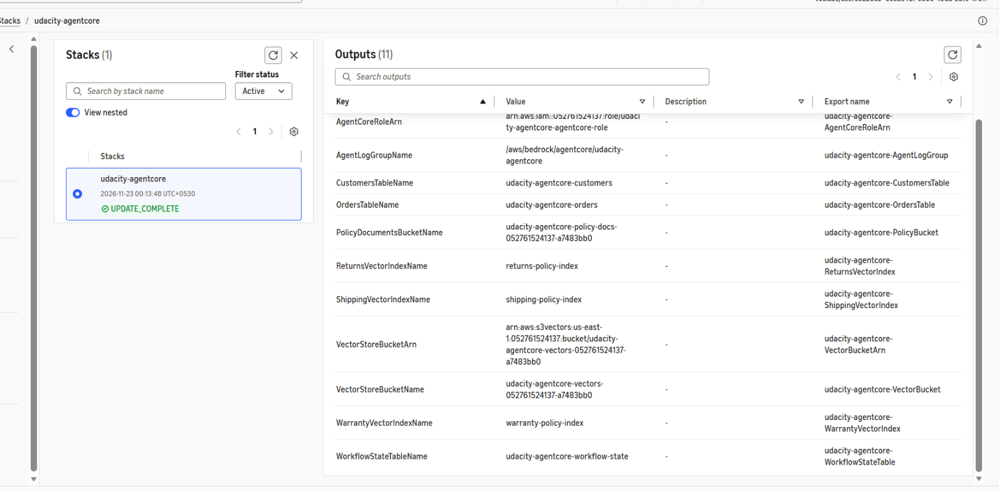
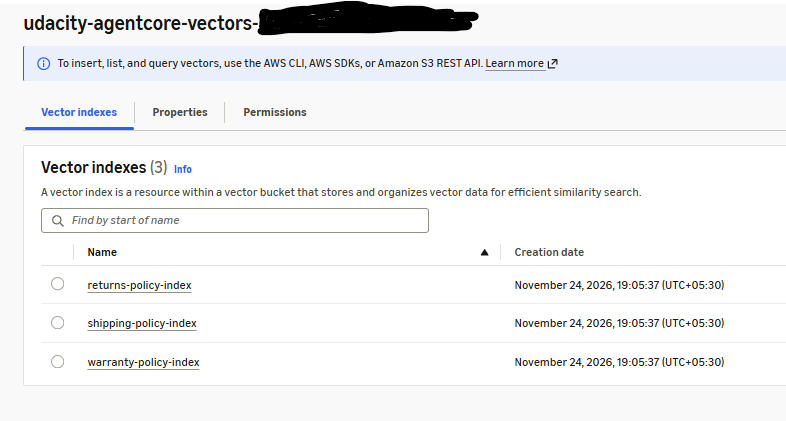
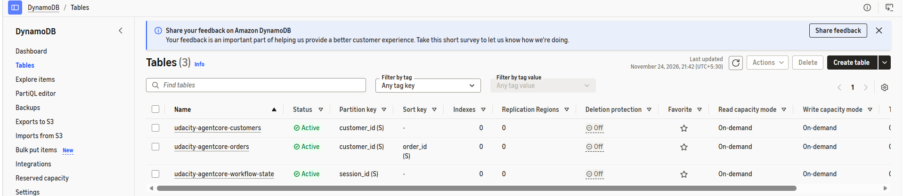
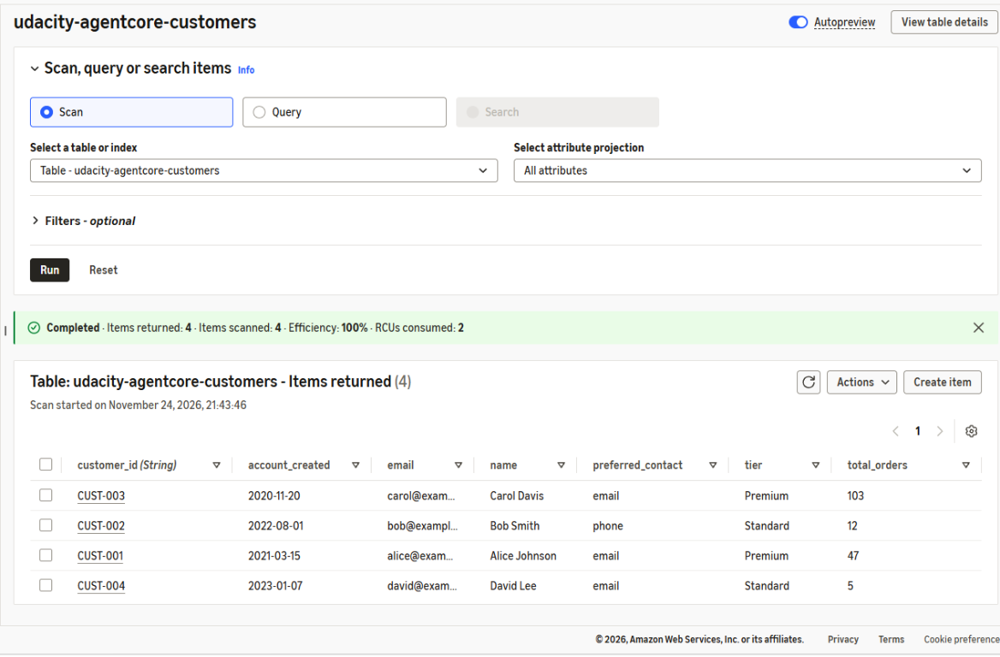
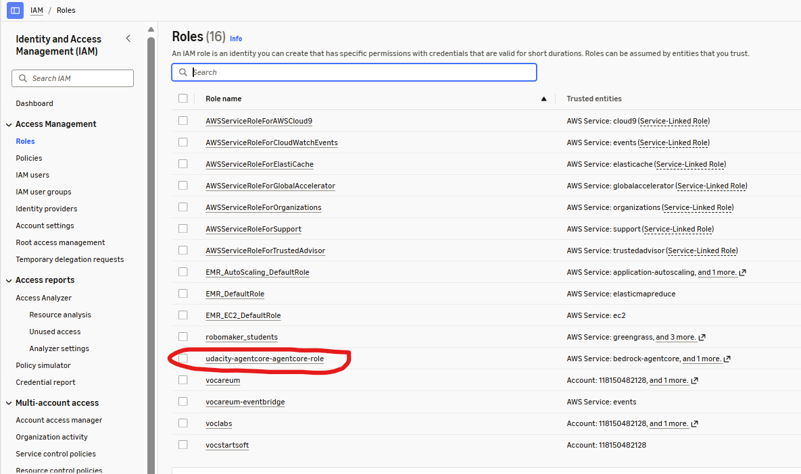
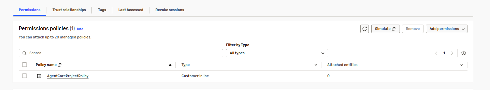
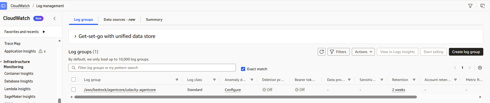
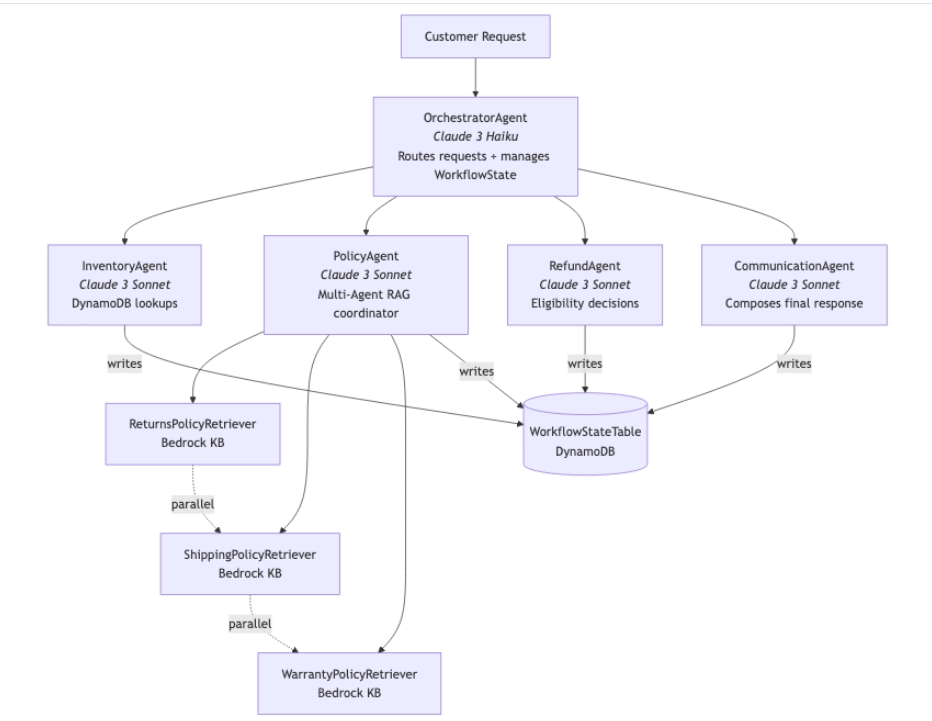
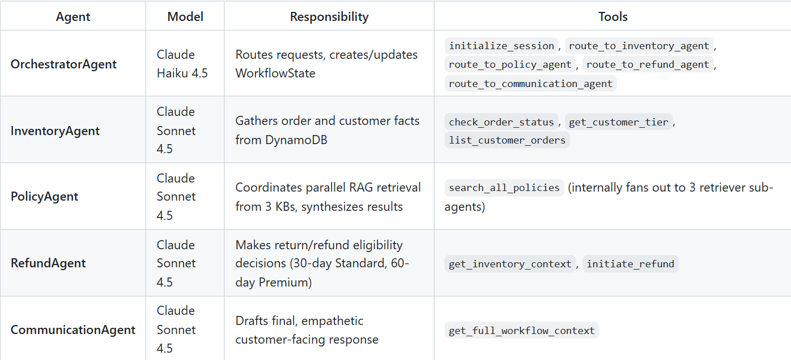

# Multi-Agent E-commerce RAG: Project Report

**Project:** Multi-Agent E-commerce RAG  
**Repository:** `harveenkaur282-web/Multi-Agent-Ecommerce-RAG`  
**Platform:** Amazon Web Services (AWS)  
**Primary language:** Python 3.13+  
**Infrastructure:** AWS CloudFormation  
**AWS region:** `us-east-1`  
**Stack name:** `udacity-agentcore`  
**Project name:** `udacity-agentcore`

> **Project status: In progress — not complete.** The three DynamoDB tables, policy-documents S3 bucket, S3 Vectors bucket, three vector indexes, AgentCore IAM role, and CloudWatch log group are visible in the AWS Console. The Returns index details confirm a 1024 dimension and cosine distance metric. The policy bucket's versioning and encryption settings have not yet been verified in the console. Inventory Agent implementation is underway: its model, prompt, and two DynamoDB lookup tools are written, but order-history retrieval and Agent construction remain TODOs. Bedrock Knowledge Bases and the AgentCore runtime are not deployed. Architecture diagrams show the intended design, not a running end-to-end system.

## 1. Project Overview

This project demonstrates the design and progressive infrastructure implementation of a multi-agent customer-support system for a fictional NovaMart e-commerce company.

The intended system combines:

- An orchestrator that classifies and routes customer requests.
- Specialist agents for inventory, policy, refund, and communication work.
- DynamoDB tables for business data and shared workflow state.
- Amazon S3 for versioned policy documents.
- Amazon S3 Vectors for policy embeddings and semantic retrieval.
- Amazon Bedrock Knowledge Bases for retrieval-augmented generation.
- Strands Agents for agent behavior and Amazon Bedrock AgentCore for future runtime deployment.

The project is intentionally documented as an implementation record and interview guide. This report distinguishes deployed and verified resources from template-only resources, design plans, and unfinished implementation. The agent workflow and end-to-end runtime are not yet operational.

The report includes relevant deployment evidence and project architecture diagrams. Planned architecture is distinguished from resources verified in AWS.

## 2. Intended Architecture

```text
Customer Request
       |
       v
Orchestrator Agent
       |
       +----------------------+
       |                      |
       v                      v
Inventory Agent        Policy Agent
Customer/order data     Parallel policy retrieval
       |                      |
       |             +--------+--------+
       |             |                 |
       |             v                 v
       |       Returns KB        Shipping KB
       |             |
       |             v
       |       Warranty KB
       |             |
       +------> Refund Agent
                     |
                     v
              Communication Agent
                     |
                     v
              Customer Response
```

The orchestrator pattern is used because a central component makes routing decisions, coordinates the specialist agents, and owns the overall workflow. The orchestrator and worker agents share workflow state rather than passing an uncontrolled chain of ad-hoc variables.

The alternative peer-to-peer pattern allows agents to communicate directly. It can be useful for dynamic collaboration, but it is harder to audit and debug in this project because the orchestrator provides a clearer decision trail and sequence.

### Implementation Timeline

The project was built incrementally. Each implementation step below has its code explanation and available screenshot evidence together in the matching report section; the commit IDs provide the Git history trail.

| Step | Work recorded in Git | Where the report shows the code and evidence |
|---|---|---|
| 1 | Started the CloudFormation template and added the customer table (`d61ce49`, `fd1fe0b`, `dcf39cd`). | Sections 4–5: template/parameter snippets, stack status, customer resource and table screenshots. |
| 2 | Added Orders and Workflow State tables (`9b48c23`, `8593507`). | Sections 6–7: key/TTL/Streams snippets and resource screenshots. |
| 3 | Added the policy S3 bucket, S3 Vectors bucket, and three policy indexes (`338afb0`, `b881c63`). | Section 8: bucket/index snippets and S3/S3 Vectors console evidence. |
| 4 | Added the AgentCore execution role and CloudWatch log group (`64a4ac7`, `a13c922`). | Sections 14–15: trust/permissions and log-group snippets followed by their console evidence. |
| 5 | Added CloudFormation exports and Python configuration (`6979d8c`, `152d855`, `abc646e`). | Sections 5 and 10: Outputs snippet/table and the `config.py` run screenshot. |
| 6 | Added deterministic seed data for DynamoDB and policy documents (`ed9350f`). | Section 11: seed write snippet, terminal run, then DynamoDB/S3 verification screenshots. |
| 7 | Added the agent package and began implementing Inventory Agent setup and data tools (`f92ea25`, `a7b5a63`, `9ff912f`, `2d41a94`, `aafda28`, `c50db65`). | Section 11: model/prompt progress, DynamoDB tool code snapshots, and remaining TODOs. |

### Agent Responsibilities

| Agent | Responsibility |
|---|---|
| Orchestrator | Classify intent, route work, coordinate state, and determine completion |
| Inventory | Retrieve customer details and order information |
| Policy | Coordinate parallel retrieval from Returns, Shipping, and Warranty knowledge bases |
| Refund | Evaluate refund or return eligibility using order data and policy results |
| Communication | Produce the final customer-facing response |

Role specialization keeps each agent responsible for a distinct business function. It also makes prompts, tools, tests, permissions, and failure handling easier to isolate.

## 3. Project Structure

| Path | Purpose |
|---|---|
| `infrastructure/starter_stack.yaml` | CloudFormation resource definitions |
| `progress-docs/project-report.md` | Canonical project and interview report |
| `progress-docs/images/` | AWS deployment evidence |
| `diagrams/` | Architecture and workflow visualizations |
| `src/multi_agent_ecommerce_rag/` | Python application and agent implementation in progress |
| `config.py` | Environment and project settings |
| `agentcore/` | AgentCore CLI project configuration and TypeScript CDK deployment scaffold |
| `tests/` | Configuration unit tests |
| `pyproject.toml` | Python project metadata and dependencies |
| `uv.lock` | Reproducible resolved dependency versions |

## 4. Step 1 — CloudFormation Foundations

CloudFormation reads a YAML or JSON template and creates, updates, lists, and deletes AWS resources as a single stack. The orchestration engine validates the template, determines resource dependencies, and makes AWS API calls in the required order.

The stack can therefore be reproduced and removed consistently. This is an advantage over manually creating resources in the AWS Console. The infrastructure is also reviewable in Git and changes can be previewed through a CloudFormation change set.

The project template is organized into these sections:

| Template section | What it describes | Project example |
|---|---|---|
| `AWSTemplateFormatVersion` | CloudFormation template format version | `'2010-09-09'` |
| `Description` | Human-readable summary | Initial customer, order, workflow, and knowledge-storage infrastructure |
| `Parameters` | Inputs supplied at deployment time | `ProjectName`, which prefixes resource names |
| `Resources` | AWS resources CloudFormation manages | DynamoDB tables, S3 bucket, S3 Vectors bucket and indexes |
| Intrinsic functions | Values and references resolved by CloudFormation | `!Ref`, `!Sub`, `!GetAtt`, `!Select`, `!Split` |

```yaml
AWSTemplateFormatVersion: '2010-09-09'
Description: >
  Initial project infrastructure for customer, order, and workflow-state tables,
  policy documents, and Bedrock Knowledge Base vector storage.

Parameters:
  ProjectName:
    Type: String
    Default: udacity-agentcore
    Description: Prefix used for resource names.
```

### Parameters

| Property | Template value | Meaning |
|---|---|---|
| `Type` | `String` | The parameter is text. |
| `Default` | `udacity-agentcore` | Used when deployment does not supply an override. |
| `Description` | `Prefix used for resource names.` | Explains how the parameter is used. |

The property name is `Default`, not `default`; CloudFormation property names are case-sensitive.

### Intrinsic Functions

| Function | Purpose |
|---|---|
| `!Ref` | References a parameter or resource |
| `!Sub` | Replaces variables in a string |
| `!GetAtt` | Reads an attribute produced by another resource |
| `!Select` | Selects an item from a list |
| `!Split` | Splits a string into a list |

An intrinsic function reference can create an **implicit dependency**. For example, `!GetAtt VectorStoreBucket.VectorBucketArn` tells CloudFormation that the vector index needs the vector bucket ARN. CloudFormation creates the bucket before the index instead of relying on deployment order in the YAML file.

### Template Validation

The repository uses `cfn-lint` to validate the CloudFormation template:

```powershell
uv run cfn-lint infrastructure/starter_stack.yaml
```

The project deployment command is:

```powershell
aws cloudformation deploy `
  --template-file infrastructure/starter_stack.yaml `
  --stack-name udacity-agentcore `
  --region us-east-1 `
  --capabilities CAPABILITY_NAMED_IAM
```

The template began as a minimal stack and was expanded resource by resource. Commits `d61ce49`, `fd1fe0b`, and `dcf39cd` record the initial template, the `ProjectName` parameter, and the first DynamoDB resource. The screenshot below shows the stack at `UPDATE_COMPLETE`; it is evidence of a successful stack operation, not proof that every future application component is deployed.


## 5. Step 2 — Customer DynamoDB Table and Stack Outputs

The first infrastructure resource was the customer table:

```yaml
CustomersTable:
  Type: AWS::DynamoDB::Table
  Properties:
    TableName: !Sub '${ProjectName}-customers'
    BillingMode: PAY_PER_REQUEST
    AttributeDefinitions:
      - AttributeName: customer_id
        AttributeType: S
    KeySchema:
      - AttributeName: customer_id
        KeyType: HASH
```

The customer table was the first deployed application-data resource (commit `dcf39cd`). The CloudFormation resource view below confirms the table definition is part of the stack; the DynamoDB view shows the table. The later seeded item scan appears in the data-seeding step in section 11.


### How It Works

- The logical ID is `CustomersTable`.
- The physical deployed table name is `udacity-agentcore-customers`.
- `customer_id` is the partition key.
- `S` means the key type is a string.
- `HASH` means DynamoDB hashes the partition-key value to determine physical storage.
- `PAY_PER_REQUEST` means on-demand billing rather than provisioned read/write capacity.
- There is no sort key.
- The table is deployed; seeded records are shown in section 11.

The simple key is appropriate because each customer has a unique identifier and direct lookup is the expected access pattern.

### CloudFormation Outputs

At the first customer-table deployment, the template did not yet define an `Outputs` section. Outputs were added later as the stack grew (commit `6979d8c`).

### Current Outputs and Exports

The current template's top-level `Outputs` section publishes useful values in the CloudFormation stack's **Outputs** tab. Each output has:

| YAML field | Meaning |
|---|---|
| Output logical ID, such as `VectorStoreBucketArn` | A template-local identifier for the output row. |
| `Value` | The resolved value CloudFormation displays after deployment. It may come from `!Ref`, `!GetAtt`, `!Sub`, or a literal name. |
| `Export.Name` | A named value that another stack in the same AWS account and Region can import. `!Sub` inserts `ProjectName` into the export name. |

Exports do not automatically populate `config.py`. Application or deployment code must explicitly retrieve or pass values into the process environment/configuration. Export names must be unique within an account and Region, and an export cannot be removed or changed while another stack imports it.

For example:

```yaml
VectorStoreBucketArn:
  Value: !GetAtt VectorStoreBucket.VectorBucketArn
  Export:
    Name: !Sub ${ProjectName}-VectorBucketArn
```

Here, the output logical ID is `VectorStoreBucketArn`; `Value` reads the ARN attribute from the vector bucket; and `Export.Name` creates a reusable name such as `udacity-agentcore-VectorBucketArn`. The `!GetAtt` reference ties the output to the resource's generated ARN. Outputs are shown after the stack operation completes; they do not configure application code by themselves.

| Output | How `Value` is resolved | Export name for `ProjectName=udacity-agentcore` | Intended use |
|---|---|---|---|
| `OrdersTableName` | `!Ref OrdersTable` returns the DynamoDB table name. | `udacity-agentcore-OrdersTable` | Configure code that reads or updates orders. |
| `CustomersTableName` | `!Ref CustomersTable` returns the DynamoDB table name. | `udacity-agentcore-CustomersTable` | Configure customer lookups. |
| `WorkflowStateTableName` | `!Ref WorkflowStateTable` returns the DynamoDB table name. | `udacity-agentcore-WorkflowStateTable` | Configure shared workflow-state access. |
| `PolicyDocumentsBucketName` | `!Ref PolicyDocumentsBucket` returns the S3 bucket name. | `udacity-agentcore-PolicyBucket` | Identify the source-document bucket for ingestion and Knowledge Base setup. |
| `VectorStoreBucketName` | `!Sub` reconstructs the parameter/account/stack-derived name used by `VectorStoreBucket`. | `udacity-agentcore-VectorBucket` | Select the S3 Vectors bucket in the Knowledge Base setup. |
| `VectorStoreBucketArn` | `!GetAtt VectorStoreBucket.VectorBucketArn` reads the generated ARN. | `udacity-agentcore-VectorBucketArn` | Identify the vector bucket for IAM and integrations. |
| `ReturnsVectorIndexName` | Literal `returns-policy-index`. | `udacity-agentcore-ReturnsVectorIndex` | Select the Returns index for its Knowledge Base. |
| `ShippingVectorIndexName` | Literal `shipping-policy-index`. | `udacity-agentcore-ShippingVectorIndex` | Select the Shipping index for its Knowledge Base. |
| `WarrantyVectorIndexName` | Literal `warranty-policy-index`. | `udacity-agentcore-WarrantyVectorIndex` | Select the Warranty index for its Knowledge Base. |
| `AgentCoreRoleArn` | `!GetAtt AgentCoreExecutionRole.Arn` reads the role ARN. | `udacity-agentcore-AgentCoreRoleArn` | Identify the execution role when configuring the runtime. |
| `AgentLogGroupName` | `!Ref AgentLogGroup` returns the log group name. | `udacity-agentcore-AgentLogGroup` | Pass the log destination to runtime configuration. |

An export name such as `!Sub ${ProjectName}-VectorBucket` resolves to `udacity-agentcore-VectorBucket` with the current parameter value. CloudFormation publishes resolved output values after the stack operation completes.

This Outputs view was added when the stack was expanded (commit `6979d8c`). It shows all 11 values and the stack status at capture time. It is evidence of values CloudFormation published; it does not mean the Python application automatically reads them.



## 6. Step 3 — Orders Table and Its Key Design

DynamoDB requires every item to have a primary key. There are two supported primary-key models:

| Primary key | Structure | Lookup meaning |
|---|---|---|
| Simple | One partition key | One attribute identifies the item |
| Composite | Partition key plus sort key | The combination identifies the item |

The Orders table uses a composite key:

```yaml
OrdersTable:
  Type: AWS::DynamoDB::Table
  Properties:
    TableName: !Sub '${ProjectName}-orders'
    BillingMode: PAY_PER_REQUEST
    AttributeDefinitions:
      - AttributeName: customer_id
        AttributeType: S
      - AttributeName: order_id
        AttributeType: S
    KeySchema:
      - AttributeName: customer_id
        KeyType: HASH
      - AttributeName: order_id
        KeyType: RANGE
    TimeToLiveSpecification:
      AttributeName: ttl
      Enabled: true
    StreamSpecification:
      StreamViewType: NEW_AND_OLD_IMAGES
```

The Orders table was added in commit `9b48c23`. The CloudFormation and DynamoDB views immediately below show its resource and key/billing configuration; the TTL view documents its expiration setting. The populated-item scan appears with the seed-data evidence in section 11.


The key design supports both:

1. Looking up one order using `customer_id` and `order_id`.
2. Querying all orders that belong to one customer using `customer_id`.

Example:

| customer_id | order_id | status |
|---|---|---|
| CUST-001 | ORD-27176 | shipped |
| CUST-001 | ORD-30011 | delivered |
| CUST-002 | ORD-18452 | processing |

The sort key keeps items for the same customer ordered by `order_id`. It is not a global index and does not make every order column searchable.

A lookup that supplies only `customer_id` can query a customer's orders. A direct `GetItem` lookup requires the complete composite key. Supplying only one key element produces a key-schema mismatch.

### TTL

```yaml
TimeToLiveSpecification:
  AttributeName: ttl
  Enabled: true
```

TTL is enabled for the `ttl` attribute. The application must store a Unix epoch-time-in-seconds value in that attribute. DynamoDB can then expire the item after the configured time, although physical deletion is asynchronous.

TTL is a separate lifecycle feature, not part of the primary key.

### DynamoDB Streams

```yaml
StreamSpecification:
  StreamViewType: NEW_AND_OLD_IMAGES
```

The stream records:

- The item after an operation with `NEW_AND_OLD_IMAGES`.
- The item before an update or deletion.

This is suitable for future event-driven processing such as inventory notifications or audit activity. It is currently infrastructure only; no consumer is implemented in this repository.

The Orders table verification showed:

- Physical table name: `udacity-agentcore-orders`.
- Partition key: `customer_id`.
- Sort key: `order_id`.
- Billing mode: on-demand.
- TTL: enabled on attribute `ttl`.
- Status: active.
- Seeded items: eleven; see section 11 for the item scan.

## 7. Step 4 — Workflow State Table

The Workflow State table stores shared execution state for a multi-agent session:

```yaml
WorkflowStateTable:
  Type: AWS::DynamoDB::Table
  Properties:
    TableName: !Sub '${ProjectName}-workflow-state'
    BillingMode: PAY_PER_REQUEST
    AttributeDefinitions:
      - AttributeName: session_id
        AttributeType: S
    KeySchema:
      - AttributeName: session_id
        KeyType: HASH
    TimeToLiveSpecification:
      AttributeName: ttl
      Enabled: true
```

The Workflow State table was added in commit `8593507`. Its CloudFormation resource view is shown here; it proves the table's stack resource, not that application sessions have been written to it.


`session_id` is the partition key. Each session has one workflow-state item.

Example state:

| session_id | customer_id | intent | version | status |
|---|---|---|---:|---|
| SESSION-001 | CUST-001 | order_status | 3 | awaiting_refund_result |
| SESSION-002 | CUST-002 | refund | 1 | policy_retrieval |

A real implementation could store:

- The customer identifier.
- The order identifier.
- Intent classification.
- Which specialist agents have run.
- Intermediate retrieval results.
- Refund eligibility.
- The final communication.
- A version for optimistic locking.

### Optimistic Locking

Optimistic locking prevents stale concurrent updates. An agent would:

1. Read the item and record its `version`.
2. Perform its work.
3. Submit a conditional update only if the stored version still matches.
4. Increment `version` if the update succeeds.

If another agent changes the item first, the stale update is rejected instead of silently overwriting the newer state.

The `version` attribute is application data. DynamoDB does not require it in `AttributeDefinitions` because `AttributeDefinitions` applies only to table indexes and primary-key attributes.

TTL can later remove expired session records. It does not remove or cancel live state immediately and still requires application code to write an epoch timestamp.

## 8. Step 5 — Policy S3 Bucket and S3 Vectors

The template defines a regular S3 bucket for source policy documents and an S3 Vectors bucket for vector search:

```yaml
PolicyDocumentsBucket:
  Type: AWS::S3::Bucket
  Properties:
    BucketName: !Sub
      - '${ProjectName}-policy-docs-${AWS::AccountId}-${ShortUUID}'
      - ShortUUID: !Select [0, !Split ['-', !Select [2, !Split ['/', !Ref 'AWS::StackId']]]]
    VersioningConfiguration:
      Status: Enabled
    BucketEncryption:
      ServerSideEncryptionConfiguration:
        - ServerSideEncryptionByDefault:
            SSEAlgorithm: AES256
```

### Why S3 Is Used

The policy bucket stores source documents such as return, shipping, and warranty policies. Versioning preserves previous document versions, and server-side AES256 encryption protects stored objects.

A bucket is the container for objects. It does not by itself perform semantic search.

### Why S3 Vectors Is Used

The RAG architecture needs embeddings, which are numeric representations of text chunks. A vector bucket provides storage for vector search data.

An index belongs inside a vector bucket and is the searchable collection for one policy domain:

```yaml
VectorStoreBucket:
  Type: AWS::S3Vectors::VectorBucket
  Properties:
    VectorBucketName: !Sub
      - '${ProjectName}-vectors-${AWS::AccountId}-${ShortUUID}'
      - ShortUUID: !Select [0, !Split ['-', !Select [2, !Split ['/', !Ref 'AWS::StackId']]]]

ReturnsVectorIndex:
  Type: AWS::S3Vectors::Index
  Properties:
    VectorBucketArn: !GetAtt VectorStoreBucket.VectorBucketArn
    IndexName: returns-policy-index
    DataType: float32
    Dimension: 1024
    DistanceMetric: cosine
    MetadataConfiguration:
      NonFilterableMetadataKeys:
        - AMAZON_BEDROCK_TEXT
```

| Property | Template value | Meaning |
|---|---|---|
| `VectorBucketArn` | `!GetAtt VectorStoreBucket.VectorBucketArn` | Associates the index with the vector bucket. `!GetAtt` also creates an implicit dependency, so CloudFormation creates the bucket first. |
| `IndexName` | `returns-policy-index` (also `shipping-policy-index` and `warranty-policy-index`) | Names the searchable collection for a policy domain. |
| `DataType` | `float32` | Stores each embedding number as a 32-bit floating-point value. |
| `Dimension` | `1024` | Number of values in each vector; must match the embedding model's output. |
| `DistanceMetric` | `cosine` | Compares vector direction to estimate semantic similarity. |
| `NonFilterableMetadataKeys` | `AMAZON_BEDROCK_TEXT` | Carries each text chunk as metadata for retrieval results; it is not intended for metadata filtering. |

The index properties and their meanings are summarized in the table above. The configured index names are set in CloudFormation; when connecting an index to a Bedrock Knowledge Base, select the existing index rather than assuming a wizard-created name.

The intended design adds separate indexes for Returns, Shipping, and Warranty policies. Each index lets the Policy Agent search a focused policy domain.

### Bucket Versus Index

| Component | Stores | Purpose |
|---|---|---|
| S3 policy bucket | Original policy documents | Source of truth and version history |
| S3 Vectors bucket | Vector-search backing storage | Holds vector collections for the project |
| Vector index | Embeddings and retrieval metadata | Searches one policy domain |
| Knowledge Base | Retrieval configuration and data source | Connects Bedrock retrieval to stored vectors |

This design separates source documents from their searchable representation. The policy bucket and vector resources were added in commits `338afb0` and `b881c63`.





The policy bucket screenshot confirms the bucket exists, but does not show versioning or encryption properties. The vector screenshots show the separate S3 Vectors bucket and all three indexes. The Returns index details confirm dimension `1024` and cosine distance; they do not independently verify the Shipping and Warranty settings.

### CDK Bootstrap Assets Bucket

The policy-documents bucket is not the bucket used to stage an AgentCore/CDK deployment package. CDK uses a separate bootstrap stack, typically named `CDKToolkit`, and its assets bucket to hold deployment artifacts such as a packaged runtime. This is deployment infrastructure, separate from both the policy-document bucket and the S3 Vectors bucket.

This project has not deployed its AgentCore runtime, so it has not intentionally bootstrapped CDK for that deployment. The existing AWS account and Region could already have a `CDKToolkit` stack and an assets bucket from another project; their existence has not been checked here. Do not treat the policy-bucket screenshots as evidence of CDK bootstrap resources. Check CloudFormation for `CDKToolkit` in `us-east-1` or S3 for a bucket named like `cdk-hnb659fds-assets-<account>-us-east-1` if you need to verify them. CDK bootstrap is normally a prerequisite to deploying CDK assets, not an application resource created by the policy seeding script.

## 9. RAG and Agent Workflow

RAG is useful because a foundation model should answer policy questions from project-controlled documents rather than from assumptions. The planned flow is:

1. Accept a customer request.
2. Classify the intent.
3. Retrieve relevant customer and order records.
4. Retrieve policy excerpts from the relevant knowledge base.
5. Pass retrieved context to the policy/refund decision logic.
6. Compose a grounded customer response.
7. Store final state and relevant trace metadata.

The Policy Agent is planned to issue parallel requests to the Returns, Shipping, and Warranty knowledge bases. Parallelism reduces end-to-end latency when all policy domains might be relevant.

The agent system is not a replacement for deterministic validation. Customer identifiers, order identifiers, refund amounts, stock quantities, and policy eligibility thresholds should still use explicit validation and tests.

## 10. Step 6 — Python Configuration

`config.py` centralizes runtime configuration. It combines local environment settings with values exported by the CloudFormation stack, so code can resolve deployed resource names instead of hard-coding account-specific identifiers.

### Imports, Defaults, and Model IDs

| Code element | What it does |
|---|---|
| `import os` | Reads process environment variables such as `AWS_REGION` and `PROJECT_NAME`. |
| `from dotenv import load_dotenv` | Imports the helper that can load values from a `.env` file. In the current file, it is imported but never called. |
| `AWS_REGION` | Reads `AWS_REGION`; defaults to `us-east-1`. Selects the AWS Region for boto3 clients. |
| `PROJECT_NAME` | Reads `PROJECT_NAME`; defaults to `udacity-agentcore`. Also forms the prefix used to find the stack's exports. |
| `ORCHESTRATOR_MODEL_ID` | Configures the intended faster/less costly routing model. This is a model identifier constant; it does not itself call the model. |
| `WORKER_MODEL_ID` | Configures the intended worker model for more involved reasoning and response generation. It does not itself start an agent. |

These are environment fallbacks rather than `.env` loading: because `load_dotenv()` is not called, values in a local `.env` file will not become available through this module unless another entry point loads them first. Shell or process environment variables do work.

### CloudFormation Export Loading

| Element | Responsibility | Important behavior |
|---|---|---|
| `_exports_cache` | Holds the export-name-to-value mapping after it is loaded. | Starts as `None`; later accesses reuse the mapping to avoid repeating the API call. |
| `ConfigError` | Project-specific configuration exception. | Gives callers a clear error for missing credentials, failed CloudFormation access, or missing required exports. |
| `_load_cf_exports()` | Calls CloudFormation `ListExports` through boto3 and builds a dictionary. | Uses the paginator so all export pages are read; caches the result after validation. |
| Export-prefix check | Checks for at least one export beginning with `{PROJECT_NAME}-`. | If none exists, raises an error suggesting that the stack be deployed. This confirms a project-prefixed export exists, not that every expected export exists. |
| AWS error handling | Translates `NoCredentialsError`, `EndpointConnectionError`, and `ClientError` into `ConfigError`. | Makes common AWS configuration failures more understandable while preserving the original exception as the cause. |

### Lookup Helpers

| Helper | Lookup order / behavior | When used |
|---|---|---|
| `_get(key, fallback_env=None)` | Looks up the export named `{PROJECT_NAME}-{key}`; optionally checks the named environment variable if the export value is missing; otherwise raises `ConfigError`. | Required resource names and ARNs. |
| `_get_env(key, required=True)` | Reads an environment variable and raises `ConfigError` if it is required but empty. | Available for settings that are not in CloudFormation; it is not currently called elsewhere in this file. |
| `_account_id()` | Calls STS `GetCallerIdentity` in `AWS_REGION` and returns the account ID. | Supplies the account identifier shown by `print_config()`. |
| `_get_kb_id(cf_key, env_key)` | Checks the environment variable first, then the matching CloudFormation export. If export loading raises `ConfigError`, returns an empty string. | Optional Returns, Shipping, and Warranty Knowledge Base IDs, which have not yet been created/exported. |
| `_get_optional_export(cf_key, env_key, default='')` | Checks the environment variable first, then CloudFormation, then returns the default. It returns the default if export loading raises `ConfigError`. | Optional Guardrail ID and version. |

### Lazy Configuration Values

`_LAZY` maps public configuration names to functions. A value is resolved only when code asks for it, for example `config.ORDERS_TABLE`. The module-level `__getattr__` is the PEP 562 hook that makes this lazy access possible.

| Public names | Source | Current purpose |
|---|---|---|
| `ACCOUNT_ID` | STS `GetCallerIdentity` | Identify the active AWS account. |
| `ORDERS_TABLE`, `CUSTOMERS_TABLE`, `WORKFLOW_STATE_TABLE` | `OrdersTable`, `CustomersTable`, `WorkflowStateTable` CloudFormation exports | Address the three DynamoDB tables. |
| `POLICY_BUCKET` | `PolicyBucket` export | Address the source policy-document bucket. |
| `VECTOR_STORE_BUCKET`, `VECTOR_STORE_BUCKET_ARN` | `VectorBucket`, `VectorBucketArn` exports | Identify the S3 Vectors bucket by name and ARN. |
| `RETURNS_VECTOR_INDEX`, `SHIPPING_VECTOR_INDEX`, `WARRANTY_VECTOR_INDEX` | The three vector-index exports | Select the index for the corresponding policy domain. |
| `AGENTCORE_ROLE_ARN` | `AgentCoreRoleArn` export | Identify the execution role. |
| `AGENT_LOG_GROUP` | `AgentLogGroup` export | Identify the CloudWatch log group. |
| `RETURNS_KB_ID`, `SHIPPING_KB_ID`, `WARRANTY_KB_ID` | Environment variable first, then `{PROJECT_NAME}-ReturnsKbId`, `...-ShippingKbId`, or `...-WarrantyKbId` export | Optional IDs for the Knowledge Bases, not yet available in the current template. |
| `GUARDRAIL_ID`, `GUARDRAIL_VERSION` | Environment variable first, then optional corresponding export | Optional guardrail settings, not yet created/exported. |

When a lazy lookup succeeds, `__getattr__` stores stable resource values in the module's globals so subsequent access does not repeat the lookup. Knowledge Base and Guardrail values are deliberately not cached, allowing those optional values to reflect later environment changes during the process. Unknown names raise `AttributeError`, as expected for a Python module.

### Runtime, Memory, and Guardrail Constants

| Constant | How it is set | Meaning / current status |
|---|---|---|
| `AGENTCORE_RUNTIME_ARN` | Reads environment variable `AGENTCORE_RUNTIME_ARN`, defaulting to an empty string. | Filled after runtime deployment; currently the report's run screenshot shows it as not yet deployed. |
| `AGENTCORE_PROJECT_NAME` | Fixed to `udacity`. | Intended to match the project `name` in `agentcore/agentcore.json`. |
| `AGENTCORE_AGENT_NAME` | Fixed to `agentcore_runtime`. | Intended to match the runtime name in `agentcore/agentcore.json`. |
| `AGENTCORE_RUNTIME_NAME` | Joins the project and agent names with `_`. | Produces `udacity_agentcore_runtime`; this is a derived name, not proof of a deployed runtime. |
| `AGENTCORE_STACK_NAME` | Builds `AgentCore-{project}-default`. | Names the stack expected from the AgentCore CLI deployment. |
| `MEMORY_NAMESPACE` | Combines `PROJECT_NAME` with `-memory`. | Human-readable namespace for the planned AgentCore Memory integration. |
| `MEMORY_NAME` | Replaces hyphens in the namespace with underscores. | Produces an identifier compatible with the naming convention noted in the code. |
| `GUARDRAIL_NAME` | Combines `PROJECT_NAME` with `-guardrail`. | Intended guardrail name; not proof that a guardrail exists. |
| `GUARDRAIL_BLOCKED_TOPICS` | Fixed list: competitor products, pricing negotiations, and legal threats. | Proposed topics for future guardrail configuration; the list alone does not enforce a guardrail. |

### `print_config()` and Script Execution

| Code element | What it does |
|---|---|
| `_display(label, value, placeholder)` | Prints a consistently aligned label and displays a placeholder when the value is empty. |
| `_resolve(name)` | Attempts a lazy lookup and converts an exception to an `ERROR: ...` display string so the diagnostic report can continue. |
| `print_config()` | Prints region, account, model identifiers, resource names, optional Knowledge Base/Guardrail values, and runtime details. |
| `if __name__ == '__main__':` | Calls `print_config()` only when running `python config.py`; importing `config` does not print the report. |

The terminal capture below shows the diagnostic run: AWS identity and CloudFormation exports resolve, while Knowledge Base IDs, runtime ARN, and Guardrail settings display their expected not-yet-configured placeholders. The derived runtime name is printed even though the runtime itself is not deployed.

The configuration loader grew in two commits: `152d855` added region/project/model settings and initial export loading; `abc646e` added cached CloudFormation export resolution and optional Knowledge Base/Guardrail fallbacks.


### Current Boundaries and Follow-Up

| Current behavior | What it does not mean |
|---|---|
| Table names, bucket names, index names, role ARN, and log-group name print successfully. | It does not mean Python agents are implemented or using those resources. |
| `ACCOUNT_ID` resolves from STS. | The account ID is not a CloudFormation output; it comes from the credentials active in the environment. |
| Knowledge Base IDs show `(not yet created)`. | The current CloudFormation template exports bucket/index names, not Knowledge Base IDs. |
| `AGENT_LOG_GROUP` resolves from the `AgentLogGroup` export. | The application does not yet write logs there merely because the name resolves. |
| `load_dotenv` is imported. | The module does not load `.env` by itself because `load_dotenv()` is not called. |

The printed values are a useful smoke check for AWS credentials, region selection, stack exports, and missing optional configuration. Keep real credentials out of the report and repository.

## 11. Step 7 — Seed Initial Data

The template has been deployed to the `udacity-agentcore` stack in `us-east-1`; the relevant stack/resource screenshots appear beside the matching template sections above. The template passes `cfn-lint`.

After CloudFormation reaches `CREATE_COMPLETE`, run the seed script to populate the existing resources:

```powershell
python infrastructure/seed_data.py
```

The script writes four mock customers and eleven orders to DynamoDB, then uploads six policy files under `policies/returns/`, `policies/shipping/`, and `policies/warranty/` in the policy-documents S3 bucket. Customer and order IDs are stable for the demo and tests (for example, `CUST-001` and `ORD-27176`); order dates are calculated relative to the run date. The script uses `put_item` and `put_object`, so rerunning it overwrites the same keys/items with the current generated values rather than creating duplicate customer/order records.

The core write operations are:

```python
table.put_item(Item=customer)
table.put_item(Item=order)
s3.put_object(
    Bucket=bucket,
    Key=f"policies/{filename}",
    Body=content.encode("utf-8"),
    ContentType="text/plain",
)
```

This follows the [Udacity starter instructions for seeding initial data](https://github.com/udacity/cd14764-aws-agentic-c3-classroom/blob/main/project/starter/README.md#4-seed-initial-data). Commit `ed9350f` adds the seed script and mock data. The terminal output below records the script run; the AWS Console scans that follow independently show the resulting data.


The script output reports four customer records and eleven orders. The DynamoDB scans independently confirm the records persisted; the table list also shows that the three tables are Active.






The following S3 console views verify the policy bucket prefix, the three policy-domain folders, and the two expected objects in each folder.


### Step 8 — Inventory Agent Implementation Progress

**Checkpoint — 2026-11-25:** The Inventory Agent setup and two of its three DynamoDB tools have been implemented, as recorded in commits `a7b5a63`, `9ff912f`, `2d41a94`, `aafda28`, and `c50db65`:

1. Construct a Strands `BedrockModel` using `config.WORKER_MODEL_ID` and `config.AWS_REGION`, rather than hard-coding the model identifier or region in the agent.
2. Write the Inventory Agent system prompt to restrict it to retrieving and reporting facts. It must not invent records or make refund/return eligibility decisions.
3. Implement `check_order_status`: retrieve one order using both `customer_id` and `order_id`, matching the Orders table's composite key; return a clear not-found result when absent; catch and log DynamoDB `ClientError`; convert DynamoDB `Decimal` values to strings so results can be serialized as JSON.
4. Implement `get_customer_tier`: retrieve one customer by the Customers table's `customer_id` key, return a not-found result when absent, log DynamoDB `ClientError`, and JSON-normalize the returned item.

The essential order-lookup and serialization logic now in the code is:

```python
table = dynamodb.Table(config.ORDERS_TABLE)
response = table.get_item(
    Key={"customer_id": customer_id, "order_id": order_id}
)
item = response.get("Item")
if not item:
    return {"found": False, "message": "Order not found"}
return {
    "found": True,
    "order": json.loads(json.dumps(item, default=str)),
}
```

The customer lookup follows the same found/not-found pattern, using the Customers table's single partition key:

```python
response = dynamodb.Table(config.CUSTOMERS_TABLE).get_item(
    Key={"customer_id": customer_id}
)
customer = response.get("Item")
if not customer:
    return {"found": False, "message": "Customer not found"}
return {
    "found": True,
    "customer": json.loads(json.dumps(customer, default=str)),
}
```

The low temperature is intended to reduce variation for a fact-retrieval role; it does not guarantee identical outputs. `list_customer_orders()` still contains `pass`, and `build_inventory_agent()` does not yet construct or return an `Agent`, so the tools are not yet assembled into a usable Inventory Agent. The commits document implementation changes, not a successful live AWS integration test. Next, implement and test order-history retrieval, then instantiate the Inventory Agent with its model, prompt, and tools.

The deployed resources are infrastructure, not a complete application. Agent code is in progress; Knowledge Bases, AgentCore runtime deployment, active log emission, and end-to-end RAG are not yet implemented.

## 12. Design Decisions and Tradeoffs

### Decision Log So Far

These are the decisions reflected in the current infrastructure or target design. Cost and operational consequences are tradeoffs to validate as the project grows, not guarantees about every AWS bill.

| Decision | Choice so far | Why | Tradeoff / caveat |
|---|---|---|---|
| Deployment rhythm | Deploy and verify in small, logical steps rather than waiting until the whole template is finished. | A failure is easier to narrow down to the latest changes; each successful update gives a known-good checkpoint. | More deployments mean more review and verification work. Use a change set for significant updates and check actual resource events. |
| DynamoDB billing | `PAY_PER_REQUEST` for all three tables. | No read/write capacity planning; avoids provisioned-throughput charges when there is no request traffic, which suits a low-traffic learning project. | Storage, Streams activity, backups, and other features can still cost money. At sustained high request volume, provisioned capacity may be cheaper, so compare real usage and pricing before production. |
| Customer table key | `customer_id` as a simple partition key. | A customer is retrieved by its unique customer identifier. | Other access patterns, such as lookup by email, would need a deliberately designed index or a different access path. |
| Orders table key | `customer_id` partition key plus `order_id` sort key. | Supports listing one customer's orders and identifying one order using both key values. | Queries must follow this access pattern; this key does not make arbitrary order attributes searchable. |
| Workflow state | One item per `session_id`, with TTL enabled. | Provides a shared durable record for the planned multi-agent workflow and a way to expire temporary sessions. | Application code still needs to write state and a Unix-epoch TTL value. Expiration is asynchronous; optimistic locking is planned but not implemented. |
| Orders stream | `NEW_AND_OLD_IMAGES`. | Retains before-and-after item images for possible future event-driven processing. | A stream consumer is not implemented. Stream processing adds operational complexity and may incur additional charges. |
| Policy storage | Regular S3 bucket for source documents; separate S3 Vectors bucket and one index per policy domain. | Keeps original documents separate from vector-search data and isolates Returns, Shipping, and Warranty retrieval. | Knowledge Bases, document ingestion/sync, and end-to-end retrieval are not yet implemented. |
| Vector settings | `float32`, dimension `1024`, cosine distance, and `AMAZON_BEDROCK_TEXT` as non-filterable metadata. | Matches the intended embedding and retrieval configuration documented for this project. | Dimension must match the embedding model; verify actual Knowledge Base configuration and retrieval behavior when implemented. |
| Naming | Prefix resource names with `ProjectName`; add account/stack-derived uniqueness to bucket names. | Gives resources a recognizable project identity while reducing global S3 name collisions. | AWS naming limits and uniqueness requirements still apply; generated names should be verified after deployment. |
| Agent coordination | Central orchestrator with specialist roles; policy retrieval is designed to be parallel. | Makes routing and ownership easier to reason about while allowing independent policy searches to run concurrently. | Agent runtime and retrieval workflow are design only; parallel calls can increase simultaneous usage and cost. |
| CloudWatch log retention | Dedicated log group with `RetentionInDays: 14`. | Keeps the planned AgentCore log destination explicit and limits how long log events are retained. | Retention controls stored log events, not whether logs are produced. Ingestion and retained data can incur charges; an empty log group is not proof of working runtime logging. |

## 13. Reliability and Failure Handling

A production implementation should handle:

- Invalid or missing customer identifiers.
- Order-not-found responses.
- DynamoDB conditional-write conflicts.
- Knowledge Base timeouts.
- Partial policy retrieval failures.
- Tool-call validation failures.
- Embedding or vector-index errors.
- Incomplete agent responses.
- Rate limits and retry exhaustion.
- Conflicting policy information.

Recommended controls include:

- Typed tool inputs and outputs.
- Timeouts and bounded retries.
- Idempotency keys for mutations.
- Conditional writes for workflow state.
- Circuit breakers for external services.
- Structured logs with session and trace identifiers.
- Human escalation when policy confidence is low.
- Explicit fallbacks when a specialist fails.

## 14. Security and Permissions

The template defines `AgentCoreExecutionRole`, named from the `ProjectName` parameter. An execution role is an IAM identity that an AWS service can assume to obtain temporary credentials while running the workload.

IAM has two separate policy ideas:

| Policy | Template property | Meaning in this project |
|---|---|---|
| Trust policy | `AssumeRolePolicyDocument` | Defines who may assume the role. It trusts `bedrock.amazonaws.com` and `bedrock-agentcore.amazonaws.com` to call `sts:AssumeRole`. |
| Permissions policy | `Policies` → `PolicyDocument` | Defines what the role may do after a trusted service assumes it. The inline policy is named `AgentCoreProjectPolicy`. |
| Why both are required | Trust policy + permissions policy | The runtime service must be allowed to assume the role, and the role must have permission for the AWS actions the runtime needs. Trust alone does not grant data/API access; permissions alone do not make a service trusted to assume the role. |
| Why the developer user is absent from trust | Trusted principals list | This is an execution role for AWS services to assume, not a role intended for direct use by the developer's IAM user. |

### The Nine Permission Statements

The inline `AgentCoreProjectPolicy` contains nine statements. Each statement groups actions that serve one part of the runtime:

| # | Statement | Why the runtime needs it | Resource scope in the template |
|---:|---|---|---|
| 1 | `bedrock:InvokeModel`, `bedrock:InvokeModelWithResponseStream`, `bedrock:ApplyGuardrail`, `bedrock:GetGuardrail` | Invoke foundation models and apply/read guardrail configuration. | `"*"` |
| 2 | `bedrock:Retrieve`, `bedrock:GetKnowledgeBase` | Retrieve content from the policy Knowledge Bases. | `"*"` |
| 3 | `cloudformation:ListExports`, `cloudformation:DescribeStacks`, `sts:GetCallerIdentity` | Let runtime configuration code discover stack exports and caller/account identity. | `"*"` |
| 4 | CloudWatch Logs actions (`CreateLogGroup`, `CreateLogStream`, `CreateLogDelivery`, `PutLogEvents`, `DescribeLogGroups`, `DescribeLogStreams`) | Create and write agent execution logs and inspect log groups/streams. | `"*"` |
| 5 | X-Ray actions (`PutTraceSegments`, `PutTelemetryRecords`, `GetSamplingRules`, `GetSamplingTargets`) | Send distributed trace data and retrieve sampling configuration. | `"*"` |
| 6 | AgentCore Memory event, memory-record, and workload-token actions | Store and retrieve memory events/records and obtain workload access tokens. | `"*"` |
| 7 | DynamoDB `GetItem`, `PutItem`, `UpdateItem`, `Query`, `Scan` | Read or update customer, order, and workflow-state data. | The three table ARNs referenced by `!GetAtt`. |
| 8 | S3 `GetObject`, `GetObjectVersion`, `PutObject`, `DeleteObject`, `ListBucket` | List and manage policy documents, including uploads and reads for ingestion/sync. | The policy bucket ARN and its object ARNs. |
| 9 | `s3vectors:*` | Allow vector-store operations for the Knowledge Base integration. | `"*"` |

`"Resource": "*"` is broad: it is not restricted to one named resource. Some AWS actions do not support resource-level scoping, but where they do, production policies should use the narrowest applicable ARNs and actions. In particular, `s3vectors:*` grants every S3 Vectors action allowed by the service authorization model; review and narrow it before production.

### CloudFormation and YAML Syntax in the Policy

| Syntax | Meaning in this template |
|---|---|
| `!GetAtt OrdersTable.Arn` | Reads the Orders table ARN. It also creates an implicit dependency, so CloudFormation creates the table before the role policy that references it. |
| `!GetAtt CustomersTable.Arn` and `!GetAtt WorkflowStateTable.Arn` | Restrict DynamoDB actions to the other two table ARNs as well. |
| `!GetAtt PolicyDocumentsBucket.Arn` | Identifies the bucket itself; this ARN is used for bucket-level actions such as `s3:ListBucket`. |
| `!Sub ${PolicyDocumentsBucket.Arn}/*` | Builds the object ARN pattern for objects inside the bucket. The bucket ARN alone does not cover object-level actions. |
| `Resource: "*"` | Must be quoted in YAML because an unquoted leading `*` is the YAML alias indicator. |

| Review note | Why it matters |
|---|---|
| Current configuration is not yet a production least-privilege design. | Some service statements use `Resource: "*"`, and `s3vectors:*` allows all S3 Vectors actions supported by the service authorization model. |
| Narrow permissions before production. | Identify the exact required actions and resources, then use resource-level ARNs wherever AWS supports them. |
| Remove unneeded permissions. | Permissions for planned services should be removed until those services are actually required. |
| Consider per-agent roles. | Separate, narrower roles can reduce the impact of an agent or tool error compared with one shared execution role. |

The role and policy were added in commit `64a4ac7`. This excerpt shows the separation between the trust policy (who can assume the role) and the permissions policy (what the assumed role can do):

```yaml
AssumeRolePolicyDocument:
  Version: '2012-10-17'
  Statement:
    - Effect: Allow
      Principal:
        Service:
          - bedrock.amazonaws.com
          - bedrock-agentcore.amazonaws.com
      Action: sts:AssumeRole
Policies:
  - PolicyName: AgentCoreProjectPolicy
    PolicyDocument:
      Version: '2012-10-17'
      Statement:
        # Service actions and scoped table/bucket permissions follow.
```

The role and policy are deployed. The screenshots below show the role, inline policy, trusted service principals, and deployed policy statements.






For the eventual per-agent design, permissions should be separated according to responsibility:

- The Inventory Agent gets read access only to the required DynamoDB tables.
- The Policy Agent gets read access only to its Knowledge Base resources.
- The Refund Agent gets no direct customer-data permissions beyond what is supplied.
- The Communication Agent gets no mutation permissions unrelated to response generation.
- The Orchestrator gets state-read/write permissions but does not need all underlying data permissions.

Additional controls should include:

- Bedrock Guardrails for blocked topics and sensitive data.
- AWS IAM roles for workload identity.
- AWS encryption for stored data.
- Secrets management for credentials and external services.
- Audit logs and trace identifiers.
- Input and output validation.
- Human approval for high-risk refund decisions.

## 15. Observability

The infrastructure now creates a CloudWatch Logs log group for the planned AgentCore runtime. The log destination exists, but the application/runtime is not implemented, so this does not yet prove that agent logs are being written. The template does not yet configure X-Ray infrastructure, though the IAM role contains X-Ray actions.

### CloudWatch Log Group

CloudWatch Logs organizes log events into **log groups** and **log streams**. A log group is the named container for related logs; a log stream is a sequence of events from a particular source or execution. The CloudFormation resource is:

```yaml
AgentLogGroup:
  Type: AWS::Logs::LogGroup
  Properties:
    LogGroupName: !Sub /aws/bedrock/agentcore/${ProjectName}
    RetentionInDays: 14
```

| Template line/property | Resolved value | Meaning |
|---|---|---|
| `Type` | `AWS::Logs::LogGroup` | Create a CloudWatch Logs log group. |
| `LogGroupName` | `/aws/bedrock/agentcore/udacity-agentcore` | `!Sub` replaces `${ProjectName}` with the stack parameter. The path is a naming convention. |
| `RetentionInDays` | `14` | CloudWatch Logs retains log events for 14 days, then deletes expired events. |

The role includes log-writing permissions, the CloudFormation template exports this group name as `AgentLogGroupName`, and `config.py` can resolve it lazily as `config.AGENT_LOG_GROUP`. This connects the infrastructure value to configuration, but the application/runtime still needs to initialize logging and emit events. Do not imply the running agents already write here.

An empty log group has no log-event ingestion or stored log data yet, but it does not mean all CloudWatch resources or future logging are free. Ingestion, storage, and other features can incur charges. A finite retention period limits stored-event lifetime.

The log group was added in commit `a13c922`. The concept image explains the relationship between groups and streams; the console image directly below is evidence of the deployed log group and its 14-day retention. Neither proves that an application has emitted events.




The broader planned observability stack may later combine:

- Amazon CloudWatch metrics and logs.
- AWS X-Ray distributed traces.
- Agent invocation IDs.
- Session IDs.
- Specialist-agent latency.
- Tool-call success and failure counts.
- Knowledge Base retrieval counts.
- Retry count.
- End-to-end request latency.
- Estimated model cost.

Useful operational measurements include:

| Metric | Why it matters |
|---|---|
| Agent success rate | Detects routing or tool failures |
| p95 latency | Identifies end-to-end slowdown |
| Retrieval latency | Measures RAG search cost |
| Model cost per session | Tracks expensive multi-agent usage |
| Retry rate | Shows upstream instability |
| Escalation rate | Measures unresolved or low-confidence requests |
| Conditional-write conflict rate | Shows concurrent workflow-state contention |

## 16. Testing Strategy

Tests should cover implementation and infrastructure at several levels:

### Unit Tests

- Configuration defaults and overrides.
- Agent intent classification.
- Tool input validation.
- DynamoDB key construction.
- TTL value calculations.
- Refund eligibility rules.

### Integration Tests

- DynamoDB CRUD and conditional writes.
- Bedrock Knowledge Base retrieval.
- S3 policy document ingestion.
- Agent-to-tool invocation.
- Shared workflow-state updates.

### Contract Tests

- Verify that each agent returns a typed, predictable result.
- Verify the orchestrator handles missing specialist results.
- Verify policy citations and source metadata are preserved.

### Infrastructure Tests

- Run `cfn-lint`.
- Validate CloudFormation through a change set.
- Verify resource names and key schemas.
- Verify stack deletion and recreation.

### Evaluation Tests

- Policy answer accuracy.
- Whether answers cite the correct knowledge source.
- Refusal behavior for unsupported or unsafe requests.
- Hallucination rate.
- Customer-facing tone.
- Latency and cost per sample request.

## 17. Current Scope and Future Work

The project is partially complete. The following status distinctions are important:

### Deployed and Verified in AWS

- DynamoDB Customers and Orders tables are seeded; persisted records are shown directly in section 11.
- DynamoDB Workflow State table.
- Policy-documents S3 bucket contains the seeded policy files shown directly in section 11; versioning and encryption settings still need separate console verification.
- S3 Vectors bucket and Returns, Shipping, and Warranty indexes are visible in the AWS Console.
- Returns vector index overview shows dimension `1024` and cosine distance metric.
- `udacity-agentcore-agentcore-role` is visible in IAM with the `AgentCoreProjectPolicy` inline policy name and Bedrock / Bedrock AgentCore trusted-service principals.
- CloudWatch log group `/aws/bedrock/agentcore/udacity-agentcore` is visible with a two-week retention setting; log-event ingestion by an application runtime is not yet verified.

### Present in the Repository

- CloudFormation definitions for the S3 policy-document bucket, S3 Vectors bucket, three indexes, AgentCore execution role with its trust and permissions policies, and CloudWatch log group; the template passes `cfn-lint`.
- AgentCore CLI configuration and CDK scaffold under `agentcore/`. Its deployment target list is empty, and its configured Python 3.12 runtime entry point/package are not yet present; no AgentCore runtime has been deployed.
- Python configuration and package code, including Inventory Agent model/prompt setup and two DynamoDB lookup tools; progress and remaining TODOs are recorded in section 11.
- Unit-test scaffold and UV dependency management.
- Architecture diagrams and design notes.

### Not Yet Implemented or Verified

- Bedrock Knowledge Base creation and synchronization.
- Complete orchestrator and specialist-agent implementation. Inventory Agent order-history retrieval and Agent construction remain TODOs; other agent builders and orchestration steps also remain incomplete.
- AgentCore runtime entry point/package, deployment target configuration, and runtime deployment. The scaffold currently declares `agent_orchestrator.py` under `build/runtime/` and Python 3.12.
- Inventory order-history retrieval, policy retrieval, workflow-state operations, and refund mutations. So far, only the Inventory order lookup and customer lookup tools are implemented.
- Workflow-state optimistic locking.
- Refund decision logic.
- Bedrock Guardrails.
- Production least-privilege IAM review and any further role separation.
- Runtime logging initialization and actual log ingestion, plus X-Ray observability.
- End-to-end RAG evaluation.

This project is an **in-progress architecture and infrastructure implementation**, not a completed or production-ready multi-agent application. The diagrams and planned flows describe the target state. They must not be presented as evidence that the full system is already running.

## 18. Interview Talking Points

### Why use DynamoDB?

The main access patterns are known and key-based: fetch a customer by `customer_id`, fetch an order by customer and order identifiers, and fetch workflow state by session identifier. DynamoDB is serverless and scales through partition-key design.

### Why use three DynamoDB tables?

Customers, Orders, and Workflow State have different access patterns and lifecycles. Keeping them separate avoids mixing operational customer data with temporary session state or storing one record with an unclear ownership boundary.

### Why use a partition key plus sort key for Orders?

A customer can have multiple orders. A partition key alone would not identify an individual order. `customer_id + order_id` identifies one order and also supports querying all orders for a customer.

### Why use a Workflow State table?

Agents need a shared, durable record of the session. The table provides one place for routing status and intermediate results. It should use optimistic locking to prevent stale concurrent updates.

### Why use RAG?

RAG grounds policy answers in customer-policy documents and can retrieve only the relevant sections instead of relying on the model's general knowledge.

### Why use multiple agents?

The work has separate responsibilities: data retrieval, policy retrieval, eligibility decisions, and response generation. Specialist agents can use specialist tools and smaller, clearer prompts.

### Why seed predictable (deterministic) mock data?

Stable customer and order IDs, products, and statuses give demos and tests a known dataset. A test can refer to a specific example such as `CUST-001` or `ORD-27176` every time, making results easier to reproduce and failures easier to debug than if records were randomly generated. The fixtures also include different customer tiers and order states so workflows can be exercised against meaningful cases.

“Deterministic” does not mean every field is identical forever: order dates are calculated relative to the day the script runs so date-sensitive scenarios, such as refund windows, stay useful. Rerunning the script writes the same customer/order keys rather than creating duplicate records.

### Why not use a simple function?

A deterministic function is preferable for fixed refund rules and routing known by exact conditions. Agents are appropriate when intent interpretation or policy synthesis requires dynamic reasoning. The strongest design combines both, using agents for uncertain decisions and functions for deterministic checks.

### How would you handle an incorrect agent tool call?

Validate tool inputs, validate tool outputs against a schema, require authorization, and treat invalid results as a recoverable workflow error. Use bounded retries and escalate or return a safe fallback response when the specialist cannot complete its task.

### How would you measure success?

Measure answer correctness, source grounding, policy accuracy, refusal quality, latency, cost, retry rate, escalation rate, tool failures, and customer satisfaction. Infrastructure metrics alone do not prove that responses are correct.

## 19. Intended Agent Architecture Diagrams

These diagrams communicate the target design; they are not deployment evidence or screenshots of a running agent application. Implementation and AWS console evidence now appears inline with the corresponding project step above.







