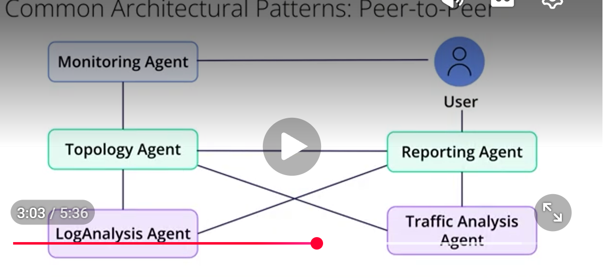
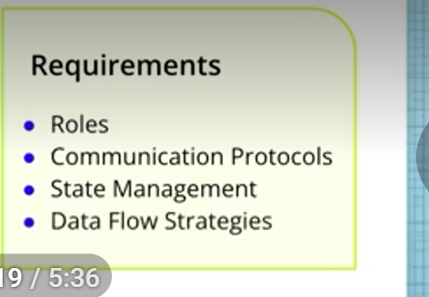
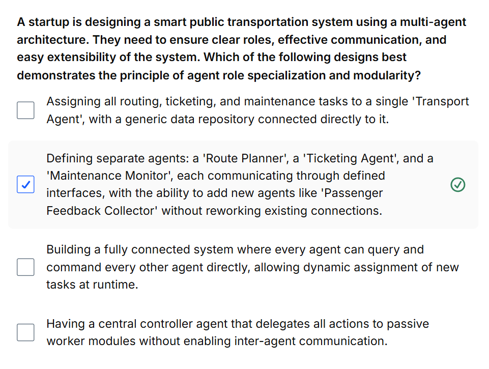

# Multi-Agent Architecture Design
detailed blueprint
high-level structure that defines each agent's job is, who they need to talk to and the rules of enagagement for their communication 
orchestrator: manager --> delegates tasks 

or peer-to-peer
flat-structure
where expert agents communicate directly 
getting the architecture-imp so the system doesn't crash under pressure

# TERMS:

1. Architecture: The fundamental organization of a system, embodied in its components, their relationships to each other and the environment, and the principles governing its design and evolution.
2. Orchestrator Pattern: A centralized architecture where a single agent (the orchestrator) manages and delegates tasks to a team of worker agents.
3. Peer-to-Peer Pattern: A decentralized architecture where agents can communicate and coordinate directly with each other without a central manager.
4. Role Specialization: The principle of assigning each agent a specific, well-defined job or responsibility.
5. Data Flow: The path that data takes through the system, moving from one agent to another.

NEED TO DEFINE CLEAR RULES AND RELATIONSHIPS 
MAP OUT HOW DATA WILL FLOW BETWEEN AGENTS IN THE SYSTEM

EX-
CUSTOMER REQ--> RETURNS ORCHESTRATOR- INVOKES POLICYAGENT TO CHECK ELIGIBILITY REQUIREMENTS 
INVENTORY AGENT--> PREPARES STOCK UPDATES
REFUND AGENT PROCESSES THE PAYMENT RETURN 
COMMUNICATION AGENT--> KEEPS CUSTOMER INFORMED THROUGHOUT 
STRUCTURED, PREDICTABLE MULTI STEP WORKFLOWS

EACH WORKER HANDLES A DISTINCT BUSINESS FUNCTION, ORDER, MANAGES STATE OF THE WHOLE return PROCESS
This makes designing, managing, and debugging complex but structured workflows much simpler.

# PEER TO PEER

AGENTS OFTEN COMMUNICATE DIRECTLY WITH EACH OTHER 
SPECIALIZED RESEARCHERS COLLABORATING DYNAMICALLY
AN AGENT MIGHT BORADCAST A REQUEST FOR HELP
or directly route a task to another agent who it knows to have right expertise

complex intermittent network failure
monitoring agent detects anomaly
might dir query topology agent-to understand the network layout arnd the failure point
task a log analysis agent to check logs and simulataneously ask traffic analysis agent- unusual patterns? 
exchange findings directly before reporting a consolidated diagnosis

