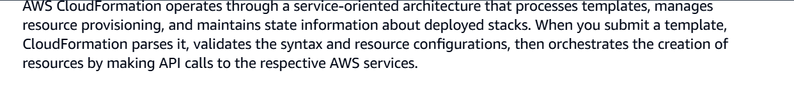
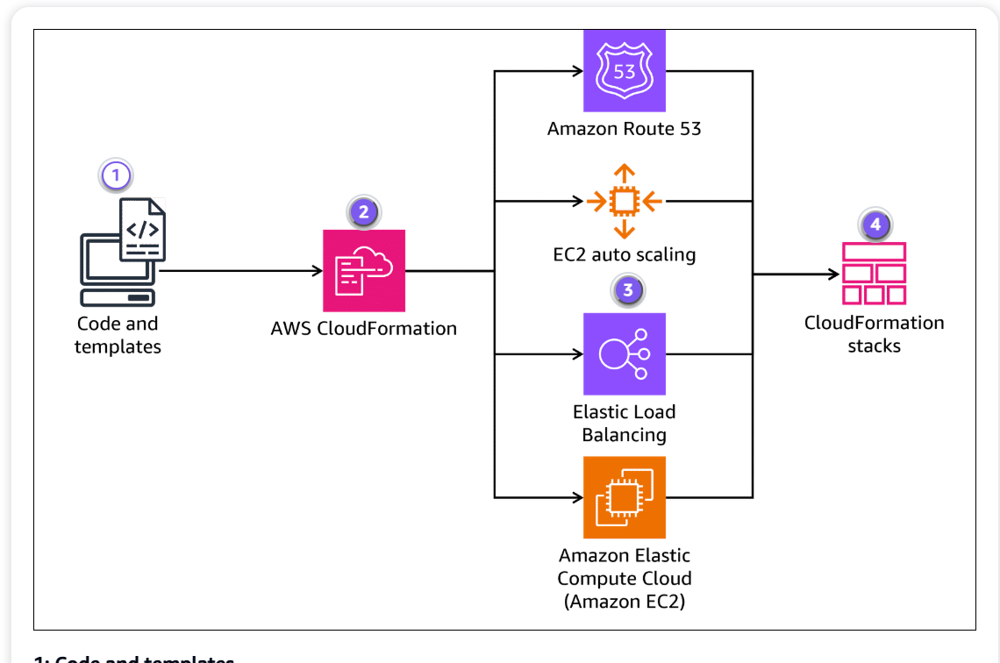
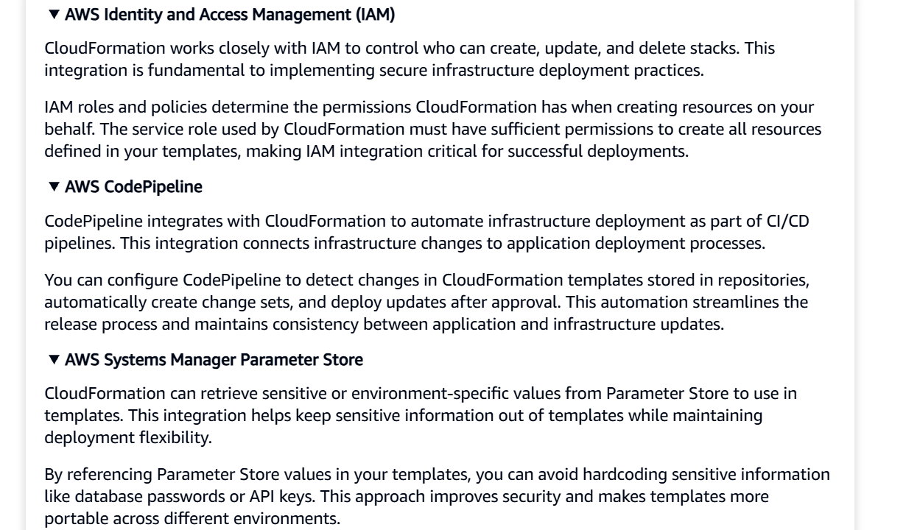
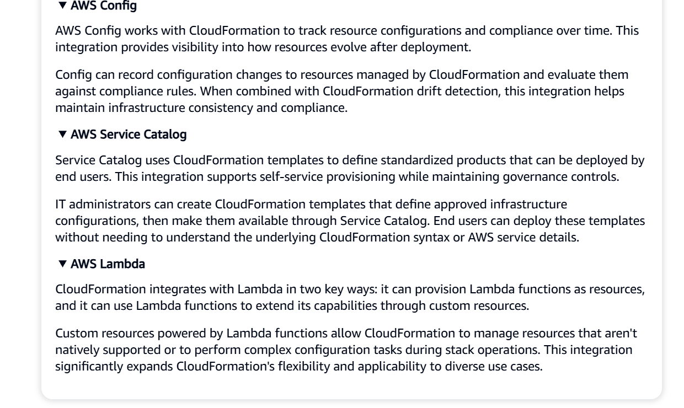
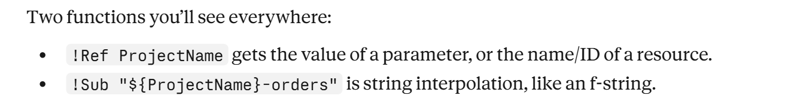
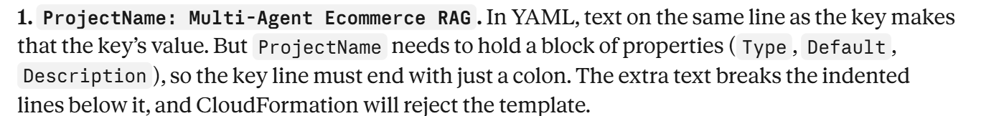
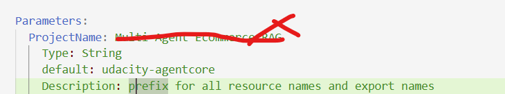

A CloudFormation template is a YAML file that describes the AWS resources you want. You hand it to AWS, which creates them and groups them into a stack. Delete the stack and everything in it is deleted, which makes it easy to experiment.

The template processing engine parses JSON or YAML templates and validates their structure and content against the CloudFormation schema requirements. The orchestrator determines the correct order for resource creation based on dependencies and makes API calls to create, update, or delete resources across AWS services.

A stack is a collection of AWS resources. The resources are managed as a single unit. They can be created, listed, described, updated, and deleted. You can maintain the state of all the resources it contains.

You can make changes to the stack settings or change resources with stack updates. The change set generator compares existing stack resources with proposed template changes to create a detailed preview of modifications before they're applied.

An element of AWS CloudFormation service architecture is the resource provisioning orchestrator, which determines the correct order for resource creation and makes API calls to create resources.

IMPORTANCE OF DEFAULT IN PARAMETERS SECTION:
without a Default, CloudFormation requires you to pass ProjectName every time you deploy, and aws cloudformation deploy will fail with an error about a missing parameter value

default should be Default. CloudFormation property names are case-sensitive. A lowercase default is an unknown property and gets rejected